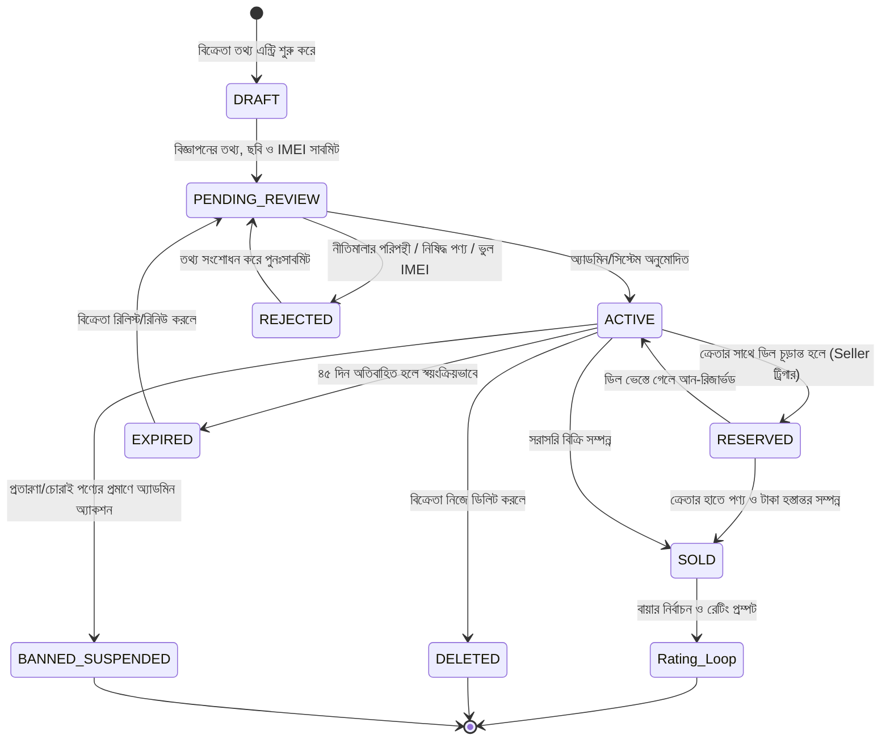
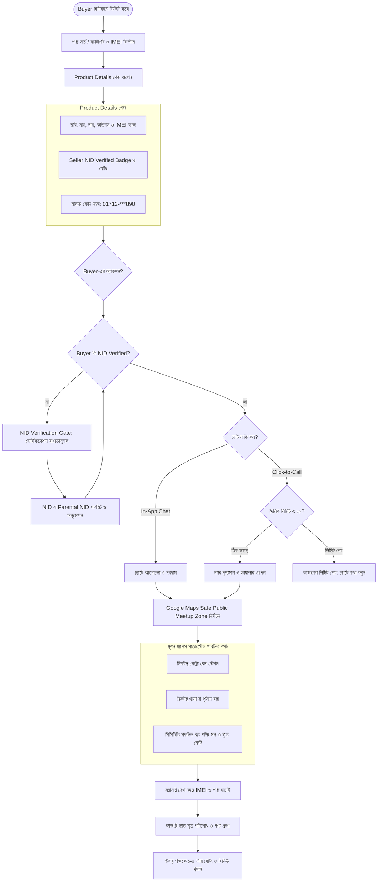
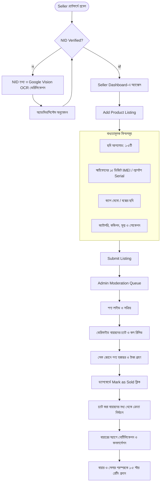

# বেচা-কেনা (Becha-Kena) — Master System Specification (P0, P1, P2)
**ডকুমেন্ট ভার্সন:** 4.0 (Production Master Spec — All 10 Architectural Decisions Integrated)  
**স্ট্যাটাস:** প্রোডাকশন-রেডি ফাইনাল স্পেসিফিকেশন  
**প্রজেক্ট:** বেচা-কেনা (Becha-Kena) — ভেরিফাইড C2C রিকমার্স মার্কেটপ্লেস  

---

# [P0] মিশন-ক্রিটিক্যাল ফাউন্ডেশন (Core Architecture & Rules)

---

## ১. Registration, NID Verification, Permission Matrix, Contact Privacy ও Security Rules

### ১.১ User Registration & Authentication Rules
1. **মোবাইল নম্বর স্পেসিফিকেশন:**
   - ফরম্যাট: আন্তর্জাতিক ই.১৬৪ মানদণ্ড অনুযায়ী বাংলাদেশি নম্বর: `+8801[3-9]\d{8}` (মোট ১১ ডিজিট)।
   - ডেটাবেজে `phone_number` ফিল্ডে Unique Index বাধ্যতামূলক।
2. **OTP (One-Time Password) পলিসি:**
   - দৈর্ঘ্য: ৬ ডিজিট (CSPRNG দ্বারা প্রস্তুত)।
   - মেয়াদ (TTL): ১২০ সেকেন্ড (২ মিনিট)। রিসেন্ড কুলডাউন: ৬০ সেকেন্ড।
   - ব্রুট-ফোর্স প্রটেকশন: ৩ বার ভুল দিলে ৩০ মিনিট লকআউট। **Google reCAPTCHA v3** ইন্টিগ্রেটেড।
3. **পাসওয়ার্ড পলিসি:**
   - এনক্রিপশন: **Argon2id** / **Bcrypt** (Salt rounds: 12)।
   - শর্ত: ন্যূনতম ৮ ক্যারেক্টার (অন্তত ১টি বড় হাতের অক্ষর, ১টি ছোট হাতের অক্ষর, ১টি সংখ্যা ও ১টি স্পেশাল ক্যারেক্টার)।

---

### ১.২ National ID (NID) ও Parental Verification Architecture
প্ল্যাটফর্মের মূল নীতি: **"100% Zero Anonymity — No Verification, No Contact"**।

1. **প্রাপ্তবয়স্ক ইউজার (১৮+ বছর):**
   - স্মার্ট কার্ড (১০ ডিজিট), পুরাতন এনআইডি (১৩ বা ১৭ ডিজিট)।
   - **Google Cloud Vision API**-এর মাধ্যমে ফ্রন্ট ও ব্যাক ছবি থেকে OCR রিড করে নাম, NID নম্বর ও জন্মতারিখ এক্সট্র্যাক্ট করা হবে।
   - একটি NID নম্বর প্ল্যাটফর্মের সমগ্র লাইফসাইকেলে কেবল ১টি অ্যাকাউন্টের সাথে যুক্ত হবে।
2. **অপ্রাপ্তবয়স্ক শিক্ষার্থী ইউজার (<১৮ বছর - Parental Verification):**
   - ১৮ বছরের কম বয়সীরা নিজের NID না থাকায় পিতা বা মাতার NID কার্ডের উভয় পাশের ছবি এবং একটি নির্দিষ্ট ফরম্যাটে অভিভাবকের সম্মতিপত্র (Parental Consent) আপলোড করবে।
   - প্রোফাইলে বিশেষ ব্যাজ থাকবে: **"Parental Verified (Minor)"**।
   - লিগ্যাল লায়াবিলিটি ও একাউন্টেবিলিটি সংশ্লিষ্ট অভিভাবকের NID-র ওপর ন্যস্ত থাকবে।
3. **NID ডেটা রিটেনশন ও গোপনীয়তা পলিসি (Data Retention - ৩০ দিন):**
   - গুগল ভিশন API এবং অ্যাডমিন দ্বারা ভেরিফিকেশন অনুমোদনের পর NID-এর মূল হাই-রেজোলিউশন ফটো ফাইল এনক্রিপ্টেড ব্যাকআপে সর্বোচ্চ **৩০ দিন** থাকবে।
   - ৩০ দিন অতিবাহিত হলে মূল ইমেজ ফাইল স্বয়ংক্রিয়ভাবে পার্মানেন্টলি ডিলিট হবে।
   - শুধুমাত্র মাস্কড NID নম্বর (যেমন: `****-****-7890`) এবং **SHA-256 এনক্রিপ্টেড হ্যাশ** ডেটাবেজে স্থায়ীভাবে সংরক্ষিত থাকবে (ভবিষ্যতে ডুপ্লিকেট রোধের জন্য)।

---

### ১.৩ Permission Matrix (Role-Based Access Control — RBAC)

| প্ল্যাটফর্ম ফিচার ও পারমিশন | Anonymous Guest | Unverified User | Parent-Verified Minor | Fully Verified User | Admin / Moderator |
| :--- | :---: | :---: | :---: | :---: | :---: |
| হোমপেজ ও পণ্য সার্চ/ব্রাউজ | ✅ | ✅ | ✅ | ✅ | ✅ |
| Product Details ও Seller Profile দেখা | ✅ | ✅ | ✅ | ✅ | ✅ |
| ইন-অ্যাপ চ্যাট শুরু করা | ❌ | ❌ (NID আবশ্যক) | ✅ | ✅ | ✅ (অডিট মোড) |
| বিক্রেতার ফোন নম্বর রিভিল ও কল করা | ❌ | ❌ (NID আবশ্যক) | ✅ (দৈনিক ১৫ বার) | ✅ (দৈনিক ১৫ বার) | ✅ (সীমাহীন) |
| চ্যাটে ফোন নম্বর শেয়ারিং | ❌ | ❌ (Regex ব্লকড) | ✅ | ✅ | ❌ |
| নতুন পণ্য লিস্টিং তৈরি ও পোস্ট | ❌ | ❌ (NID আবশ্যক) | ✅ | ✅ | ❌ |
| Seller Dashboard অ্যাক্সেস | ❌ | ❌ | ✅ | ✅ | ❌ |
| ডিল শেষে রেটিং ও রিভিউ প্রদান | ❌ | ❌ | ✅ | ✅ | ❌ |
| NID ভেরিফিকেশন ও লিস্টিং অনুমোদন | ❌ | ❌ | ❌ | ❌ | ✅ |
| ফ্রড তদন্ত ও NID ব্ল্যাকলিস্ট করা | ❌ | ❌ | ❌ | ❌ | ✅ |

---

### ১.৪ Contact Privacy & Strict Number Sharing Protection

1. **No Verification, No Contact Policy:**
   - ক্রেতা এবং বিক্রেতা **উভয় পক্ষের NID ভেরিফিকেশন অনুমোদিত না হওয়া পর্যন্ত** ফোন নম্বর কোনো অবস্থাতেই দেখা যাবে না।
2. **চ্যাটে গোপন নম্বর আদান-প্রদান রোধ (Regex Anti-Bypass Filter):**
   - আন-ভেরিফাইড কোনো ইউজার চ্যাটে ফোন নম্বর (যেমন: `017...`, `০১৭...`, বা অক্ষর দিয়ে ভাঙা নম্বর) লিখলে সার্ভার সাইড Regex তা আটকে দেবে:
     ```regex
     (?:\+?880|0)?1[3-9](?:[ -]?\d){8}|(?:\+?৮৮০|০)?১[৩-৯](?:[ -]?[০-৯]){8}
     ```
   - সিস্টেম ওয়ার্নিং দেবে: *"উভয় ব্যবহারকারীর NID ভেরিফিকেশন সম্পন্ন না হওয়া পর্যন্ত যোগাযোগের নম্বর শেয়ার করা সম্পূর্ণ নিষিদ্ধ।"*
3. **ক্লিক-টু-কল ও স্ক্র্যাপিং প্রটেকশন:**
   - ভেরিফাইড ক্রেতার জন্যও দিনে সর্বোচ্চ **১৫টি নম্বরে** ক্লিক-টু-কল লিমিট প্রযোজ্য।

---

## ২. Anti-Theft Protocol, Listing Lifecycle ও User Flows

### ২.১ Anti-Theft Protocol (চোরাই মোবাইল ও ল্যাপটপ প্রতিরোধ)
* **স্মার্টফোন ক্যাটাগরি:**
  - ১৫ ডিজিটের ভ্যালিড **IMEI নম্বর** বাধ্যতামূলক (Luhn অ্যালগরিদম ভ্যালিডেশন)।
  - অরিজিনাল ক্রয় রসিদ (Cash Memo) বা বক্সের ছবি আপলোডের বিশেষ ফিল্ড।
  - বিজ্ঞাপনে "IMEI & Proof Verified" ব্যাজ প্রদর্শিত হবে।
* **ল্যাপটপ ও গ্যাজেট ক্যাটাগরি:**
  - ডিভাইসের বডি বা বায়োসের **Serial Number** এন্ট্রি বাধ্যতামূলক।

---

### ২.২ Listing Lifecycle (স্টেট ট্রানজিশন ডায়াগ্রাম)



---

### ২.৩ Google Maps Safe Meetup Zones & সম্পূর্ণ Buyer Flow



---

### ২.৪ সম্পূর্ণ Seller Flow ও Rating Loop



---

# [P1] সিস্টেম নির্ভরযোগ্যতা, কন্ট্রোল ও কোয়ালিটি নিশ্চিতকরণ

---

## ৩. Error Handling, Dispute Resolution ও Monetization

### ৩.১ Error Handling & Anti-Bypass Edge Cases

| মডিউল | এরর সিনারিও (Edge Case) | সিস্টেম রেসপন্স | HTTP কোড |
| :--- | :--- | :--- | :--- |
| **Auth** | ৩ বার ভুল OTP এন্ট্রি | Google reCAPTCHA v3 ট্রিগার + ৩০ মিনিট লকআউট। | `429 Too Many Requests` |
| **NID** | আন-ভেরিফাইড বায়ার চ্যাট করার চেষ্টা | "চ্যাট করতে অনুগ্রহ করে NID ভেরিফিকেশন সম্পন্ন করুন।" | `403 Forbidden` |
| **Chat** | আন-ভেরিফাইড ইউজার চ্যাটে ফোন নম্বর টাইপ করেছে | Regex ব্লক: "NID ভেরিফিকেশন ছাড়া নম্বর শেয়ার নিষিদ্ধ।" | `400 Bad Request` |
| **Listing** | স্মার্টফোনে অবৈধ IMEI নম্বর (Luhn অ্যালগরিদম ফেইল) | "অনুগ্রহ করে সঠিক ১৫ ডিজিটের IMEI নম্বর দিন।" | `422 Unprocessable` |
| **Contact** | ২৪ ঘণ্টায় ১৫টির বেশি নম্বর ভিউ চেষ্টা | "আজকের জন্য নম্বর দেখার সর্বোচ্চ সীমা শেষ।" | `429 Too Many Requests` |
| **Dispute** | কেনার পর পণ্য ক্লোন বা লকড প্রমাণিত | বায়ার ৭২ ঘণ্টার মধ্যে Dispute Ticket খুললে সেলারের অ্যাকাউন্ট ফ্রিজ। | `409 Conflict` |

---

### ৩.২ Dispute Resolution & Legal Shield Policy
1. **Terms of Service (ToS) দায়মুক্তি ক্লজ:**
   - Becha-Kena শুধুমাত্র তালিকাভুক্তি ও এনআইডি ভেরিফিকেশন মাধ্যম; পণ্য কেনার সময় ক্রেতা স্বচক্ষে যাচাই করবে। অভ্যন্তরীণ যন্ত্রাংশের কোনো স্থায়ী ওয়ারেন্টির আইনি দায় প্ল্যাটফর্ম বহন করে না।
2. **৭২ ঘণ্টার ফ্রড লগার (Dispute Workflow):**
   - কেনার পর কোনো সমস্যা হলে বায়ার চ্যাট পেজ থেকে **"Report Fraud / Dispute"** দাখিল করতে পারবে।
   - অ্যাডমিন টিম বিক্রেতার অ্যাকাউন্ট তাৎক্ষণিক ফ্রিজ করবে এবং প্রয়োজনে আইন প্রয়োগকারী সংস্থার অফিসিয়াল রিকোয়েস্টে অভিযুক্তের ভেরিফাইড NID রেকর্ড হস্তান্তর করবে।

---

### ৩.৩ Monetization Architecture (আয় ও খরচের ভারসাম্য)

| আয়ের উৎস | মডেল ও ফিচার | মূল্য নির্ধারণ |
| :--- | :--- | :--- |
| **Top / Featured Ad** | ক্যাটাগরি ও সার্চ পেজের শীর্ষে হাইলাইট | ৳৯৯ (৩ দিন) / ৳১৯৯ (৭ দিন) |
| **Urgent Tag** | বিজ্ঞাপনে লাল রঙের "Urgent" ব্যাজ | ৳৪৯ প্রতি বিজ্ঞাপন |
| **Express NID Verification** | ১০ মিনিটে ফাস্ট-ট্র্যাক ভেরিফিকেশন (স্ট্যান্ডার্ড ভেরিফিকেশন ফ্রি) | ৳২৯ এককালীন |
| **Google Display Ads** | সাইডবারে নন-ইনট্রুসিভ প্রাসঙ্গিক বিজ্ঞাপন | CPM / CPC রেট |

---

# [P2] পারফরম্যান্স, মনিটরিং, ব্যাকআপ ও লোকালাইজেশন

---

## ৪. Performance, Monitoring, Recovery ও Localization

1. **পারফরম্যান্স বেঞ্চমার্ক:**
   - Core API Latency P95 < ২০০ms, Search API P95 < ১৫০ms।
   - Google Vision OCR রেসপন্স টাইম < ২.৫ সেকেন্ড।
   - ৫,০০০ কনকারেন্ট ইউজারে এরর রেট < ০.১%।
2. **ডিজাস্টার রিকভারি (DR) ও ব্যাকআপ:**
   - RPO < ১ ঘণ্টা, RTO < ২ ঘণ্টা।
   - NID মূল ইমেজ ৩০ দিন পর ডিলিট হলেও মেটাডাটা ও হ্যাশ দৈনিক এনক্রিপ্টেড ব্যাকআপে থাকবে।
3. **লোকালাইজেশন:**
   - সম্পূর্ণ বাংলা (ডিফল্ট `bn-BD`) ও ইংরেজি (`en-US`) ইন্টারফেস।
   - বাংলাদেশি মুদ্রা (`৳` / BDT) এবং সময় (BST, UTC+6)।
