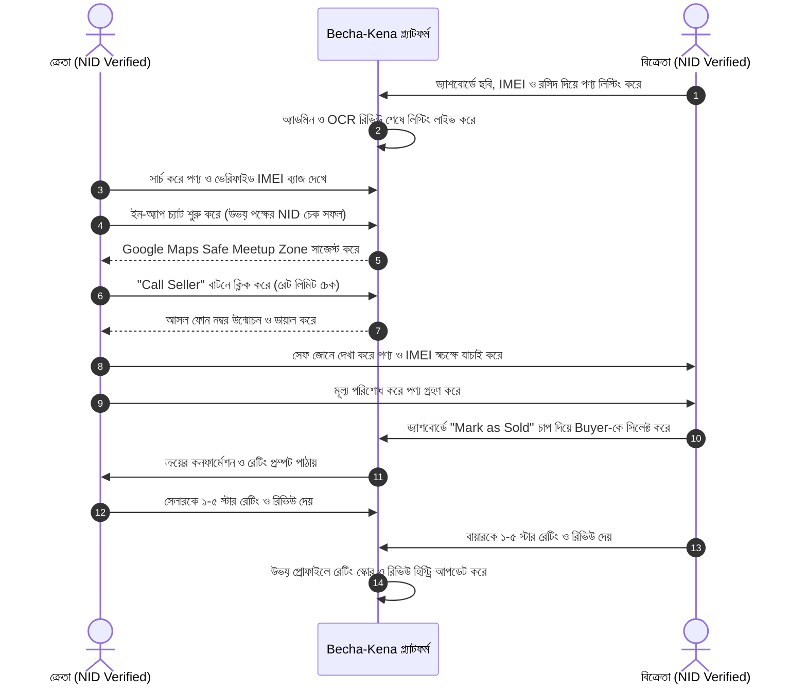

# বেচা-কেনা (Becha-Kena) — User Stories & User Flows (Updated)
**ভার্সন:** 3.0 (100% Verified Buyer-Seller Architecture)  
**উদ্দেশ্য:** Development ও QA টিমের জন্য চূড়ান্ত User Story, Acceptance Criteria এবং User Flow।

---

## ১. Buyer (ক্রেতা)

### ১.১ Buyer User Stories

* **US-B1 (Registration & Mandatory NID Verification):**
  * *Story:* একজন Buyer হিসেবে, আমি মোবাইল OTP দিয়ে সাইন আপ করে আমার NID (অথবা ১৮-র কম হলে অভিভাবকের NID) ভেরিফিকেশন সম্পন্ন করতে চাই, যাতে আমি প্ল্যাটফর্মের সকল ভেরিফাইড বিক্রেতার সাথে নিরাপদ যোগাযোগ করতে পারি।
  * *Acceptance Criteria:*
    - NID ভেরিফিকেশন ছাড়া চ্যাট বা কল বাটন সম্পূর্ণ লক থাকবে।
    - Google Cloud Vision API দিয়ে NID-এর তথ্য OCR-এর মাধ্যমে রিড করা হবে।
    - ভেরিফিকেশন অনুমোদিত হলে প্রোফাইলে ভেরিফাইড ব্যাজ দৃশ্যমান হবে।
* **US-B2 (Search with Anti-Theft Filters):**
  * *Story:* একজন Buyer হিসেবে, আমি ক্যাটাগরি, লোকেশন এবং "IMEI / Proof Verified" ফিল্টার ব্যবহার করে আসল ও নিখুঁত সেকেন্ড-হ্যান্ড পণ্য খুঁজতে চাই।
  * *Acceptance Criteria:*
    - স্মার্টফোনে ১৫ ডিজিটের IMEI এবং ল্যাপটপে Serial Number আছে এমন বিজ্ঞাপনগুলো ফিল্টার করা যাবে।
* **US-B3 (In-App Chat & Google Maps Safe Meetup Suggestion):**
  * *Story:* একজন ভেরিফাইড Buyer হিসেবে, আমি ইন-অ্যাপ চ্যাটে বিক্রেতার সাথে কথা বলতে চাই এবং গুগল ম্যাপসের মাধ্যমে নির্ধারিত নিরাপদ পাবলিক স্পটে সাক্ষাতের লোকেশন ঠিক করতে চাই।
  * *Acceptance Criteria:*
    - উভয় পক্ষ ভেরিফাইড হলে চ্যাট উইন্ডো খুলবে।
    - গুগল ম্যাপস থেকে নিকটস্থ থানা, মেট্রো স্টেশন বা শপিং মল সেফ জোন হিসেবে সিলেক্ট করা যাবে।
    - চ্যাটে কোনো পক্ষ ফোন নম্বর টাইপ করলে তা স্বয়ংক্রিয়ভাবে ব্লক হবে যদি কোনো এক পক্ষ আন-ভেরিফাইড থাকে।
* **US-B4 (Click-to-Call under Verification Shield):**
  * *Story:* একজন ভেরিফাইড Buyer হিসেবে, আমি বিক্রেতার ফোন নম্বরে সরাসরি কল করতে চাই।
  * *Acceptance Criteria:*
    - বায়ার এবং সেলার উভয় পক্ষ ভেরিফাইড হলেই কেবল আসল নম্বর প্রদর্শিত হবে এবং ডায়াল প্যাড খুলবে।
    - একজন বায়ার দিনে সর্বোচ্চ ১৫ জন বিক্রেতার নম্বর দেখতে পারবে।
* **US-B5 (Post-Deal Rating & Review):**
  * *Story:* একজন Buyer হিসেবে, পণ্য বুঝে পাওয়ার পর আমি বিক্রেতাকে ১ থেকে ৫ স্টার রেটিং ও রিভিউ দিতে চাই, যাতে অন্যান্য ক্রেতারা উপকৃত হয়।

---

## ২. Seller (বিক্রেতা)

### ২.১ Seller User Stories

* **US-S1 (Seller NID / Parental Verification):**
  * *Story:* একজন Seller হিসেবে, আমি আমার নিজের NID (বা অপ্রাপ্তবয়স্ক হলে অভিভাবকের NID ও সম্মতিপত্র) জমা দিয়ে ভেরিফাইড হতে চাই, যাতে আমি সেলার ড্যাশবোর্ডে প্রবেশ করতে পারি।
* **US-S2 (Product Listing with Anti-Theft Protocol):**
  * *Story:* একজন Seller হিসেবে, আমি লিস্টিং ফর্মে পণ্যের ছবির সাথে স্মার্টফোনের ১৫ ডিজিটের IMEI অথবা ল্যাপটপের Serial Number এবং ক্রয়ের রসিদের ছবি যুক্ত করে সাবমিট করতে চাই।
  * *Acceptance Criteria:*
    - স্মার্টফোন ক্যাটাগরিতে IMEI ইনপুট বাধ্যতামূলক এবং Luhn অ্যালগরিদমে যাচাই হবে।
    - সাবমিটের পর বিজ্ঞাপনটি `Under Review` স্টেটে যাবে এবং অ্যাডমিন অনুমোদন দিলে লাইভ হবে।
* **US-S3 (Listing Management & Safe Handoff):**
  * *Story:* একজন Seller হিসেবে, ডিল চূড়ান্ত হলে আমি পণ্যটিকে `Reserved` করতে চাই এবং হস্তান্তর শেষে `Mark as Sold` করতে চাই।
* **US-S4 (Buyer Selection & Mutual Rating):**
  * *Story:* একজন Seller হিসেবে, `Mark as Sold` করার সময় আমি চ্যাট করা ক্রেতাদের মধ্য থেকে প্রকৃত ক্রেতাকে নির্বাচিত করতে চাই এবং তাকে ১ থেকে ৫ স্টার রেটিং দিতে চাই।

---

## ৩. সম্পূর্ণ ইউজার ফ্লো ডায়াগ্রাম

