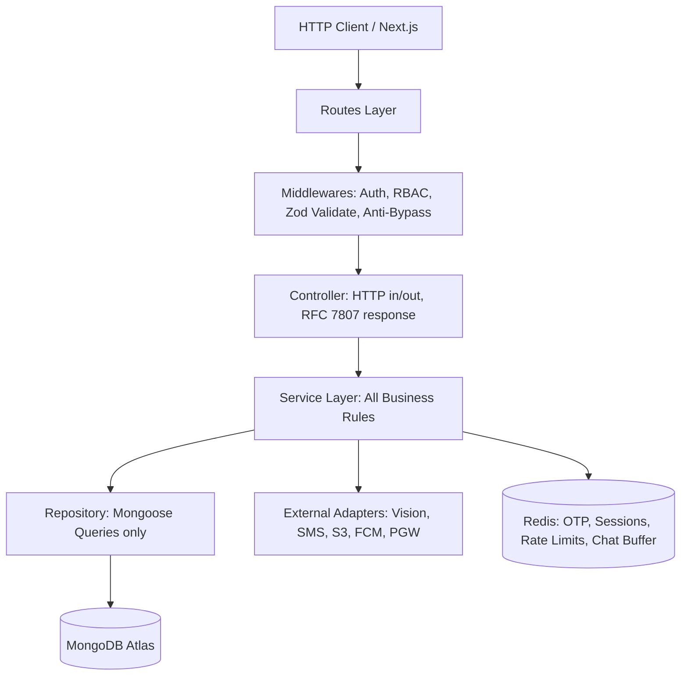

# বেচা-কেনা (Becha-Kena) — System Architecture Document
**ডকুমেন্ট ভার্সন:** 2.0.0 (Final — All Findings Integrated)
**স্ট্যাটাস:** আর্কিটেকচার চূড়ান্ত ও প্রোডাকশন-রেডি
**টেক স্ট্যাক:** Next.js (Frontend + Admin) + Express.js TypeScript (Backend) + MongoDB Atlas + Redis

---

## ১. High-Level System Architecture Diagram

```
[User Browser / Mobile Web]          [Admin Browser]
             │                               │
             ▼ HTTPS (TLS 1.3)              ▼ HTTPS (TLS 1.3)
      [Cloudflare / NGINX] (CDN, DDoS Protection, SSL Termination, WAF)
             │                               │
      ┌──────┘                               └──────┐
      ▼                                            ▼
[Next.js App]                             [Next.js Admin App]
 app.becha-kena.com                        admin.becha-kena.com
 - App Router (SSR & RSC)                 - Separate Build & Deploy
 - TanStack Query & Zustand               - TOTP 2FA (speakeasy)
 - next-intl (i18n)                       - Admin-scoped JWT
      │                                            │
      └──────────────────┬─────────────────────────┘
                         │ REST API (/api/v1/*)
                         ▼
              [Express.js API Server (Backend)]
               - Layered Monolith Architecture
               - WebSocket / Socket.io Engine
               - BullMQ Job Processor
                         │
      ┌──────────────────┼──────────────────────────────────┐
      ▼                  ▼                                   ▼
[MongoDB Atlas]    [Redis Cluster]              [Cloud Storage (S3 / GCS)]
 - Core Store       - OTP TTL (120s)             - Public: Listing Photos
 - All Indexes      - Session Blacklist           - Private: NID Bucket (AES-256)
 - Replica Set      - Rate Limit Counters         - 30-Day Auto-Purge Lifecycle Rule
                    - BullMQ Queues
                    - Chat Buffer (2s batch)
                         │
      ┌──────────────────┼──────────────────────────────────┐
      ▼                  ▼                                   ▼
[Google Cloud APIs]  [SMS Gateway]               [Payment Gateway (PGW)]
 - Vision API (OCR)   - SSL Wireless (Primary)    - bKash / Nagad PGW
 - Maps & Places      - GP SMS (Failover)         - HMAC Webhook Verify
 - reCAPTCHA v3       - BullMQ sms-queue          - Idempotency via Redis
 - FCM (Push)
```

---

## ২. Backend Architecture: Layered Monolith (Express.js + TypeScript)

### ২.১ ফোল্ডার স্ট্রাকচার (Clean Layered Structure)

```
backend/
├── src/
│   ├── config/             # Env, DB, Redis, KMS keys, 3rd-party SDKs
│   ├── constants/          # Error codes, Roles, Listing states, Regex
│   ├── middlewares/        # Auth, RBAC, Rate Limiter, Anti-Bypass, Error Handler
│   ├── modules/            # Feature-based Domain Modules
│   │   ├── auth/           # Registration, Login, OTP, Multi-device session
│   │   ├── user/           # Profile, Minor account grouping
│   │   ├── verification/   # NID upload, Vision OCR, Admin queue
│   │   ├── listing/        # Ad CRUD, IMEI validation, Lifecycle, Re-review rules
│   │   ├── category/       # Category taxonomy, field-rule engine
│   │   ├── search/         # Geo-search, Featured rank, Top Seller badge logic
│   │   ├── chat/           # Socket rooms, Anti-bypass filter, Lifecycle lock
│   │   ├── review/         # Bidirectional ratings, 7-day window, dispute
│   │   ├── dispute/        # State machine, Strike/Warning counters, Freeze/Unfreeze
│   │   ├── payment/        # bKash/Nagad initiate, Webhook, Idempotency
│   │   ├── notification/   # SMS + FCM push dispatcher, in-app store
│   │   └── audit/          # Immutable append-only compliance logs
│   │
│   │   # প্রতিটি মডিউলের ভেতরে:
│   │   # ├── *.routes.ts       -> HTTP verb mapping
│   │   # ├── *.controller.ts   -> Request/Response, RFC 7807 errors
│   │   # ├── *.service.ts      -> Pure Business Logic
│   │   # ├── *.repository.ts   -> Mongoose queries (no service-level DB calls)
│   │   # ├── *.model.ts        -> Mongoose Schema, Hooks, Indexes
│   │   # └── *.validation.ts   -> Zod Schemas (shared with frontend)
│   │
│   ├── jobs/               # BullMQ Workers: sms, ocr, push, chat-persist, maintenance
│   ├── sockets/            # Socket.io handlers, Room manager, Redis Adapter
│   ├── utils/              # AES-256-GCM crypto, Luhn checker, Winston logger
│   └── app.ts              # Express setup, middleware pipeline
└── server.ts               # HTTP + WebSocket bootstrap
```

### ২.২ লেয়ারসমূহের প্রবাহ (Separation of Concerns)



---

## ৩. Frontend Architecture: Next.js (App Router)

### ৩.১ টেকনিক্যাল সিদ্ধান্তসমূহ
* **Server Components (RSC):** হোমপেজ, ক্যাটাগরি ও পাবলিক লিস্টিং পেজ (SEO + FCP)।
* **Client Components:** ড্যাশবোর্ড, রিয়েল-টাইম চ্যাট, NID আপলোডার, ক্যামেরা ক্যাপচার।
* **Server State:** TanStack Query v5 (ক্যাশিং, ব্যাকগ্রাউন্ড ফেচিং, অপটিমিস্টিক আপডেট)।
* **Client / UI State:** Zustand (লগইন স্ট্যাটাস, নোটিফিকেশন কাউন্ট, ড্রয়ার মেনু)।
* **ফর্ম ও ভ্যালিডেশন:** React Hook Form + Zod (সার্ভার ও ক্লায়েন্টে একই স্কিমা শেয়ার)।
* **লোকালাইজেশন (i18n):** `next-intl` — বাংলা (`bn-BD`) ডিফল্ট, ইংরেজি (`en-US`)।
* **UI ও স্টাইলিং:** Tailwind CSS + shadcn/ui (Radix UI) — মোবাইল-ফার্স্ট।

### ৩.২ Next.js App Folder Structure

```
frontend/src/app/
├── (public)/                        # Auth প্রয়োজন নেই (SSR + SEO)
│   ├── page.tsx                     # Homepage / Feed
│   ├── search/page.tsx              # Search results with geo-filter
│   ├── listings/[id]/page.tsx       # Product details (SSR for SEO)
│   └── categories/[slug]/page.tsx   # Category browse page
│
├── (auth)/                          # লগইন না থাকলে দেখাবে
│   ├── login/page.tsx
│   ├── register/page.tsx
│   └── verify-otp/page.tsx
│
├── (verification)/                  # NID ভেরিফিকেশন গেট
│   └── verify-nid/page.tsx          # Onboarding NID upload flow
│
├── (protected)/                     # NID Verified ইউজার লাগবে
│   ├── dashboard/
│   │   ├── page.tsx                 # Seller dashboard overview
│   │   ├── listings/new/page.tsx    # Category-aware listing form
│   │   ├── listings/[id]/edit/page.tsx
│   │   └── disputes/page.tsx
│   ├── chat/
│   │   ├── page.tsx                 # All chat conversations list
│   │   └── [roomId]/page.tsx        # Real-time chat room (Socket.io)
│   ├── profile/[userId]/page.tsx    # Public seller profile + ratings
│   └── dispute/[id]/page.tsx        # Dispute detail & evidence upload
│
└── layout.tsx                       # Root layout + Providers + i18n
```

> **Route Protection:** Root-level `middleware.ts` JWT cookie চেক করে। আন-ভেরিফাইড ইউজার protected route-এ গেলে `/verify-nid`-এ রিডাইরেক্ট।

### ৩.৩ Admin Panel Architecture (Separate Next.js App)

**Admin প্যানেল সম্পূর্ণ আলাদা Next.js অ্যাপ** (`/apps/admin` — monorepo) যা আলাদা subdomain-এ (`admin.becha-kena.com`) deploy হবে।

**কারণ:** Main app-এ কোনো XSS vulnerability থাকলেও সম্পূর্ণ আলাদা domain ও build-এ থাকায় admin routes এক্সপোজড হবে না।

```
admin/src/app/
├── login/page.tsx           # Password login
├── verify-totp/page.tsx     # TOTP 2FA screen (Google Authenticator)
├── dashboard/
│   ├── page.tsx             # Overview metrics
│   ├── nid-queue/page.tsx   # Pending NID verifications
│   ├── listing-queue/page.tsx
│   ├── disputes/page.tsx    # Dispute management
│   └── users/[id]/page.tsx  # User detail + ban/blacklist
└── layout.tsx
```

* **Admin 2FA (TOTP):**
  - লগইনে পাসওয়ার্ড ভেরিফিকেশনের পর ৬ ডিজিটের TOTP (Time-based OTP) চাওয়া হবে।
  - Library: `speakeasy` (TOTP generation) + `qrcode` (QR enrollment)।
  - Admin-scoped JWT payload: `{ role: 'MODERATOR' | 'SUPER_ADMIN', admin_session: true }`।

* **Immutable `audit_logs` Enforcement:**
  - MongoDB collection-level `validator` with `$jsonSchema` — সব ফিল্ডে read-only constraint।
  - Application repository layer-এ শুধুমাত্র `insertOne()` expose করা হবে। কোনো `updateOne()` বা `deleteOne()` method থাকবে না।

---

## ৪. কোর সার্ভিসেস ও আর্কিটেকচারাল অ্যাপ্রোচ

### ৪.১ API Design: RESTful with RFC 7807 & OpenAPI
* **প্রস্তাবিত অ্যাপ্রোচ:** RESTful API (`/api/v1/*`) with Zod & Swagger।
* Cloudflare Edge Caching পাবলিক লিস্টিং এন্ডপয়েন্টে কার্যকর। প্রতিটি API error RFC 7807 মানে।

### ৪.২ Authentication: Hybrid Dual-Token JWT + Redis Blacklist
1. **Access Token (১৫ মিনিট):** ক্লায়েন্ট মেমরিতে (XSS প্রটেকশন)।
2. **Refresh Token (৭ দিন):** `HttpOnly`, `Secure`, `SameSite=Strict` কুকি।
3. **Redis Session Blacklist:** Admin ban → `DEL session:{user_id}:*` → সমস্ত ডিভাইস তাৎক্ষণিক লগআউট।
4. **OTP Engine:** Redis TTL-এ (১২০ সেকেন্ড), ডেটাবেজে কোনো রাইট নেই।
5. **Multi-Device Session Management:**
   - Redis key: `session:{user_id}:{device_fingerprint}` → TTL: ৭ দিন।
   - নতুন লগইনে সেশন সংখ্যা ≥ ২ হলে সবচেয়ে পুরাতনটি `DEL` হবে।
   - Device fingerprint: hash(User-Agent + IP + Accept-Language)।

### ৪.৩ File Upload & Sensitive NID Storage (Tiered Storage)
* **সাধারণ পণ্যের ছবি (Public):**
  - Client-side WebP compression → Backend presigned URL → S3/GCS direct upload (সার্ভারের ব্যান্ডউইথ ০%)।
* **সংবেদনশীল NID ডকুমেন্টস (Private PII):**
  - Express server memory → AES-256-GCM Envelope Encryption → Private bucket (কোনো public access নেই)।
* **৩০ দিনের অটো-পার্জ ক্রন জব:**
  - BullMQ `maintenance-queue` প্রতিরাত ১২:০১ মিনিটে চলে।
  - Condition: `verification_status = 'APPROVED' AND verified_at < NOW() - 30 days`।
  - ফাইল cryptographically shred, শুধু SHA-256 hash থাকে।
* **Client-side Pre-check:**
  - Canvas API দিয়ে ক্লায়েন্টে blur detection → low-quality ছবি আগেই reject (Google Vision API call বাঁচায়)।

### ৪.৪ Real-Time Chat: Socket.io with Redis Adapter
* **কেন Socket.io:** স্বয়ংক্রিয় reconnection, অফলাইন packet queuing, room management।
* **Redis Adapter:** Multi-node Express cluster-এ cross-node chat নিশ্চিত করে।
* **Chat persistence:** Redis-এ ২ সেকেন্ড বাফার → BullMQ `chat-persist-queue` → MongoDB batch insert (latency < ৫০ms)।
* **Chat lifecycle enforcement:** Listing SOLD/DELETED হলে Socket.io room-এ `ROOM_LOCKED` event broadcast → frontend input disabled।

### ৪.৫ MongoDB Atlas: Schema Design & Indexing Strategy

**Collections:**

| Collection | উদ্দেশ্য |
| :--- | :--- |
| `users` | Profile, NID status, role, session info, strike/warning counts |
| `nid_verifications` | OCR results, image refs (30-day TTL), admin decision |
| `categories` | Taxonomy tree, field rules per category |
| `listings` | Ad content, IMEI/serial, lifecycle state, featured flag |
| `chat_rooms` | Room metadata, participants, last message preview, lock status |
| `messages` | Individual messages (separate collection, referenced by chat_room_id) |
| `ratings` | Bidirectional scores, 7-day window tracking, dispute flag |
| `disputes` | State machine, evidence refs, strike/warning updates |
| `payments` | Gateway tx records, idempotency keys |
| `notifications` | In-app notification store per user |
| `audit_logs` | Immutable append-only compliance records |

**Critical Indexes:**

```js
// listings — geo-search
listings.createIndex({ location: "2dsphere" })

// listings — category + status + date filter (most common query)
listings.createIndex({ category_id: 1, status: 1, created_at: -1 })

// listings — IMEI duplicate check (active listings only)
listings.createIndex(
  { imei_number: 1 },
  {
    unique: true,
    sparse: true,
    partialFilterExpression: {
      status: { $in: ["ACTIVE", "PENDING_REVIEW", "RESERVED"] }
    }
  }
)
// ব্যাখ্যা: Partial index ব্যবহারে SOLD listing-এর IMEI unique constraint থেকে বাদ পড়ে,
// ফলে বিক্রির পর একই IMEI পুনরায় লিস্ট করা যায় (original seller কর্তৃক)।

// messages — chat history queries
messages.createIndex({ chat_room_id: 1, created_at: -1 })

// categories — taxonomy tree
categories.createIndex({ parent_id: 1, is_active: 1 })
```

**`categories` Collection Schema:**
```ts
{
  _id: ObjectId,
  name_bn: string,           // "স্মার্টফোন"
  name_en: string,           // "Smartphones"
  slug: string,              // "electronics-smartphones"
  parent_id: ObjectId | null, // null = top-level
  icon_url: string,
  required_fields: string[], // ["imei_number"] | ["serial_number"] | []
  optional_fields: string[], // ["cash_memo_photo"] | []
  is_active: boolean
}
```

**`messages` Collection (Separate from `chat_rooms`):**
```ts
{
  _id: ObjectId,
  chat_room_id: ObjectId,    // Reference to chat_rooms
  sender_id: ObjectId,
  content: string,
  content_type: "TEXT" | "SYSTEM_ALERT" | "PRICE_CHANGE_NOTICE",
  is_filtered: boolean,      // true = regex caught phone number attempt
  created_at: Date
}
```
> **কেন Separate Collection:** Embedded messages পদ্ধতিতে MongoDB-র ১৬MB document size limit-এ hit করার ঝুঁকি আছে। Reference পদ্ধতিতে সমস্যা নেই।

**`payments` Collection Schema:**
```ts
{
  _id: ObjectId,
  user_id: ObjectId,
  listing_id: ObjectId | null,
  type: "FEATURED_AD" | "EXPRESS_VERIFY" | "URGENT_TAG",
  amount: number,
  currency: "BDT",
  gateway: "BKASH" | "NAGAD",
  gateway_tx_id: string,
  status: "PENDING" | "SUCCESS" | "FAILED",
  idempotency_key: string,   // UUID, Redis-এ ১০ মিনিট TTL
  created_at: Date
}
```

### ৪.৬ Background Jobs: BullMQ on Redis

| Queue নাম | কাজ | Retry Policy |
| :--- | :--- | :--- |
| `sms-queue` | OTP ও সব SMS notification | ৩ বার, exponential backoff |
| `push-notification-queue` | FCM push (chat, deal, alerts) | ৩ বার, exponential backoff |
| `ocr-queue` | Google Vision API NID processing | ৩ বার; ৩ fail → admin queue `OCR_FAILED` |
| `chat-persist-queue` | Redis buffer → MongoDB batch write | ৫ বার, fixed 1s delay |
| `maintenance-queue` | NID 30-day purge + Ad 45-day expiry | ১ বার, daily scheduled |

> **কেন BullMQ, `node-cron` নয়:** ডিস্ট্রিবিউটেড, restart-safe, built-in retry, multi-worker concurrency।

### ৪.৭ Notification Service Architecture (Multi-Channel)

```
[notification.service.ts]
       │
       ├── SMS channel → sms-queue (BullMQ) → SSL Wireless / GP SMS
       ├── Push channel → push-notification-queue (BullMQ) → FCM (firebase-admin)
       └── In-App channel → MongoDB `notifications` collection
                          → Socket.io `notification` room (real-time badge count)
```

* FCM token registration: ইউজার লগইনে service worker নিবন্ধিত হয়, FCM token `users` document-এ save হয়।
* In-app polling fallback: TanStack Query প্রতি ৩০ সেকেন্ডে `/api/v1/notifications/unread-count` hit করে।

### ৪.৮ Payment Gateway Integration (bKash / Nagad)

```
[Client] → POST /api/v1/payments/initiate
         ← { payment_url, idempotency_key }
[Client] → Redirect user to payment_url
[bKash/Nagad] → POST /api/v1/payments/webhook/bkash (IPN callback)
[Backend]
  1. HMAC signature verify
  2. Redis idempotency_key check (prevent duplicate webhook)
  3. Update payments collection (status: SUCCESS)
  4. Trigger: activate Featured Ad | queue Express NID priority
  5. Send success notification
```

* **Payment Failure:** Featured Ad activate হবে না। বায়ার SMS ও in-app notification পাবে retry link সহ।
* **Idempotency Key:** UUID, Redis-এ ১০ মিনিট TTL। একই key দুবার এলে `200 OK` (no re-processing)।

### ৪.৯ Google Cloud Vision API — Cost & Rate Management

* **Cost Estimate:**
  - প্রতি ১,০০০ OCR call ≈ \$1.50।
  - ৫০০ verification/month → ≈ \$0.75/month (MVP scale)। Linear scaling।
* **Rate Limiting:**
  - Google quota: ১,৮০০ requests/minute।
  - BullMQ `ocr-queue` concurrency: `10` workers (quota-এর মধ্যে নিরাপদে)।
* **Fallback Strategy:**
  - Vision API confidence < 0.85 → re-queue (max 3 attempts, exponential backoff)।
  - ৩ failure পরেও fail → `OCR_FAILED` flag → manual admin queue (SLA: ২ ঘণ্টা)।
* **Cost Optimization:**
  - Client-side canvas API দিয়ে blur detection → low quality ছবি reject করলে needless API call বাঁচবে।

---

## ৫. Security & Compliance Matrix

| ডোমেন | ইমপ্লিমেন্টেশন মেকানিজম | টুলস / লাইব্রেরি |
| :--- | :--- | :--- |
| **DDoS & WAF** | Rate limiting, IP blacklist, Bot filter | Cloudflare + `express-rate-limit` |
| **Injection & XSS** | Parameterized queries, CSP headers | Mongoose + `helmet` |
| **CORS Policy** | Origin whitelist (Next.js domains only) | `cors` |
| **Input Validation** | Runtime type-checking, sanitization | `zod` |
| **Password Security** | Memory-hard hashing | `argon2` (bcrypt fallback, rounds 12) |
| **Data Encryption** | AES-256-GCM for PII, KMS key rotation | Node.js `crypto` + Cloud KMS |
| **Audit Logging** | Immutable insert-only collection | `winston` + MongoDB `audit_logs` |
| **Admin 2FA** | TOTP (30s window, 6-digit) | `speakeasy` + `qrcode` |
| **Contact Reveal** | HMAC-SHA256 signed one-time token | Node.js `crypto` |
| **Session Security** | HttpOnly Refresh Token cookie | express-session config |

---

## ৬. Deployment & Infrastructure Strategy

```
[Production — Monorepo Structure]
├── /apps/frontend     → Vercel (or AWS ECS) — app.becha-kena.com
├── /apps/admin        → Separate Vercel/ECS — admin.becha-kena.com
├── /apps/backend      → Dockerized Express.js + PM2 (AWS ECS Fargate)
├── /packages/shared   → Shared Zod schemas, TypeScript types, constants
│
[Infrastructure]
├── MongoDB Atlas        → M10+ Replica Set, Automated Daily Snapshots, PITR
├── Redis                → Upstash Redis (or Redis Cloud) — Managed
├── Object Storage       → AWS S3 (Public bucket + Private NID bucket)
├── CDN                  → Cloudflare (Edge caching, DDoS, WAF)
└── CI/CD                → GitHub Actions (Lint → Test → Build → Deploy)
```

> **Monorepo Tool:** Turborepo — শেয়ারড Zod schema ও TypeScript types frontend, admin এবং backend সবাই একই `/packages/shared` থেকে import করবে।
