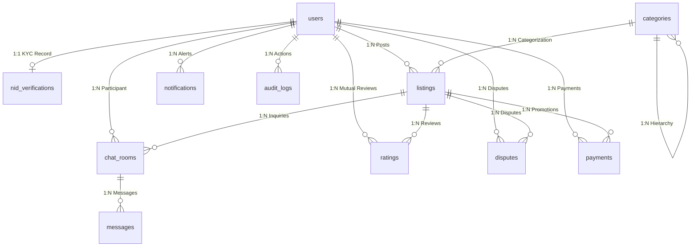

# বেচা-কেনা (Becha-Kena) — Database Schema Specification
**ডকুমেন্ট ভার্সন:** 1.0.0 (Production Schema Master)  
**স্ট্যাটাস:** অনুমোদিত ডেটাবেজ স্কিমা বিবরণ  
**ডেটাবেজ ইঞ্জিন:** MongoDB Atlas (v7.0+) + Mongoose ODM (v8.x) + TypeScript  
**রেফারেন্স ফাইলসমূহ:** `database.md`, `architecture.md`, `PRD.md`, `SPECIFICATION_P0_P1_P2.md`  

---

## কালেকশন সূচিপত্র (Table of Contents)

1. [১. `users` Collection](#১-users-collection) — ইউজার প্রোফাইল, নিরাপত্তা ও রোল নিয়ন্ত্রণ
2. [২. `nid_verifications` Collection](#২-nid_verifications-collection) — NID মেটাডাটা ও ৩০-দিনের ইমেজ লাইফসাইকেল
3. [৩. `categories` Collection](#৩-categories-collection) — ক্যাটাগরি ও আবশ্যক ফিল্ড রুলস
4. [৪. `listings` Collection](#৪-listings-collection) — পণ্যের বিজ্ঞাপন, জিও-লোকেশন ও লাইফসাইকেল
5. [৫. `chat_rooms` Collection](#৫-chat_rooms-collection) — ১-অন-১ চ্যাট চ্যানেল ও সেফ জোন
6. [৬. `messages` Collection](#৬-messages-collection) — চ্যাট বার্তা, ফিল্টারিং ও ৯০-দিনের রিটেনশন
7. [৭. `ratings` Collection](#৭-ratings-collection) — ডিল-পরবর্তী পারস্পরিক রিভিউ ও রেটিং
8. [৮. `disputes` Collection](#৮-disputes-collection) — ৭২ ঘণ্টার ফ্রড রিপোর্ট ও স্টেট মেশিন
9. [৯. `payments` Collection](#৯-payments-collection) — বিকাশ/নগদ পেমেন্ট ট্রানজ্যাকশন ও আইডেমপোটেন্সি
10. [১০. `notifications` Collection](#১০-notifications-collection) — ইন-অ্যাপ অ্যালার্ট ও ৩০-দিনের টিটিএল
11. [১১. `audit_logs` Collection](#১১-audit_logs-collection) — অপরিবর্তনযোগ্য (Append-Only) সিকিউরিটি ও কমপ্লায়েন্স ট্রেইল

---

## ১. `users` Collection
* **উদ্দেশ্য:** প্ল্যাটফর্মের সমস্ত ব্যবহারকারী (ক্রেতা, বিক্রেতা, অভিভাবক, মডারেটর ও সুপার অ্যাডমিন)-এর পরিচিতি, নিরাপত্তা ক্রেডেনশিয়াল এবং ট্রাস্ট স্কোর নিয়ন্ত্রণ।
* **কালেকশনের নাম:** `users`
* **ডকুমেন্ট সাইজ:** ~১.৫ KB

| ফিল্ডের নাম | BSON Type | কনস্ট্রেইন্ট / ডিফল্ট | বিবরণ ও ভ্যালিডেশন লজিক |
| :--- | :--- | :--- | :--- |
| `_id` | ObjectId | Primary Key | স্বয়ংক্রিয় ইউনিক আইডেন্টিফায়ার। |
| `phone_number` | String | Required, Unique, Indexed | আন্তর্জাতিক ফরম্যাট: `+8801[3-9]\d{8}`। প্রাইমারি লগইন আইডেন্টিফায়ার। |
| `password_hash` | String | Required | Argon2id হ্যাশ অ্যালগরিদমে এনক্রিপ্টেড ক্রেডেনশিয়াল। |
| `full_name` | String | Required, Trim | ব্যবহারকারীর পূর্ণ নাম (NID কার্ডের নামের সাথে যাচাইযোগ্য)। |
| `avatar_url` | String | Optional, Nullable | প্রোফাইল ছবির CDN URL (পাবলিক S3 বাকেট)। |
| `role` | String | Enum, Default: `VERIFIED_USER` | `GUEST`, `UNVERIFIED_USER`, `PARENT_VERIFIED_MINOR`, `VERIFIED_USER`, `MODERATOR`, `SUPER_ADMIN`। |
| `nid_status` | String | Enum, Default: `UNVERIFIED`, Indexed | `UNVERIFIED`, `PENDING_REVIEW`, `APPROVED`, `REJECTED`। |
| `nid_verification_id` | ObjectId | Optional, Ref: `nid_verifications` | সম্পর্কিত NID যাচাইকরণ মেটাডাটা রেকর্ডের রেফারেন্স। |
| `parent_user_id` | ObjectId | Optional, Ref: `users` | অপ্রাপ্তবয়স্ক ব্যবহারকারীর ক্ষেত্রে অভিভাবকের ইউজার আইডি (গ্রুপ লিমিট: সর্বোচ্চ ২ সন্তান)। |
| `rating_average` | Double | Default: `0.0`, Min: 0.0, Max: 5.0 | গড় রেটিং স্কোর (সর্বনিম্ন ৩টি রেটিংয়ের পর পাবলিক প্রোফাইলে প্রদর্শিত হবে)। |
| `rating_count` | Integer | Default: `0` | মোট প্রাপ্ত সফল রেটিংয়ের সংখ্যা। |
| `completed_deals_count`| Integer | Default: `0` | প্ল্যাটফর্মে সফলভাবে সম্পন্ন হওয়া ক্রয়-বিক্রয়ের মোট সংখ্যা। |
| `strikes_count` | Integer | Default: `0`, Max: 3 | ফ্রড ডিসপিউট তদন্তে দোষী প্রমাণিত হলে প্রাপ্ত স্ট্রাইক (৩ হলে পার্মানেন্ট ব্যান)। |
| `warnings_count` | Integer | Default: `0`, Max: 3 | মিথ্যা ডিসপিউট দাখিলের ক্ষেত্রে প্রাপ্ত সতর্কবার্তা কাউন্টার। |
| `is_frozen` | Boolean | Default: `false`, Indexed | কোনো ডিসপিউটের তদন্ত চলাকালীন অ্যাকাউন্ট সাময়িক স্থগিত/ফ্রিজ ফ্ল্যাগ। |
| `is_banned` | Boolean | Default: `false`, Indexed | ৩ স্ট্রাইক বা মারাত্মক নিয়ম লঙ্ঘনে স্থায়ী বহিষ্কার ফ্ল্যাগ। |
| `active_sessions_count`| Integer | Default: `0`, Max: 2 | সমসাময়িক সক্রিয় ডিভাইস/লগইন সেশন সংখ্যা (সর্বোচ্চ ২টি অনুমোদিত)। |
| `created_at` | Date | Default: `Date.now` | অ্যাকাউন্ট নিবন্ধনের সঠিক টাইমস্ট্যাম্প। |
| `updated_at` | Date | Default: `Date.now` | সর্বশেষ প্রোফাইল বা সিকিউরিটি আপডেটের সময়। |

---

## ২. `nid_verifications` Collection
* **উদ্দেশ্য:** NID ডকুমেন্টের যাচাইকরণ মেটাডাটা, ডুপ্লিকেট অ্যাকাউন্ট প্রতিরোধ এবং ৩০-দিনের ইমেজ লাইফসাইকেল ম্যানেজমেন্ট।
* **কালেকশনের নাম:** `nid_verifications`
* **ডকুমেন্ট সাইজ:** ~২.০ KB
* **রিলেশন:** `users` কালেকশনের সাথে ১:১ ইউনিক রিলেশন।

| ফিল্ডের নাম | BSON Type | কনস্ট্রেইন্ট / ডিফল্ট | বিবরণ ও ভ্যালিডেশন লজিক |
| :--- | :--- | :--- | :--- |
| `_id` | ObjectId | Primary Key | ইউনিক ভেরিফিকেশন রেকর্ড আইডি। |
| `user_id` | ObjectId | Required, Ref: `users`, Unique | ব্যবহারকারীর রেফারেন্স আইডি। |
| `nid_number_masked`| String | Required | মাস্কড NID ফরম্যাট (e.g. `****-****-1234`), যা সিস্টেমে দৃশ্যমান। |
| `nid_hash` | String | Required, Unique, Indexed | ডুপ্লিকেট অ্যাকাউন্ট রোধে মূল NID নম্বরের SHA-256 এনক্রিপ্টেড হ্যাশ। |
| `date_of_birth` | Date | Required | NID কার্ড অনুযায়ী জন্মতারিখ (১৮+ বয়স যাচাইয়ে ব্যবহৃত)। |
| `ocr_extracted_data` | Object | Optional | Google Vision API থেকে প্রাপ্ত Raw OCR JSON এবং টেম্পারিং স্কোর। |
| `front_image_ref` | String | Nullable | প্রাইভেট S3 বাকেটে AES-256-GCM এনক্রিপ্টেড সম্মুখ ভাগের ছবি। |
| `back_image_ref` | String | Nullable | প্রাইভেট বাকেটের এনক্রিপ্টেড পেছনের পাতার ছবির অবজেক্ট কী। |
| `is_image_purged` | Boolean | Default: `false` | ৩০ দিন পর ক্রিপ্টোগ্রাফিক কী ডিলিটের মাধ্যমে মূল ছবি পার্জ সম্পন্ন হয়েছে কি না। |
| `verified_by_admin` | ObjectId | Optional, Ref: `users` | ম্যানুয়াল রিভিউয়ের ক্ষেত্রে অনুমোদনকারী অ্যাডমিন/মডারেটরের ইউজার আইডি। |
| `rejection_reason` | String | Optional, Enum | `BLURRY_IMAGE`, `NAME_MISMATCH`, `UNDERAGE`, `TAMPERED_DOC`, `DUPLICATE_NID`। |
| `verified_at` | Date | Optional, Indexed | অনুমোদন সম্পন্ন হওয়ার তারিখ (৩০-দিনের ইমেজ পার্জিং ক্রন ট্র্যাকিংয়ে ব্যবহৃত)। |
| `created_at` | Date | Default: `Date.now` | ভেরিফিকেশন আবেদন দাখিলের সময়। |

---

## ৩. `categories` Collection
* **উদ্দেশ্য:** পণ্যের শ্রেণিবিন্যাস এবং ক্যাটাগরিভিত্তিক আবশ্যক ও ঐচ্ছিক ফিল্ডের বিজনেস রুলস সংরক্ষণ।
* **কালেকশনের নাম:** `categories`
* **ডকুমেন্ট সাইজ:** ~০.৮ KB
* **ভলিউম:** ৫০-১০০টি স্থায়ী সিস্টেম রেকর্ড।

| ফিল্ডের নাম | BSON Type | কনস্ট্রেইন্ট / ডিফল্ট | বিবরণ ও ভ্যালিডেশন লজিক |
| :--- | :--- | :--- | :--- |
| `_id` | ObjectId | Primary Key | ক্যাটাগরি আইডি। |
| `name_bn` | String | Required | বাংলায় ক্যাটাগরির নাম (e.g. "স্মার্টফোন")। |
| `name_en` | String | Required | ইংরেজিতে নাম (e.g. "Smartphones")। |
| `slug` | String | Required, Unique, Indexed | URL ফ্রেন্ডলি ইউনিক স্লাগ (e.g. `electronics-smartphones`)। |
| `parent_id` | ObjectId | Nullable, Ref: `categories` | প্যারেন্ট ক্যাটাগরি রেফারেন্স (টপ-লেভেল ক্যাটাগরি হলে null)। |
| `icon_url` | String | Required | ক্যাটাগরি আইকন ইমেজের ক্লাউড URL। |
| `required_fields` | Array of String | Default: `[]` | বিজ্ঞাপন তৈরিকালীন আবশ্যক ফিল্ডের তালিকা (e.g. `["imei_number"]`, `["serial_number"]`)। |
| `optional_fields` | Array of String | Default: `[]` | ঐচ্ছিক ফিল্ডের তালিকা (e.g. `["cash_memo_photo", "box_photo"]`)। |
| `display_order` | Integer | Default: `0` | ইউজার ইন্টারফেসে প্রদর্শনের ক্রমবিন্যাস। |
| `is_active` | Boolean | Default: `true` | ক্যাটাগরি সক্রিয় কি না। |

---

## ৪. `listings` Collection
* **উদ্দেশ্য:** বিক্রয়ের জন্য বিজ্ঞাপিত পণ্যের পূর্ণাঙ্গ তথ্য, মূল্য, অ্যান্টি-থেফট আইডেন্টিফায়ার ও ভৌগোলিক স্থানাঙ্ক।
* **কালেকশনের নাম:** `listings`
* **ডকুমেন্ট সাইজ:** ~৩.৫ KB
* **ইনডেক্সিং:** `location: 2dsphere`, `imei_number: Partial Unique Index`।

| ফিল্ডের নাম | BSON Type | কনস্ট্রেইন্ট / ডিফল্ট | বিবরণ ও ভ্যালিডেশন লজিক |
| :--- | :--- | :--- | :--- |
| `_id` | ObjectId | Primary Key | লিস্টিংয়ের ইউনিক আইডি। |
| `seller_id` | ObjectId | Required, Ref: `users`, Indexed | বিজ্ঞাপনের মালিক/বিক্রেতার ইউজার আইডি। |
| `title` | String | Required, Min: 10, Max: 100 | পণ্যের শিরোনাম (সার্চ ও এসইও ফ্রেন্ডলি)। |
| `slug` | String | Required, Unique, Indexed | URL ফ্রেন্ডলি ইউনিক স্লাগ। |
| `description` | String | Required, Min: 30, Max: 3000 | বিস্তারিত বিবরণ (কন্ডিশন, ব্যবহারকাল, আনুষাঙ্গিক)। |
| `category_id` | ObjectId | Required, Ref: `categories`, Indexed | নির্বাচিত ক্যাটাগরির রেফারেন্স আইডি। |
| `price` | Integer | Required, Min: 10, Max: 5000000 | বিক্রয় মূল্য (BDT)। |
| `is_negotiable` | Boolean | Default: `false` | আলোচনা সাপেক্ষে মূল্য নির্ধারণযোগ্য কি না। |
| `condition` | String | Enum, Required | `LIKE_NEW`, `GENTLY_USED`, `FAIR`, `FOR_PARTS`। |
| `imei_number` | String | Optional, Partial Unique | ১৫ ডিজিটের Luhn-ভ্যালিডেটেড IMEI (সক্রিয় অবস্থায় ইউনিক)। |
| `serial_number` | String | Optional | ল্যাপটপ বা ইলেকট্রনিক ডিভাইসের প্রস্তুতকারক প্রদত্ত সিরিয়াল নম্বর। |
| `photos` | Array of Object | Required, Min: 1, Max: 5 | পণ্যের ছবির তালিকা `[{ url: String, is_primary: Boolean }]`। |
| `cash_memo_url` | String | Optional | ক্রয়ের অরিজিনাল রসিদের ছবির ক্লাউড URL। |
| `box_photo_url` | String | Optional | ডিভাইসের মূল প্যাকেজিং বক্সের ছবির ক্লাউড URL। |
| `location` | GeoJSON Point | Required, 2dsphere Indexed | ভৌগোলিক স্থানাঙ্ক `{ type: "Point", coordinates: [lng, lat] }`। |
| `division` | String | Required | প্রশাসনিক বিভাগ (e.g. "ঢাকা")। |
| `district` | String | Required | জেলা (e.g. "ঢাকা")। |
| `thana` | String | Required | থানা / উপজেলা (e.g. "ধানমন্ডি")। |
| `status` | String | Enum, Default: `PENDING_REVIEW` | `DRAFT`, `PENDING_REVIEW`, `ACTIVE`, `RESERVED`, `SOLD`, `EXPIRED`, `REJECTED`, `BANNED_SUSPENDED`। |
| `is_featured` | Boolean | Default: `false`, Indexed | শীর্ষ ৩টি স্পন্সর্ড স্লটে পিন করা কি না (পেইড বেনিফিট)। |
| `featured_expires_at` | Date | Optional | Featured মেয়াদের সমাপ্তি তারিখ ও সময়। |
| `is_urgent` | Boolean | Default: `false` | লাল "Urgent" ব্যাজ সক্রিয় কি না (পেইড বেনিফিট)। |
| `views_count` | Integer | Default: `0` | বিজ্ঞাপন পরিদর্শনের মোট সংখ্যা। |
| `expires_at` | Date | Required, Indexed | বিজ্ঞাপনের মেয়াদোত্তীর্ণের তারিখ (পাবলিশের ৪৫ দিন পর)। |
| `created_at` | Date | Default: `Date.now`, Indexed | লিস্টিং তৈরির সময়। |
| `updated_at` | Date | Default: `Date.now` | সর্বশেষ লিস্টিং আপডেটের সময়। |

---

## ৫. `chat_rooms` Collection
* **উদ্দেশ্য:** বায়ার ও সেলারের মধ্যকার ১-অন-১ যোগাযোগের চ্যানেল, নিরাপদ মিটআপ স্পট ও রুম লাইফসাইকেল পরিচালনা।
* **কালেকশনের নাম:** `chat_rooms`
* **ডকুমেন্ট সাইজ:** ~১.০ KB
* **কনস্ট্রেইন্ট:** `{ buyer_id: 1, seller_id: 1, listing_id: 1 }` ইউনিক কম্পাউন্ড ইনডেক্স।

| ফিল্ডের নাম | BSON Type | কনস্ট্রেইন্ট / ডিফল্ট | বিবরণ ও ভ্যালিডেশন লজিক |
| :--- | :--- | :--- | :--- |
| `_id` | ObjectId | Primary Key | চ্যাট রুমের ইউনিক আইডি। |
| `listing_id` | ObjectId | Required, Ref: `listings`, Indexed | যে নির্দিষ্ট বিজ্ঞাপনকে কেন্দ্র করে আলোচনা চলছে। |
| `buyer_id` | ObjectId | Required, Ref: `users`, Indexed | আগ্রহী ক্রেতার ইউজার আইডি। |
| `seller_id` | ObjectId | Required, Ref: `users`, Indexed | বিজ্ঞাপনের মালিক/বিক্রেতার ইউজার আইডি। |
| `status` | String | Enum, Default: `ACTIVE` | `ACTIVE` (উন্মুক্ত), `LOCKED` (পণ্য বিক্রি সম্পন্ন হলে লকড), `ARCHIVED`। |
| `suggested_safe_zone`| Object | Optional | গুগল ম্যাপস থেকে সাজেস্টেড থানা/পাবলিক স্পট `{ name: String, lat: Number, lng: Number }`। |
| `last_message_preview`| String | Optional, Max: 100 | ইনবক্স তালিকার জন্য সর্বশেষ বার্তার স্ন্যাপশট। |
| `last_message_at` | Date | Default: `Date.now`, Indexed | সর্বশেষ মেসেজ প্রেরণের সময় (রিসেন্সি সর্টিংয়ে ব্যবহৃত)। |
| `unread_buyer_count` | Integer | Default: `0` | ক্রেতার অপঠিত বার্তার সংখ্যা। |
| `unread_seller_count`| Integer | Default: `0` | বিক্রেতার অপঠিত বার্তার সংখ্যা। |
| `created_at` | Date | Default: `Date.now` | চ্যাট রুম তৈরির সময়। |

---

## ৬. `messages` Collection
* **উদ্দেশ্য:** চ্যাট রুমের প্রতিটি পৃথক বার্তা সংরক্ষণ, ফোন নম্বর বাইপাস ফিল্টারিং এবং ৯০-দিনের রিটেনশন ট্র্যাকিং।
* **কালেকশনের নাম:** `messages`
* **ডকুমেন্ট সাইজ:** ~০.৫ KB
* **আর্কিটেকচারাল প্যাটার্ন:** Referenced Pattern (MongoDB 16MB সাইজ লিমিট এড়াতে আলাদা কালেকশন)।

| ফিল্ডের নাম | BSON Type | কনস্ট্রেইন্ট / ডিফল্ট | বিবরণ ও ভ্যালিডেশন লজিক |
| :--- | :--- | :--- | :--- |
| `_id` | ObjectId | Primary Key | মেসেজের ইউনিক আইডি। |
| `chat_room_id` | ObjectId | Required, Ref: `chat_rooms`, Indexed | সম্পর্কিত চ্যাট রুমের রেফারেন্স আইডি। |
| `sender_id` | ObjectId | Required, Ref: `users` | বার্তা প্রেরণকারীর ইউজার আইডি। |
| `content` | String | Required, Max: 2000 | বার্তার টেক্সট কন্টেন্ট। |
| `content_type` | String | Enum, Default: `TEXT` | `TEXT`, `SYSTEM_ALERT`, `PRICE_CHANGE_NOTICE`, `SAFE_ZONE_SUGGESTION`। |
| `is_filtered` | Boolean | Default: `false` | ফোন নম্বর Regex ফিল্টার বা ফিশিং প্রোটেকশনে কোনো পরিবর্তন করা হয়েছে কি না। |
| `is_archived` | Boolean | Default: `false`, Indexed | ৯০ দিনের রিটেনশন পলিসি অনুযায়ী Soft-Delete ফ্ল্যাগ (True হলে UI-তে লুকায়িত হবে এবং Cron দ্বারা মুছে ফেলা হবে)। |
| `created_at` | Date | Default: `Date.now`, Indexed | বার্তা প্রেরণের সঠিক সময়। |

---

## ৭. `ratings` Collection
* **উদ্দেশ্য:** সফল ডিল সমাপ্তির পর ক্রেতা ও বিক্রেতার পারস্পরিক ১-৫ স্টার রেটিং, রিভিউ এবং ৭-দিনের উইন্ডো ট্র্যাকিং।
* **কালেকশনের নাম:** `ratings`
* **ডকুমেন্ট সাইজ:** ~১.২ KB
* **কনস্ট্রেইন্ট:** `{ listing_id: 1, reviewer_id: 1 }` ইউনিক কম্পাউন্ড ইনডেক্স (ডাবল রেটিং প্রতিরোধ)।

| ফিল্ডের নাম | BSON Type | কনস্ট্রেইন্ট / ডিফল্ট | বিবরণ ও ভ্যালিডেশন লজিক |
| :--- | :--- | :--- | :--- |
| `_id` | ObjectId | Primary Key | রেটিং রেকর্ডের ইউনিক আইডি। |
| `listing_id` | ObjectId | Required, Ref: `listings` | সংশ্লিষ্ট বিক্রিত বিজ্ঞাপনের রেফারেন্স। |
| `reviewer_id` | ObjectId | Required, Ref: `users`, Indexed | যিনি রেটিং ও মূল্যায়ন দিচ্ছেন। |
| `reviewee_id` | ObjectId | Required, Ref: `users`, Indexed | যার সম্পর্কে রেটিং দেওয়া হচ্ছে। |
| `role_type` | String | Enum, Required | `BUYER_TO_SELLER`, `SELLER_TO_BUYER`। |
| `score` | Integer | Required, Min: 1, Max: 5 | রেটিং স্কোর (১ থেকে ৫ তারকা)। |
| `comment` | String | Optional, Max: 500 | লিখিত রিভিউ বা ফিডব্যাক। |
| `tags` | Array of String | Default: `[]` | পজিটিভ/নেগেটিভ ট্যাগসমূহ (e.g. `["Honest", "Accurate Description", "Punctual"]`)। |
| `is_disputed` | Boolean | Default: `false` | রিভিউটির বিরুদ্ধে কোনো অপব্যবহারের রিপোর্ট করা হয়েছে কি না। |
| `window_expires_at` | Date | Required, Indexed | ৭ দিনের রেটিং উইন্ডোর সমাপ্তি সময় (উইন্ডো শেষ হলে আর রিভিউ দেওয়া যাবে না)। |
| `created_at` | Date | Default: `Date.now` | রেটিং রেকর্ড তৈরি বা জমা দেওয়ার সময়। |

---

## ৮. `disputes` Collection
* **উদ্দেশ্য:** পণ্য ক্রয়ের ৭২ ঘণ্টার মধ্যে জালিয়াতি/প্রতারণার অভিযোগ গ্রহণ, তদন্ত লগ এবং ৩-স্ট্রাইক পার্মানেন্ট ব্যান স্টেট মেশিন।
* **কালেকশনের নাম:** `disputes`
* **ডকুমেন্ট সাইজ:** ~২.৫ KB

| ফিল্ডের নাম | BSON Type | কনস্ট্রেইন্ট / ডিফল্ট | বিবরণ ও ভ্যালিডেশন লজিক |
| :--- | :--- | :--- | :--- |
| `_id` | ObjectId | Primary Key | ডিসপিউট টিকেটের ইউনিক আইডি। |
| `listing_id` | ObjectId | Required, Ref: `listings` | অভিযুক্ত বিজ্ঞাপনের রেফারেন্স আইডি। |
| `plaintiff_id` | ObjectId | Required, Ref: `users` | অভিযোগকারী ক্রেতার আইডি। |
| `defendant_id` | ObjectId | Required, Ref: `users`, Indexed | অভিযুক্ত বিক্রেতার আইডি। |
| `reason` | String | Enum, Required | `CLONE_DEVICE`, `ICLOUD_LOCKED`, `HARDWARE_FAULT`, `STOLEN_SUSPECT`, `MISLEADING_INFO`। |
| `description` | String | Required, Min: 20, Max: 2000 | বিস্তারিত অভিযোগ বিবরণ। |
| `evidence_urls` | Array of String | Required, Min: 1 | প্রমাণাদির ছবির ক্লাউড লিঙ্ক (স্ক্রিনশট, মেমো, টেকনিশিয়ান স্লিপ)। |
| `status` | String | Enum, Default: `OPEN`, Indexed | `OPEN`, `UNDER_INVESTIGATION`, `RESOLVED_BUYER_WIN`, `RESOLVED_SELLER_WIN`, `DISMISSED`। |
| `assigned_admin_id`| ObjectId | Optional, Ref: `users` | তদন্তের দায়িত্বে নিয়োজিত ব্যাকঅফিস মডারেটর কর্মকর্তা। |
| `admin_resolution_notes`| String | Optional | অ্যাডমিনের সিদ্ধান্তের যৌক্তিকতা ও তদন্ত পর্যবেক্ষণ নোট। |
| `resolved_at` | Date | Optional | বিরোধ নিষ্পত্তির চূড়ান্ত নিষ্পত্তির সময়। |
| `created_at` | Date | Default: `Date.now` | অভিযোগ দাখিলের সময় (লিস্টিং বিক্রয়ের ৭২ ঘণ্টার মধ্যে হতে হবে)। |

---

## ৯. `payments` Collection
* **উদ্দেশ্য:** মনিটাইজেশন লেনদেন (Featured Ad, Urgent Tag, Express NID), গেটওয়ে কলব্যাক এবং আইডেমপোটেন্ট পেমেন্ট অডিট।
* **কালেকশনের নাম:** `payments`
* **ডকুমেন্ট সাইজ:** ~১.০ KB
* **কনস্ট্রেইন্ট:** `idempotency_key: Unique Index` (ডাবল বিলিং সম্পূর্ণ রোধ)।

| ফিল্ডের নাম | BSON Type | কনস্ট্রেইন্ট / ডিফল্ট | বিবরণ ও ভ্যালিডেশন লজিক |
| :--- | :--- | :--- | :--- |
| `_id` | ObjectId | Primary Key | পেমেন্ট ট্রানজ্যাকশন আইডি। |
| `user_id` | ObjectId | Required, Ref: `users`, Indexed | পেমেন্ট প্রদানকারী ব্যবহারকারীর আইডি। |
| `listing_id` | ObjectId | Optional, Ref: `listings` | সম্পর্কিত লিস্টিং আইডি (Featured বা Urgent সার্ভিসের ক্ষেত্রে)। |
| `type` | String | Enum, Required | `FEATURED_AD_3D`, `FEATURED_AD_7D`, `URGENT_TAG`, `EXPRESS_VERIFY`। |
| `amount` | Integer | Required, Min: 10 | টাকার পরিমাণ (BDT, e.g. ৳২৯, ৳৪৯, ৳৯৯, ৳১৯৯)। |
| `gateway` | String | Enum, Required | `BKASH`, `NAGAD`। |
| `gateway_tx_id` | String | Optional, Indexed | পেমেন্ট গেটওয়ে থেকে প্রদত্ত ট্রানজ্যাকশন আইডি (TXN ID)। |
| `idempotency_key` | String | Required, Unique, Indexed | ডুপ্লিকেট পেমেন্ট ও ডাবল রিচার্জ রোধে ক্লায়েন্ট প্রদত্ত UUID। |
| `status` | String | Enum, Default: `PENDING`, Indexed | `PENDING`, `SUCCESS`, `FAILED`, `CANCELLED`। |
| `created_at` | Date | Default: `Date.now` | পেমেন্ট রিকোয়েস্ট তৈরির সময়। |

---

## ১০. `notifications` Collection
* **উদ্দেশ্য:** রিয়েল-টাইম ইন-অ্যাপ নোটিফিকেশন হিস্ট্রি, অপঠিত ব্যাজ কাউন্ট এবং ৩০-দিনের টিটিএল অটো-পার্জিং।
* **কালেকশনের নাম:** `notifications`
* **ডকুমেন্ট সাইজ:** ~০.৬ KB
* **ইনডেক্সিং:** `{ created_at: 1 }` (TTL: `expireAfterSeconds: 2592000`)।

| ফিল্ডের নাম | BSON Type | কনস্ট্রেইন্ট / ডিফল্ট | বিবরণ ও ভ্যালিডেশন লজিক |
| :--- | :--- | :--- | :--- |
| `_id` | ObjectId | Primary Key | নোটিফিকেশনের ইউনিক আইডি। |
| `user_id` | ObjectId | Required, Ref: `users`, Indexed | প্রাপক ব্যবহারকারীর ইউজার আইডি। |
| `title` | String | Required | নোটিফিকেশনের শিরোনাম (e.g. "বিজ্ঞাপন স্পন্সরড হয়েছে!")। |
| `message` | String | Required | বিস্তারিত বিবরণী বার্তা। |
| `event_type` | String | Enum, Required | `AUTH_OTP`, `NID_APPROVED`, `NID_REJECTED`, `CHAT_MESSAGE`, `DEAL_SOLD_BUYER`, `DISPUTE_OPENED`, `DISPUTE_RESOLVED`, `PAYMENT_SUCCESS`। |
| `action_url` | String | Optional | ক্লিকে নির্দিষ্ট পেজে রিডাইরেক্ট হওয়ার URL পাথ (e.g. `/chat/room-123`)। |
| `is_read` | Boolean | Default: `false`, Indexed | বার্তাটি ব্যবহারকারী পড়েছেন কি না। |
| `created_at` | Date | Default: `Date.now`, Indexed | নোটিফিকেশন তৈরির সময় (৩০ দিন পর স্বয়ংক্রিয়ভাবে ডিলিট হবে)। |

---

## ১১. `audit_logs` Collection
* **উদ্দেশ্য:** অপরিবর্তনযোগ্য (Append-Only) সিকিউরিটি, কমপ্লায়েন্স ও আইনি তদন্তের জন্য ফরেনসিক অডিট ট্রেইল।
* **কালেকশনের নাম:** `audit_logs`
* **ডকুমেন্ট সাইজ:** ~১.০ KB
* **রিটেনশন:** ন্যূনতম ৩ বছর (Read-Only Schema, কোনো মডিফিকেশন বা ডিলিট অনুমোদিত নয়)।

| ফিল্ডের নাম | BSON Type | কনস্ট্রেইন্ট / ডিফল্ট | বিবরণ ও ভ্যালিডেশন লজিক |
| :--- | :--- | :--- | :--- |
| `_id` | ObjectId | Primary Key | অডিট লগ এন্ট্রির ইউনিক আইডি। |
| `actor_id` | ObjectId | Optional, Ref: `users`, Indexed | অ্যাকশন পরিচালনাকারীর ইউজার আইডি (সিস্টেম ইভেন্ট হলে null)। |
| `actor_role` | String | Required | `SUPER_ADMIN`, `MODERATOR`, `SELLER`, `BUYER`, `SYSTEM`। |
| `action_type` | String | Enum, Required, Indexed | `NID_APPROVED`, `NID_REJECTED`, `AD_BANNED`, `USER_SUSPENDED`, `PHONE_REVEALED`, `IMEI_EDITED`, `DEAL_SOLD`, `DISPUTE_RESOLVED`, `USER_BANNED`। |
| `target_entity_type`| String | Required | `USER`, `LISTING`, `NID_VERIFICATION`, `DISPUTE`। |
| `target_entity_id` | ObjectId | Required, Indexed | সংশ্লিষ্ট টার্গেট অবজেক্টের ObjectId। |
| `old_state` | Object | Optional | ডেটা পরিবর্তনের পূর্ববর্তী অবস্থার স্ন্যাপশট। |
| `new_state` | Object | Optional | পরিবর্তনের পরবর্তী চূড়ান্ত অবস্থার স্ন্যাপশট। |
| `ip_address` | String | Required | ব্যবহারকারী বা অ্যাডমিনের পাবলিক আইপি অ্যাড্রেস। |
| `user_agent` | String | Required | ক্লায়েন্ট ব্রাউজার বা ডিভাইসের ইউজার এজেন্ট স্ট্রিং। |
| `timestamp` | Date | Default: `Date.now`, Indexed | ইভেন্ট সংঘটিত হওয়ার অপরিবর্তনীয় সময়। |

---

## ১২. সম্পর্ক ও রেফারেন্সিং আর্কিটেকচার (Relationship Mapping)

---

## ১৩. ডেটাবেজ স্কিমা সামারি টেবিল (Quick Reference)

| ক্রম | কালেকশন নাম | প্রাইমারি কি | ইউনিক কী / ইনডেক্স | বিশেষ ইনডেক্স / টিটিএল |
| :---: | :--- | :--- | :--- | :--- |
| ১ | `users` | `_id` | `phone_number` | `{ role: 1, is_banned: 1 }` |
| ২ | `nid_verifications` | `_id` | `user_id`, `nid_hash` | `{ verified_at: 1 }` (৩০ দিন পর ইমেজ পার্জ) |
| ৩ | `categories` | `_id` | `slug` | `{ parent_id: 1, is_active: 1 }` |
| ৪ | `listings` | `_id` | `slug` | `location: 2dsphere`, `imei_number: Partial Unique`, `{ is_featured: -1, created_at: -1 }` |
| ৫ | `chat_rooms` | `_id` | `{ buyer_id: 1, seller_id: 1, listing_id: 1 }` | `{ last_message_at: -1 }`, `{ buyer_id: 1, last_message_at: -1 }` |
| ৬ | `messages` | `_id` | N/A | `{ chat_room_id: 1, created_at: -1 }`, `{ created_at: 1, is_archived: 1 }` |
| ৭ | `ratings` | `_id` | `{ listing_id: 1, reviewer_id: 1 }` | `{ window_expires_at: 1 }` (৭ দিনের মেয়াদ), `{ reviewee_id: 1, score: -1 }` |
| ৮ | `disputes` | `_id` | N/A | `{ status: 1, created_at: -1 }`, `{ defendant_id: 1 }` |
| ৯ | `payments` | `_id` | `idempotency_key` | `{ gateway_tx_id: 1 }` |
| ১০ | `notifications` | `_id` | N/A | `{ created_at: 1 }` (TTL: ৩০ দিন), `{ user_id: 1, is_read: 1 }` |
| ১১ | `audit_logs` | `_id` | N/A | `{ timestamp: -1, action_type: 1 }` (Append-Only) |
