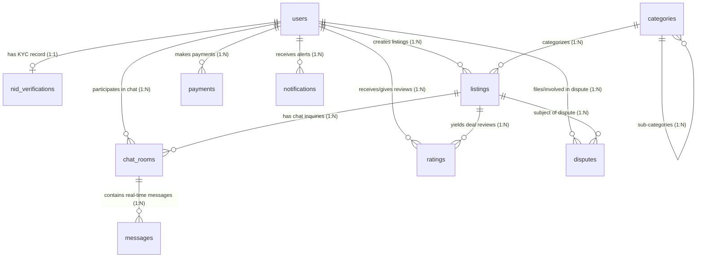
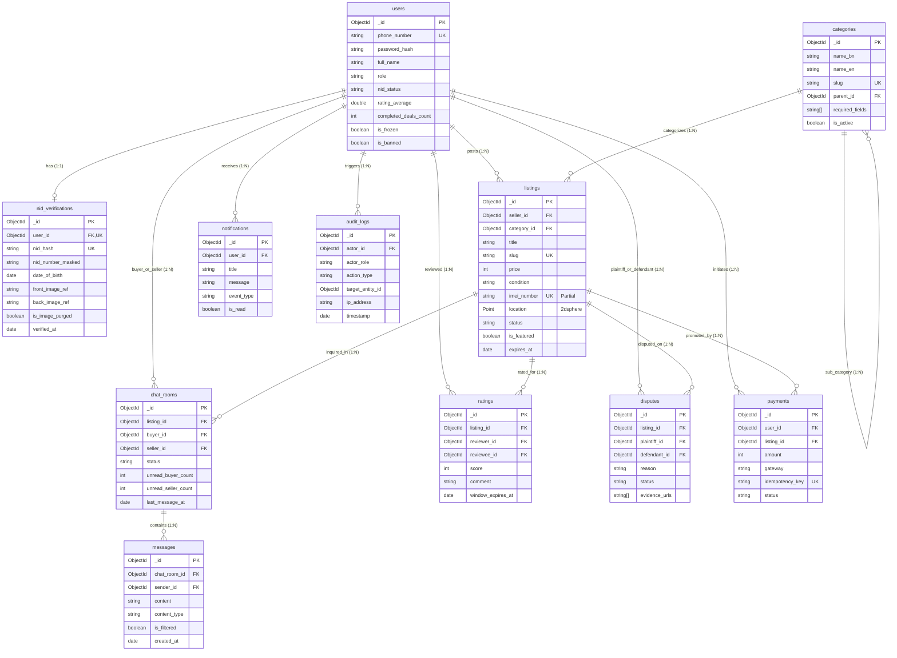

# বেচা-কেনা (Becha-Kena) — Database Design & Schema Specification
**ডকুমেন্ট ভার্সন:** 2.0.0 (Production MongoDB Atlas Schema)  
**স্ট্যাটাস:** অনুমোদিত প্রোডাকশন ডেটাবেজ স্পেসিফিকেশন  
**টেকনোলজি:** MongoDB Atlas (v7.0+) + Mongoose ODM (v8.x) + TypeScript  
**রেফারেন্স ফাইলসমূহ:** `database-schema.md`, `dfd.md`, `architecture.md`, `PRD.md`  

---

## ১. Collection List (কালেকশন পরিচিতি)

বেচা-কেনা প্ল্যাটফর্মের ডেটাবেজ ১১টি ডেডিকেটেড কালেকশনে বিভক্ত। প্রতিটি কালেকশন নির্দিষ্ট ডোমেন রেসপন্সিবিলিটি নিয়ে গঠিত:

| ক্রম | Collection নাম | ডোমেন ও দায়িত্ব | ডকুমেন্টের গড় সাইজ | আনুমানিক গ্রোথ ভলিউম |
| :---: | :--- | :--- | :---: | :---: |
| **১** | `users` | ইউজার প্রোফাইল, ফোন নম্বর, ক্রেডেনশিয়াল, ভেরিফিকেশন স্ট্যাটাস ও ট্রাস্ট স্কোর | ~১.৫ KB | মাঝারি (প্রতি ইউজারে ১টি) |
| **২** | `nid_verifications` | NID মেটাডাটা, OCR টেক্সট, SHA-256 হ্যাশ এবং ৩০-দিনের ইমেজ রিটেনশন ট্র্যাকিং | ~২.০ KB | মাঝারি (১:১ রিলেশন) |
| **৩** | `categories` | ক্যাটাগরি ও সাব-ক্যাটাগরি ট্রি, ফিল্ড রুলস (IMEI/সিরিয়াল বাধ্যতামূলক কি না) | ~০.৮ KB | অতি ক্ষুদ্র (৫০-১০০টি স্থায়ী রেকর্ড) |
| **৪** | `listings` | পণ্যের বিজ্ঞাপন, মূল্য, GeoJSON লোকেশন, কন্ডিশন, IMEI এবং লাইফসাইকেল স্টেট | ~৩.৫ KB | উচ্চ (প্রতিদিন শত শত নতুন রেকর্ড) |
| **৫** | `chat_rooms` | ১-অন-১ চ্যাট রুমের মেটাডাটা, অংশগ্রহণকারী আইডি ও রুম লক স্ট্যাটাস | ~১.০ KB | উচ্চ (প্রতি লিস্টিংয়ে একাধিক রুম) |
| **৬** | `messages` | চ্যাট মেসেজ, রিয়েল-টাইম কন্টেন্ট, সিস্টেম অ্যালার্ট ও ফিল্টারিং ফ্ল্যাগ | ~০.৫ KB | সর্বোচ্চ (প্রতিদিন লক্ষাধিক রেকর্ড) |
| **৭** | `ratings` | ডিল-পরবর্তী বায়ার-সেলার পারস্পরিক ১-৫ স্টার রেটিং ও রিভিউ | ~১.২ KB | মাঝারি (প্রতিটি সফল বিক্রয়ে ২টি) |
| **৮** | `disputes` | ৭২ ঘণ্টার ফ্রড কমপ্লেন, প্রমাণাদি, অ্যাডমিন ইনভেস্টিগেশন স্টেট ও স্ট্রাইক | ~২.৫ KB | নিম্ন (শুধু বিরোধপূর্ণ লেনদেনে) |
| **৯** | `payments` | bKash/Nagad পেমেন্ট ট্রানজ্যাকশন, গেটওয়ে ট্রানজ্যাকশন আইডি ও আইডেমপোটেন্সি কী | ~১.০ KB | মাঝারি (পেইড সার্ভিস গ্রহণে) |
| **১০** | `notifications` | মাল্টি-চ্যানেল ইন-অ্যাপ পুশ নোটিফিকেশন হিস্ট্রি | ~০.৬ KB | উচ্চ (ব্যবহারকারী প্রতি নিয়মিত) |
| **১১** | `audit_logs` | অপরিবর্তনযোগ্য (Append-Only) সিকিউরিটি ও কমপ্লায়েন্স অডিট ট্রেইল | ~১.০ KB | অতি উচ্চ (নিয়মিত সিস্টেম ইভেন্টে) |

---

## ২. Schema Design & Field Specifications (স্কিমা বিবরণ)

> [!NOTE]
> প্ল্যাটফর্মের ১১টি কালেকশনের প্রতিটি ফিল্ডের পুঙ্খানুপুঙ্খ বিবরণ, টাইপ, ভ্যালিডেশন কনস্ট্রেইন্ট এবং বিজনেস লজিক মাস্টার ফাইল **[`database-schema.md`](./database-schema.md)**-এ বিস্তারিতভাবে স্থানান্তরিত ও সংকলিত করা হয়েছে।

নিচে ১১টি কালেকশনের ফিল্ড স্পেসিফিকেশনের মূল রেফারেন্স দেওয়া হলো:

### ২.১ `users` Collection
* **বিস্তারিত স্পেসিফিকেশন:** [`database-schema.md#১-users-collection`](./database-schema.md#১-users-collection)
* **উদ্দেশ্য:** প্ল্যাটফর্মের সমস্ত ব্যবহারকারী (ক্রেতা, বিক্রেতা ও অ্যাডমিন)-এর প্রোফাইল ও নিরাপত্তা নিয়ন্ত্রণ।

| ফিল্ডের নাম | BSON Type | কনস্ট্রেইন্ট / ডিফল্ট | বিবরণ |
| :--- | :--- | :--- | :--- |
| `_id` | ObjectId | Primary Key | স্বয়ংক্রিয় ইউনিক আইডেন্টিফায়ার |
| `phone_number` | String | Required, Unique, Indexed | আন্তর্জাতিক ফরম্যাট: `+8801[3-9]\d{8}` |
| `password_hash` | String | Required | Argon2id অথবা Bcrypt হ্যাশ |
| `full_name` | String | Required, Trim | ব্যবহারকারীর পূর্ণ নাম (NID অনুযায়ী) |
| `avatar_url` | String | Optional, Nullable | প্রোফাইল ছবির ক্লাউড URL |
| `role` | String | Enum, Default: `VERIFIED_USER` | `GUEST`, `UNVERIFIED_USER`, `PARENT_VERIFIED_MINOR`, `VERIFIED_USER`, `MODERATOR`, `SUPER_ADMIN` |
| `nid_status` | String | Enum, Default: `UNVERIFIED` | `UNVERIFIED`, `PENDING_REVIEW`, `APPROVED`, `REJECTED` |
| `nid_verification_id` | ObjectId | Optional, Ref: `nid_verifications` | সম্পর্কিত NID ডকুমেন্টের রেফারেন্স |
| `parent_user_id` | ObjectId | Optional, Ref: `users` | অপ্রাপ্তবয়স্ক হলে অভিভাবকের ইউজার আইডি |
| `rating_average` | Double | Default: `0.0`, Min: 0.0, Max: 5.0 | গড় রেটিং স্কোর (সর্বনিম্ন ৩টি রেটিংয়ের পর দৃশ্যমান) |
| `rating_count` | Integer | Default: `0` | মোট প্রাপ্ত রেটিংয়ের সংখ্যা |
| `completed_deals_count`| Integer | Default: `0` | সফলভাবে সম্পন্ন হওয়া কেনাবেচার সংখ্যা |
| `strikes_count` | Integer | Default: `0`, Max: 3 | ফ্রড ডিসপিউটে প্রাপ্ত স্ট্রাইক (৩ হলে পার্মানেন্ট ব্যান) |
| `warnings_count` | Integer | Default: `0`, Max: 3 | মিথ্যা ডিসপিউটের সতর্কবার্তা কাউন্টার |
| `is_frozen` | Boolean | Default: `false` | ডিসপিউট তদন্ত চলাকালীন অ্যাকাউন্ট ফ্রিজ ফ্ল্যাগ |
| `is_banned` | Boolean | Default: `false` | অ্যাকাউন্ট আজীবন নিষিদ্ধ কি না |
| `active_sessions_count`| Integer | Default: `0`, Max: 2 | সমসাময়িক লগইন ডিভাইসের সংখ্যা |
| `created_at` | Date | Default: `Date.now` | অ্যাকাউন্ট তৈরির টাইমস্ট্যাম্প |
| `updated_at` | Date | Default: `Date.now` | সর্বশেষ আপডেটের টাইমস্ট্যাম্প |

---

### ২.২ `nid_verifications` Collection
* **উদ্দেশ্য:** NID ডকুমেন্টের মেটাডাটা ও ৩০-দিনের ইমেজ লাইফসাইকেল ম্যানেজমেন্ট।

| ফিল্ডের নাম | BSON Type | কনস্ট্রেইন্ট / ডিফল্ট | বিবরণ |
| :--- | :--- | :--- | :--- |
| `_id` | ObjectId | Primary Key | ইউনিক ভেরিফিকেশন রেকর্ড আইডি |
| `user_id` | ObjectId | Required, Ref: `users`, Unique | ব্যবহারকারীর রেফারেন্স |
| `nid_number_masked`| String | Required | মাস্কড NID ফরম্যাট (e.g. `****-****-1234`) |
| `nid_hash` | String | Required, Unique, Indexed | ডুপ্লিকেট রোধে SHA-256 এনক্রিপ্টেড ইউনিক হ্যাশ |
| `date_of_birth` | Date | Required | NID কার্ড অনুযায়ী জন্মতারিখ |
| `ocr_extracted_data` | Object | Optional | Google Vision API থেকে প্রাপ্ত Raw OCR JSON |
| `front_image_ref` | String | Nullable | প্রাইভেট বাকেটের এনক্রিপ্টেড অবজেক্ট পাথ |
| `back_image_ref` | String | Nullable | প্রাইভেট বাকেটের এনক্রিপ্টেড অবজেক্ট পাথ |
| `is_image_purged` | Boolean | Default: `false` | ৩০ দিন পর ইমেজ ডিলিট সম্পন্ন হয়েছে কি না |
| `verified_by_admin` | ObjectId | Optional, Ref: `users` | অনুমোদনকারী অ্যাডমিনের ইউজার আইডি |
| `rejection_reason` | String | Optional, Enum | `BLURRY_IMAGE`, `NAME_MISMATCH`, `UNDERAGE`, `TAMPERED_DOC`, `DUPLICATE_NID` |
| `verified_at` | Date | Optional, Indexed | অনুমোদন সম্পন্ন হওয়ার তারিখ (ক্রন ট্র্যাকিংয়ে ব্যবহৃত) |
| `created_at` | Date | Default: `Date.now` | আবেদন তৈরির সময় |

---

### ২.৩ `categories` Collection
* **উদ্দেশ্য:** পণ্যের শ্রেণিবিন্যাস এবং ক্যাটাগরিভিত্তিক আবশ্যক ফিল্ডের সংজ্ঞা।

| ফিল্ডের নাম | BSON Type | কনস্ট্রেইন্ট / ডিফল্ট | বিবরণ |
| :--- | :--- | :--- | :--- |
| `_id` | ObjectId | Primary Key | ক্যাটাগরি আইডি |
| `name_bn` | String | Required | বাংলায় ক্যাটাগরির নাম (e.g. "স্মার্টফোন") |
| `name_en` | String | Required | ইংরেজিতে নাম (e.g. "Smartphones") |
| `slug` | String | Required, Unique, Indexed | URL ফ্রেন্ডলি স্লাগ (e.g. `electronics-smartphones`) |
| `parent_id` | ObjectId | Nullable, Ref: `categories` | প্যারেন্ট ক্যাটাগরি রেফারেন্স (টপ লেভেল হলে null) |
| `icon_url` | String | Required | আইকন ইমেজের URL |
| `required_fields` | Array of String | Default: `[]` | আবশ্যক ফিল্ডের তালিকা (e.g. `["imei_number"]`, `["serial_number"]`) |
| `optional_fields` | Array of String | Default: `[]` | ঐচ্ছিক ফিল্ডের তালিকা (e.g. `["cash_memo_photo", "box_photo"]`) |
| `display_order` | Integer | Default: `0` | প্রদর্শনের ক্রমবিন্যাস |
| `is_active` | Boolean | Default: `true` | ক্যাটাগরি সক্রিয় কি না |

---

### ২.৪ `listings` Collection
* **উদ্দেশ্য:** বিক্রয়ের জন্য বিজ্ঞাপিত পণ্যের পূর্ণাঙ্গ তথ্য ও ভৌগোলিক স্থানাঙ্ক।

| ফিল্ডের নাম | BSON Type | কনস্ট্রেইন্ট / ডিফল্ট | বিবরণ |
| :--- | :--- | :--- | :--- |
| `_id` | ObjectId | Primary Key | লিস্টিং আইডি |
| `seller_id` | ObjectId | Required, Ref: `users`, Indexed | বিজ্ঞাপনের মালিক/বিক্রেতার আইডি |
| `title` | String | Required, Min: 10, Max: 100 | পণ্যের শিরোনাম |
| `slug` | String | Required, Unique, Indexed | SEO ফ্রেন্ডলি স্লাগ |
| `description` | String | Required, Min: 30, Max: 3000 | বিস্তারিত বিবরণ |
| `category_id` | ObjectId | Required, Ref: `categories`, Indexed | নির্বাচিত ক্যাটাগরির রেফারেন্স |
| `price` | Integer | Required, Min: 10, Max: 5000000 | বিক্রয় মূল্য (BDT) |
| `is_negotiable` | Boolean | Default: `false` | আলোচনা সাপেক্ষে কি না |
| `condition` | String | Enum, Required | `LIKE_NEW`, `GENTLY_USED`, `FAIR`, `FOR_PARTS` |
| `imei_number` | String | Optional, Partial Unique Index | ১৫ ডিজিটের Luhn-ভ্যালিডেটেড IMEI (স্মার্টফোনে আবশ্যক) |
| `serial_number` | String | Optional | ল্যাপটপ বা ডিভাইসের সিরিয়াল নম্বর |
| `photos` | Array of Object | Required, Min: 1, Max: 5 | পণ্যের ছবির তালিকা `[{ url: String, is_primary: Boolean }]` |
| `cash_memo_url` | String | Optional | ক্রয়ের রসিদের ছবির ক্লাউড URL |
| `box_photo_url` | String | Optional | আসল প্যাকেজিং বক্সের ছবির URL |
| `location` | GeoJSON Point | Required, 2dsphere Indexed | ভৌগোলিক স্থানাঙ্ক `{ type: "Point", coordinates: [lng, lat] }` |
| `division` | String | Required | প্রশাসনিক বিভাগ (e.g. "ঢাকা") |
| `district` | String | Required | জেলা (e.g. "ঢাকা") |
| `thana` | String | Required | থানা / উপজেলা (e.g. "ধানমন্ডি") |
| `status` | String | Enum, Default: `PENDING_REVIEW` | `DRAFT`, `PENDING_REVIEW`, `ACTIVE`, `RESERVED`, `SOLD`, `EXPIRED`, `REJECTED`, `BANNED_SUSPENDED` |
| `is_featured` | Boolean | Default: `false` | শীর্ষ ৩টি স্পন্সর্ড স্লটে পিন করা কি না |
| `featured_expires_at` | Date | Optional | Featured মেয়াদের সমাপ্তি তারিখ |
| `is_urgent` | Boolean | Default: `false` | লাল "Urgent" ব্যাজ সক্রিয় কি না |
| `views_count` | Integer | Default: `0` | ভিউ সংখ্যা |
| `expires_at` | Date | Required, Indexed | বিজ্ঞাপনের মেয়াদোত্তীর্ণের তারিখ (পাবলিশের ৪৫ দিন পর) |
| `created_at` | Date | Default: `Date.now`, Indexed | লিস্টিং তৈরির সময় |
| `updated_at` | Date | Default: `Date.now` | সর্বশেষ আপডেটের সময় |

---

### ২.৫ `chat_rooms` Collection
* **উদ্দেশ্য:** বায়ার ও সেলারের মধ্যকার ১-অন-১ যোগাযোগের চ্যানেল পরিচালনা।

| ফিল্ডের নাম | BSON Type | কনস্ট্রেইন্ট / ডিফল্ট | বিবরণ |
| :--- | :--- | :--- | :--- |
| `_id` | ObjectId | Primary Key | চ্যাট রুমের ইউনিক আইডি |
| `listing_id` | ObjectId | Required, Ref: `listings`, Indexed | যে বিজ্ঞাপনকে কেন্দ্র করে চ্যাট হচ্ছে |
| `buyer_id` | ObjectId | Required, Ref: `users`, Indexed | আগ্রহী ক্রেতার আইডি |
| `seller_id` | ObjectId | Required, Ref: `users`, Indexed | পণ্যের বিক্রেতার আইডি |
| `status` | String | Enum, Default: `ACTIVE` | `ACTIVE` (উন্মুক্ত), `LOCKED` (পণ্য বিক্রি/ডিলিট হলে লকড), `ARCHIVED` |
| `suggested_safe_zone`| Object | Optional | গুগল ম্যাপস থেকে সাজেস্টেড সেফ স্পট `{ name: String, lat: Number, lng: Number }` |
| `last_message_preview`| String | Optional | চ্যাট তালিকার প্রিভিউ টেক্সট |
| `last_message_at` | Date | Default: `Date.now`, Indexed | সর্বশেষ মেসেজের সময় |
| `unread_buyer_count` | Integer | Default: `0` | বায়ারের অপঠিত মেসেজের সংখ্যা |
| `unread_seller_count`| Integer | Default: `0` | সেলারের অপঠিত মেসেজের সংখ্যা |
| `created_at` | Date | Default: `Date.now` | রুম তৈরির সময় |

---

### ২.৬ `messages` Collection
* **উদ্দেশ্য:** চ্যাট রুমের প্রতিটি পৃথক বার্তা সংরক্ষণ (পৃথক কালেকশনে রাখা হয়েছে ১৬MB লিমিট এড়াতে)।

| ফিল্ডের নাম | BSON Type | কনস্ট্রেইন্ট / ডিফল্ট | বিবরণ |
| :--- | :--- | :--- | :--- |
| `_id` | ObjectId | Primary Key | মেসেজ আইডি |
| `chat_room_id` | ObjectId | Required, Ref: `chat_rooms`, Indexed | সম্পর্কিত চ্যাট রুমের রেফারেন্স |
| `sender_id` | ObjectId | Required, Ref: `users` | বার্তা প্রেরণকারীর আইডি |
| `content` | String | Required, Max: 2000 | বার্তার টেক্সট কন্টেন্ট |
| `content_type` | String | Enum, Default: `TEXT` | `TEXT`, `SYSTEM_ALERT`, `PRICE_CHANGE_NOTICE`, `SAFE_ZONE_SUGGESTION` |
| `is_filtered` | Boolean | Default: `false` | ফোন নম্বর বা ফিশিং ফিল্টারে কোনো পরিবর্তন করা হয়েছে কি না |
| `is_archived` | Boolean | Default: `false` | ৯০ দিনের রিটেনশন পলিসি অনুযায়ী Soft-Delete ফ্ল্যাগ (True হলে চ্যাটে হাইড হবে এবং Cron দ্বারা স্থায়ীভাবে ব্যাচ-ডিলিট হবে) |
| `created_at` | Date | Default: `Date.now`, Indexed | বার্তা প্রেরণের সময় (৯০ দিন রিটেনশন ট্র্যাকিং) |

---

### ২.৭ `ratings` Collection
* **উদ্দেশ্য:** লেনদেন সমাপ্তির পর ক্রেতা-বিক্রেতার পারস্পরিক ১-৫ স্টার রেটিং ও সোশ্যাল প্রুফ।

| ফিল্ডের নাম | BSON Type | কনস্ট্রেইন্ট / ডিফল্ট | বিবরণ |
| :--- | :--- | :--- | :--- |
| `_id` | ObjectId | Primary Key | রেটিং আইডি |
| `listing_id` | ObjectId | Required, Ref: `listings` | বিক্রিত পণ্যের রেফারেন্স |
| `reviewer_id` | ObjectId | Required, Ref: `users`, Indexed | যিনি রেটিং দিচ্ছেন |
| `reviewee_id` | ObjectId | Required, Ref: `users`, Indexed | যার সম্পর্কে রেটিং দেওয়া হচ্ছে |
| `role_type` | String | Enum, Required | `BUYER_TO_SELLER`, `SELLER_TO_BUYER` |
| `score` | Integer | Required, Min: 1, Max: 5 | তারকামানের স্কোর (১ থেকে ৫) |
| `comment` | String | Optional, Max: 500 | লিখিত মতামত / রিভিউ |
| `tags` | Array of String | Default: `[]` | ট্যাগসমূহ (e.g. `["Punctual", "Accurate Description", "Polite"]`) |
| `is_disputed` | Boolean | Default: `false` | রিভিউটির বিরুদ্ধে ডিসপিউট খোলা হয়েছে কি না |
| `window_expires_at` | Date | Required | ৭ দিনের রেটিং উইন্ডো সমাপ্তির সময় |
| `created_at` | Date | Default: `Date.now` | রেটিং প্রদানের সময় |

---

### ২.৮ `disputes` Collection
* **উদ্দেশ্য:** পণ্য ক্রয়ের ৭২ ঘণ্টার মধ্যে প্রতারণা সংক্রান্ত অভিযোগ ও তদন্ত লগ।

| ফিল্ডের নাম | BSON Type | কনস্ট্রেইন্ট / ডিফল্ট | বিবরণ |
| :--- | :--- | :--- | :--- |
| `_id` | ObjectId | Primary Key | ডিসপিউট টিকেট আইডি |
| `listing_id` | ObjectId | Required, Ref: `listings` | অভিযুক্ত লিস্টিং আইডি |
| `plaintiff_id` | ObjectId | Required, Ref: `users` | অভিযোগকারী (ক্রেতা) |
| `defendant_id` | ObjectId | Required, Ref: `users`, Indexed | অভিযুক্ত (বিক্রেতা) |
| `reason` | String | Enum, Required | `CLONE_DEVICE`, `ICLOUD_LOCKED`, `HARDWARE_FAULT`, `STOLEN_SUSPECT`, `MISLEADING_INFO` |
| `description` | String | Required, Min: 20, Max: 2000 | বিস্তারিত অভিযোগ |
| `evidence_urls` | Array of String | Required, Min: 1 | প্রমাণাদির ছবির লিঙ্ক (স্ক্রিনশট, জিডি কপি) |
| `status` | String | Enum, Default: `OPEN` | `OPEN`, `UNDER_INVESTIGATION`, `RESOLVED_BUYER_WIN`, `RESOLVED_SELLER_WIN`, `DISMISSED` |
| `assigned_admin_id`| ObjectId | Optional, Ref: `users` | তদন্তকারী অ্যাডমিন কর্মকর্তা |
| `admin_resolution_notes`| String | Optional | অ্যাডমিনের সিদ্ধান্তের যৌক্তিকতা ও নোট |
| `resolved_at` | Date | Optional | নিষ্পত্তি সম্পন্ন হওয়ার তারিখ |
| `created_at` | Date | Default: `Date.now` | অভিযোগ দাখিলের সময় |

---

### ২.৯ `payments` Collection
* **উদ্দেশ্য:** মনিটাইজেশন লেনদেন এবং পেমেন্ট গেটওয়ের অডিট।

| ফিল্ডের নাম | BSON Type | কনস্ট্রেইন্ট / ডিফল্ট | বিবরণ |
| :--- | :--- | :--- | :--- |
| `_id` | ObjectId | Primary Key | পেমেন্ট রেকর্ড আইডি |
| `user_id` | ObjectId | Required, Ref: `users`, Indexed | পেমেন্ট প্রদানকারীর আইডি |
| `listing_id` | ObjectId | Optional, Ref: `listings` | সম্পর্কিত লিস্টিং (Featured/Urgent-এর ক্ষেত্রে) |
| `type` | String | Enum, Required | `FEATURED_AD_3D`, `FEATURED_AD_7D`, `URGENT_TAG`, `EXPRESS_VERIFY` |
| `amount` | Integer | Required, Min: 10 | টাকার পরিমাণ (BDT) |
| `gateway` | String | Enum, Required | `BKASH`, `NAGAD` |
| `gateway_tx_id` | String | Optional, Indexed | গেটওয়ে থেকে প্রাপ্ত ট্রানজ্যাকশন আইডি |
| `idempotency_key` | String | Required, Unique, Indexed | ডুপ্লিকেট পেমেন্ট রোধে UUID |
| `status` | String | Enum, Default: `PENDING` | `PENDING`, `SUCCESS`, `FAILED`, `CANCELLED` |
| `created_at` | Date | Default: `Date.now` | রিকোয়েস্ট তৈরির সময় |

---

### ২.১০ `notifications` Collection
* **উদ্দেশ্য:** ইন-অ্যাপ ব্যবহারকারী নোটিফিকেশন হিস্ট্রি ও ব্যাজ কাউন্ট।

| ফিল্ডের নাম | BSON Type | কনস্ট্রেইন্ট / ডিফল্ট | বিবরণ |
| :--- | :--- | :--- | :--- |
| `_id` | ObjectId | Primary Key | নোটিফিকেশন আইডি |
| `user_id` | ObjectId | Required, Ref: `users`, Indexed | প্রাপক ব্যবহারকারীর আইডি |
| `title` | String | Required | নোটিফিকেশনের শিরোনাম |
| `message` | String | Required | বিস্তারিত বার্তা |
| `event_type` | String | Enum, Required | `AUTH_OTP`, `NID_APPROVED`, `NID_REJECTED`, `CHAT_MESSAGE`, `DEAL_SOLD_BUYER`, `DISPUTE_OPENED` |
| `action_url` | String | Optional | ক্লিকে নির্দিষ্ট স্ক্রিনে যাওয়ার পাথ (e.g. `/chat/room-123`) |
| `is_read` | Boolean | Default: `false`, Indexed | পঠিত কি না |
| `created_at` | Date | Default: `Date.now`, Indexed | তৈরির সময় |

---

### ২.১১ `audit_logs` Collection
* **উদ্দেশ্য:** অপরিবর্তনযোগ্য (Append-Only) সিকিউরিটি, কমপ্লায়েন্স ও পুলিশি তদন্ত অডিট।

| ফিল্ডের নাম | BSON Type | কনস্ট্রেইন্ট / ডিফল্ট | বিবরণ |
| :--- | :--- | :--- | :--- |
| `_id` | ObjectId | Primary Key | অডিট লগ আইডি |
| `actor_id` | ObjectId | Optional, Ref: `users`, Indexed | অ্যাকশন পরিচালনাকারীর আইডি (সিস্টেম হলে null) |
| `actor_role` | String | Required | `SUPER_ADMIN`, `MODERATOR`, `SELLER`, `BUYER`, `SYSTEM` |
| `action_type` | String | Enum, Required, Indexed | `NID_APPROVED`, `NID_REJECTED`, `AD_BANNED`, `USER_SUSPENDED`, `PHONE_REVEALED`, `IMEI_EDITED` |
| `target_entity_type`| String | Required | `USER`, `LISTING`, `NID_VERIFICATION`, `DISPUTE` |
| `target_entity_id` | ObjectId | Required, Indexed | সংশ্লিষ্ট টার্গেট অবজেক্টের আইডি |
| `old_state` | Object | Optional | পরিবর্তনের পূর্ববর্তী স্টেট |
| `new_state` | Object | Optional | পরিবর্তনের পরবর্তী স্টেট |
| `ip_address` | String | Required | ব্যবহারকারী বা অ্যাডমিনের আইপি ঠিকানা |
| `user_agent` | String | Required | ক্লায়েন্ট ব্রাউজার বা ডিভাইসের বিবরণ |
| `timestamp` | Date | Default: `Date.now`, Indexed | ইভেন্ট সংঘটিত হওয়ার অবিকৃত সময় |

---

## ৩. Relationship & Cardinality Architecture (সম্পর্ক ও সংযোগ)



### ৩.১ Embedded vs Referenced Design Decisions

1. **`messages` vs `chat_rooms` (Referenced Pattern):**  
   * *সিদ্ধান্ত:* মেসেজগুলোকে `chat_rooms`-এর ভেতরে অ্যারে হিসেবে Embed **না করে** আলাদা কালেকশনে Reference করা হয়েছে।  
   * *যৌক্তিকতা:* দীর্ঘস্থায়ী চ্যাটে শত শত মেসেজ যুক্ত হলে MongoDB-র **16 MB Document Size Limit** অতিক্রম করার ঝুঁকি থাকে। এছাড়া মেসেজ আলাদা থাকলে পেজিনেশন (`limit` / `skip`) অনেক বেশি পারফরম্যান্ট হয়।

2. **`location` in `listings` (Embedded GeoJSON Point):**  
   * *সিদ্ধান্ত:* ভৌগোলিক স্থানাঙ্ক লিস্টিং ডকুমেন্টের ভেতরেই `{ type: "Point", coordinates: [lng, lat] }` ফরম্যাটে Embed করা হয়েছে।  
   * *যৌক্তিকতা:* এটি MongoDB-র নেটিভ **`2dsphere` ইনডেক্স** ব্যবহার করে একক কুয়েরিতে মিলিসেকেন্ডের মধ্যে স্পেশিয়াল প্রোক্সিমিটি (۱۰ কি.মি. রেডিয়াস) সার্চ সম্পন্ন করতে পারে।

3. **`photos` in `listings` (Embedded Array):**  
   * *সিদ্ধান্ত:* প্রতিটি লিস্টিংয়ে সর্বোচ্চ ৫টি ছবি অনুমোদিত। তাই এদের জন্য আলাদা কালেকশন তৈরি না করে লিস্টিং ডকুমেন্টের ভেতরেই Embed করা হয়েছে।

---

## ৪. Indexing Architecture & Query Optimization

ডেটাবেজের দ্রুততা নিশ্চিত করতে এবং ফুল টেবিল স্ক্যান (COLLSCAN) সম্পূর্ণ এড়াতে নিচের স্পেশালাইজড ইনডেক্সগুলো সংজ্ঞায়িত করা হয়েছে:

### ৪.১ Index Definitions Table

| কালেকশন | ইনডেক্সের ফিল্ডসমূহ | ইনডেক্সের ধরন | ইনডেক্স ব্যবহারের কারণ / টার্গেট কুয়েরি |
| :--- | :--- | :--- | :--- |
| **`users`** | `{ phone_number: 1 }` | Unique, Single | দ্রুত লগইন ও ডুপ্লিকেট অ্যাকাউন্ট প্রতিরোধ। |
| **`users`** | `{ role: 1, is_banned: 1 }` | Compound | অ্যাডমিন প্যানেলে অ্যাক্টিভ ইউজার ও মডারেটর ফিল্টারিং। |
| **`nid_verifications`**| `{ nid_hash: 1 }` | Unique, Sparse | একই NID কার্ড দিয়ে একাধিকবার অ্যাকাউন্ট খোলা রোধ। |
| **`nid_verifications`**| `{ verified_at: 1 }` | TTL / Single | TTL-Cron Target: ৩০ দিন পর `front_image_ref` ও `back_image_ref` মূল ছবি cryptographically shred (AES key ডিলিট), `is_image_purged=true`। Mongoose TTL index (`expireAfterSeconds: 2592000`) অথবা BullMQ maintenance-queue দ্বারা পরিচালিত। |
| **`categories`**| `{ parent_id: 1, is_active: 1 }` | Compound | সাব-ক্যাটাগরি ট্রি দ্রুত লোড করা। |
| **`categories`**| `{ slug: 1 }` | Unique | ক্যাটাগরি পেজের ডাইনামিক রাউটিং। |
| **`listings`** | `{ location: "2dsphere" }` | Geospatial | ইউজার থেকে ১০ কি.মি. ব্যাসার্ধের মধ্যে পণ্য অনুসন্ধান। |
| **`listings`** | `{ category_id: 1, status: 1, created_at: -1 }` | Compound | ক্যাটাগরি অনুযায়ী সক্রিয় বিজ্ঞাপনের ডিফল্ট পেজ লোড। |
| **`listings`** | `{ is_featured: -1, created_at: -1 }` | Compound | সার্চ রেজাল্টের শীর্ষে Featured বিজ্ঞাপন পিন করা। |
| **`listings`** | `{ imei_number: 1 }` (Partial Filter) | Partial Unique | শুধুমাত্র `ACTIVE`, `PENDING_REVIEW`, `RESERVED` বিজ্ঞাপনে IMEI ডুপ্লিকেট রোধ। |
| **`chat_rooms`** | `{ buyer_id: 1, seller_id: 1, listing_id: 1 }` | Compound Unique | বায়ার, সেলার ও লিস্টিংয়ের মধ্যকার ডুপ্লিকেট রুম প্রতিরোধ ও তাৎক্ষণিক রুম রিড। |
| **`chat_rooms`** | `{ buyer_id: 1, last_message_at: -1 }`, `{ seller_id: 1, last_message_at: -1 }` | Compound | ইউজারের ইনবক্স চ্যাট লিস্ট সাম্প্রতিক মেসেজের ক্রমানুসারে দ্রুত লোড করা। |
| **`messages`** | `{ chat_room_id: 1, created_at: -1 }` | Compound | নির্দিষ্ট চ্যাট রুমের বার্তাগুলো সময় অনুযায়ী দ্রুত রিড করা। |
| **`messages`** | `{ created_at: 1, is_archived: 1 }` | Compound | ৯০ দিনের retention cron: `created_at < now-90d AND is_archived=false` মেসেজ batch-archive করা। |
| **`ratings`** | `{ listing_id: 1, reviewer_id: 1 }` | Unique Compound | একই বিক্রিত পণ্যে একজন ইউজার যাতে দুইবার রেটিং দিতে না পারে (ডুপ্লিকেট প্রতিরোধ)। |
| **`ratings`** | `{ reviewee_id: 1, score: -1 }` | Compound | বিক্রেতার পাবলিক প্রোফাইলে রেটিং স্কোর হিসেব করা। |
| **`ratings`** | `{ window_expires_at: 1 }` | Sparse TTL | ৭-দিনের রেটিং উইন্ডো মেয়াদ শেষের পর পেন্ডিং রেটিং রেকর্ড নিষ্ক্রিয়/ক্লিনআপ করা। |
| **`disputes`** | `{ status: 1, created_at: -1 }` | Compound | অ্যাডমিন ব্যাকঅফিসে ওপেন ও তদন্তাধীন ডিসপিউট কিউ দ্রুত সর্টিং ও ফিল্টারিং। |
| **`disputes`** | `{ defendant_id: 1 }` | Single | অভিযুক্ত বিক্রেতার অতীত ডিসপিউট ও স্ট্রাইক ট্র্যাক রেকর্ড যাচাই। |
| **`payments`** | `{ idempotency_key: 1 }` | Unique | ডুপ্লিকেট পেমেন্ট ও ডাবল রিচার্জ রোধ। |
| **`notifications`**| `{ created_at: 1 }` | TTL (expireAfterSeconds: 2592000) | ৩০ দিন পুরনো পঠিত (`is_read=true`) নোটিফিকেশন স্বয়ংক্রিয়ভাবে পার্জ করে স্টোরেজ নিয়ন্ত্রণ। |
| **`audit_logs`** | `{ timestamp: -1, action_type: 1 }` | Compound | অডিট রিপোর্ট ও সিকিউরিটি তদন্তে টাইম-সিরিজ অ্যানালাইসিস। |

---

## ৫. Validation Rules & Data Integrity ($jsonSchema)

MongoDB Atlas লেভেলে ডেটা করাপশন রোধ করতে কালেকশন তৈরিকালীন নিচের `$jsonSchema` ভ্যালিডেটর কনফিগার করা হবে:

### ৫.১ Collection Validator: `listings` (IMEI & Price Enforcement)
```json
{
  "$jsonSchema": {
    "bsonType": "object",
    "required": ["seller_id", "title", "category_id", "price", "condition", "location", "status"],
    "properties": {
      "price": {
        "bsonType": "int",
        "minimum": 10,
        "maximum": 5000000,
        "description": "মূল্য অবশ্যই ১০ টাকা থেকে ৫০ লক্ষ টাকার মধ্যে হতে হবে।"
      },
      "imei_number": {
        "bsonType": ["string", "null"],
        "pattern": "^[0-9]{15}$",
        "description": "IMEI অবশ্যই ১৫ ডিজিটের সাংখ্যিক মান হতে হবে।"
      },
      "status": {
        "enum": ["DRAFT", "PENDING_REVIEW", "ACTIVE", "RESERVED", "SOLD", "EXPIRED", "REJECTED", "BANNED_SUSPENDED"],
        "description": "অবশ্যই অনুমোদিত ৮টি লাইফসাইকেল স্টেটের একটি হতে হবে।"
      }
    }
  }
}
```

### ৫.২ Collection Validator: `users` (Role, Status & Strikes Enforcement)
```json
{
  "$jsonSchema": {
    "bsonType": "object",
    "required": ["phone_number", "password_hash", "full_name", "role", "nid_status"],
    "properties": {
      "phone_number": {
        "bsonType": "string",
        "pattern": "^\\+8801[3-9]\\d{8}$",
        "description": "বাংলাদেশী মোবাইল নম্বর আন্তর্জাতিক ফরম্যাটে হতে হবে।"
      },
      "role": {
        "enum": ["GUEST", "UNVERIFIED_USER", "PARENT_VERIFIED_MINOR", "VERIFIED_USER", "MODERATOR", "SUPER_ADMIN"],
        "description": "অবশ্যই অনুমোদিত ৬টি রোলের একটি হতে হবে।"
      },
      "nid_status": {
        "enum": ["UNVERIFIED", "PENDING_REVIEW", "APPROVED", "REJECTED"],
        "description": "NID ভেরিফিকেশন স্টেট অবশ্যই অনুমোদিত ৪টি মানের একটি হতে হবে।"
      },
      "strikes_count": {
        "bsonType": "int",
        "minimum": 0,
        "maximum": 3,
        "description": "স্ট্রাইক সংখ্যা ০ থেকে ৩ এর মধ্যে হতে হবে।"
      }
    }
  }
}
```

### ৫.৩ Collection Validator: `disputes` (Evidence & State Machine Enforcement)
```json
{
  "$jsonSchema": {
    "bsonType": "object",
    "required": ["listing_id", "plaintiff_id", "defendant_id", "reason", "description", "evidence_urls", "status"],
    "properties": {
      "reason": {
        "enum": ["CLONE_DEVICE", "ICLOUD_LOCKED", "HARDWARE_FAULT", "STOLEN_SUSPECT", "MISLEADING_INFO"],
        "description": "অভিযোগের কারণ অবশ্যই নির্ধারিত ৫টি ক্যাটাগরির একটি হতে হবে।"
      },
      "status": {
        "enum": ["OPEN", "UNDER_INVESTIGATION", "RESOLVED_BUYER_WIN", "RESOLVED_SELLER_WIN", "DISMISSED"],
        "description": "ডিসপিউটের বর্তমান অবস্থা অবশ্যই বৈধ স্টেট মেশিনের একটি ধাপে থাকতে হবে।"
      },
      "evidence_urls": {
        "bsonType": "array",
        "minItems": 1,
        "description": "কমপক্ষে ১টি প্রমাণের লিঙ্ক আবশ্যক।"
      }
    }
  }
}
```

---

## ৬. Production Aggregation Pipelines

### ৬.১ Aggregation ১: Geo-Search, Proximity Sorting & Featured Ad Boost
এই পাইপলাইনটি ব্যবহারকারীর বর্তমান ভৌগোলিক অবস্থান থেকে ১০ কি.মি. দূরত্বের মধ্যে নির্দিষ্ট ক্যাটাগরির পণ্য খোঁজে এবং শীর্ষে ৩টি Featured Ad রেখে বাকিগুলোকে সময় অনুযায়ী সাজিয়ে পেজিনেশনসহ রিটার্ন করে:

```javascript
db.listings.aggregate([
  // ধাপ ১: ১০ কি.মি. (১০,০০০ মিটার) ব্যাসার্ধে জিও-সার্চ
  {
    $geoNear: {
      near: { type: "Point", coordinates: [90.3742, 23.7465] }, // e.g. ধানমন্ডি, ঢাকা
      distanceField: "distance_meters",
      maxDistance: 10000,
      spherical: true,
      query: {
        category_id: ObjectId("671400000000000000000001"),
        status: "ACTIVE"
      }
    }
  },
  // ধাপ ২: সেলারের ভেরিফাইড স্ট্যাটাস ও নাম লোড
  {
    $lookup: {
      from: "users",
      localField: "seller_id",
      foreignField: "_id",
      as: "seller"
    }
  },
  { $unwind: "$seller" },
  // ধাপ ৩: সাজানো — Featured বিজ্ঞাপন সর্বাগ্রে, অতঃপর দূরত্বের ক্রমানুসারে
  {
    $sort: {
      is_featured: -1,
      distance_meters: 1,
      created_at: -1
    }
  },
  // ধাপ ৪: প্রয়োজনীয় ফিল্ড প্রজেকশন
  {
    $project: {
      title: 1,
      price: 1,
      is_negotiable: 1,
      condition: 1,
      photos: { $slice: ["$photos", 1] }, // প্রথম থাম্বনেইল ছবি
      is_featured: 1,
      is_urgent: 1,
      distance_km: { $round: [{ $divide: ["$distance_meters", 1000] }, 1] },
      "seller._id": 1,
      "seller.full_name": 1,
      "seller.nid_status": 1,
      "seller.rating_average": 1,
      created_at: 1
    }
  },
  { $skip: 0 },
  { $limit: 20 }
]);
```

---

### ৬.২ Aggregation ২: Seller Reputation & "Top Seller" Badge Calculation
কোনো বিক্রেতার লেনদেন সম্পন্ন হওয়ার পর তার গড় রেটিং এবং "Top Seller" ব্যাজের যোগ্যতা (রেটিং ≥ ৪.৫ এবং সফল ডিল ≥ ৫) যাচাই করতে এই পাইপলাইন ব্যবহৃত হয়:

```javascript
db.ratings.aggregate([
  // ধাপ ১: নির্দিষ্ট বিক্রেতার উদ্দেশ্যে দেওয়া রেটিং ফিল্টার
  {
    $match: {
      reviewee_id: ObjectId("671400000000000000000002"),
      role_type: "BUYER_TO_SELLER",
      is_disputed: false
    }
  },
  // ধাপ ২: গড় রেটিং এবং মোট রেটিং সংখ্যা গ্রুপ করা
  {
    $group: {
      _id: "$reviewee_id",
      average_rating: { $avg: "$score" },
      total_ratings: { $sum: 1 },
      five_star_count: { $sum: { $cond: [{ $eq: ["$score", 5] }, 1, 0] } }
    }
  },
  // ধাপ ৩: সেলার ডকুমেন্টের সাথে যুক্ত করে ডিল সংখ্যা যাচাই
  {
    $lookup: {
      from: "users",
      localField: "_id",
      foreignField: "_id",
      as: "user"
    }
  },
  { $unwind: "$user" },
  // ধাপ ৪: Top Seller যোগ্যতা নির্ধারণ
  {
    $project: {
      average_rating: { $round: ["$average_rating", 1] },
      total_ratings: 1,
      completed_deals: "$user.completed_deals_count",
      is_top_seller: {
        $and: [
          { $gte: ["$average_rating", 4.5] },
          { $gte: ["$user.completed_deals_count", 5] }
        ]
      }
    }
  }
]);
```

---

### ৬.৩ Aggregation ৩: Admin — Pending NID Verification Queue (FIFO Priority)
অ্যাডমিন প্যানেলে অপেক্ষমান NID ভেরিফিকেশন রিকোয়েস্ট সময়ানুসারে (FIFO) রিড ও অগ্রাধিকার নির্ধারণের পাইপলাইন:

```javascript
db.nid_verifications.aggregate([
  // ধাপ ১: শুধুমাত্র PENDING_REVIEW স্ট্যাটাসের ইউজারদের NID রেকর্ড ফিল্টার
  {
    $lookup: {
      from: "users",
      localField: "user_id",
      foreignField: "_id",
      as: "user"
    }
  },
  { $unwind: "$user" },
  {
    $match: {
      "user.nid_status": "PENDING_REVIEW",
      is_image_purged: false
    }
  },
  // ধাপ ২: পুরনো রিকোয়েস্ট সর্বাগ্রে (FIFO)
  { $sort: { created_at: 1 } },
  // ধাপ ৩: অ্যাডমিন পর্যালোচনার আবশ্যক ফিল্ড প্রজেকশন
  {
    $project: {
      "user._id": 1,
      "user.full_name": 1,
      "user.phone_number": 1,
      "user.created_at": 1,
      nid_number_masked: 1,
      date_of_birth: 1,
      front_image_ref: 1,
      back_image_ref: 1,
      ocr_extracted_data: 1,
      created_at: 1
    }
  },
  { $limit: 50 }
]);
```

---

## ৭. Multi-Document ACID Transactions

MongoDB Atlas Replica Set-এ একাধিক কালেকশনের মধ্যে ডেটা কনসিস্টেন্সি রক্ষা করতে ট্রানজ্যাকশন ব্যবহার করা বাধ্যতামূলক:

### ৭.১ Transaction ১: Deal Finalization & Mark as Sold Flow
* **দৃশ্যপট:** বিক্রেতা পণ্য বিক্রি সম্পন্ন করে `Mark as Sold` চাপলেন এবং নির্দিষ্ট ক্রেতাকে নির্বাচিত করলেন।
* **অ্যাটমিক অপারেশনসমূহ:**
  1. `listings`: স্ট্যাটাস আপডেট হবে `SOLD`-এ।
  2. `chat_rooms`: এই লিস্টিংয়ের সমস্ত চলমান চ্যাট রুম লক (`LOCKED`) হবে।
  3. `ratings`: বায়ার এবং সেলারের জন্য ৭ দিনের উইন্ডো সহ ২টি রেটিং রেকর্ড পেন্ডিং স্টেটে তৈরি হবে।
  4. `users`: সেলারের `completed_deals_count` ১ বৃদ্ধি পাবে।
  5. `audit_logs`: একটি অপরিবর্তনযোগ্য সোল্ড ইভেন্ট ইনসার্ট হবে।

```typescript
import mongoose from "mongoose";

export async function completeDealTransaction(
  listingId: string,
  sellerId: string,
  buyerId: string
) {
  const session = await mongoose.startSession();
  session.startTransaction();

  try {
    // ১. লিস্টিং স্ট্যাটাস SOLD করা
    const listing = await mongoose.model("Listing").findOneAndUpdate(
      { _id: listingId, seller_id: sellerId, status: { $in: ["ACTIVE", "RESERVED"] } },
      { $set: { status: "SOLD", updated_at: new Date() } },
      { session, new: true }
    );
    if (!listing) throw new Error("লিস্টিং পাওয়া যায়নি অথবা ইতোমধ্যে বিক্রি হয়ে গেছে।");

    // ২. সমস্ত চ্যাট রুম লক করা
    await mongoose.model("ChatRoom").updateMany(
      { listing_id: listingId },
      { $set: { status: "LOCKED" } },
      { session }
    );

    // ৩. রেটিং রেকর্ড ইনিশিয়ালাইজ করা (৭ দিনের মেয়াদ)
    const windowExpiry = new Date(Date.now() + 7 * 24 * 60 * 60 * 1000);
    await mongoose.model("Rating").insertMany(
      [
        {
          listing_id: listingId,
          reviewer_id: buyerId,
          reviewee_id: sellerId,
          role_type: "BUYER_TO_SELLER",
          window_expires_at: windowExpiry
        },
        {
          listing_id: listingId,
          reviewer_id: sellerId,
          reviewee_id: buyerId,
          role_type: "SELLER_TO_BUYER",
          window_expires_at: windowExpiry
        }
      ],
      { session }
    );

    // ৪. সেলারের ডিল কাউন্ট বাড়ানো
    await mongoose.model("User").findByIdAndUpdate(
      sellerId,
      { $inc: { completed_deals_count: 1 } },
      { session }
    );

    // ৫. অডিট লগ সংরক্ষণ
    await mongoose.model("AuditLog").create(
      [
        {
          actor_id: sellerId,
          actor_role: "SELLER",
          action_type: "DEAL_SOLD",
          target_entity_type: "LISTING",
          target_entity_id: listingId,
          new_state: { status: "SOLD", buyer_id: buyerId },
          ip_address: "127.0.0.1",
          user_agent: "Node.js Server Transaction"
        }
      ],
      { session }
    );

    await session.commitTransaction();
    return { success: true, listing };
  } catch (error) {
    await session.abortTransaction();
    throw error;
  } finally {
    session.endSession();
  }
}
```

---

### ৭.২ Transaction ২: Dispute Resolution & Account Strike / Ban Flow
* **দৃশ্যপট:** অ্যাডমিন কোনো ডিসপিউটের বিষয়ে চূড়ান্ত সিদ্ধান্ত নিলেন — Buyer Win, Seller Win অথবা Dismissed।
* **অ্যাটমিক অপারেশনসমূহ:**
  1. `disputes`: স্ট্যাটাস আপডেট হবে `RESOLVED_BUYER_WIN` বা `RESOLVED_SELLER_WIN` বা `DISMISSED`।
  2. `users` (Defendant): Buyer Win হলে বিবাদীর `strikes_count` ১ বাড়বে; `strikes_count >= 3` হলে আজীবন ব্যান (`is_banned=true`) হবে এবং অ্যাকাউন্ট আনফ্রিজ (`is_frozen=false`) হবে।
  3. `users` (Plaintiff): ডিসপিউট Dismissed হলে মিথ্যা অভিযোগকারী বায়ারের `warnings_count` ১ বাড়বে।
  4. `notifications`: উভয় পক্ষকে সিদ্ধান্তের ইন-অ্যাপ নোটিফিকেশন প্রদান করা হবে।
  5. `audit_logs`: একটি অপরিবর্তনযোগ্য `DISPUTE_RESOLVED` কমপ্লায়েন্স অডিট রেকর্ড সংরক্ষিত হবে।

```typescript
export async function resolveDisputeTransaction(
  disputeId: string,
  verdict: "RESOLVED_BUYER_WIN" | "RESOLVED_SELLER_WIN" | "DISMISSED",
  adminId: string,
  resolutionNotes: string,
  ipAddress: string
) {
  const session = await mongoose.startSession();
  session.startTransaction();

  try {
    // ১. ডিসপিউট রেকর্ড পড়া
    const dispute = await mongoose.model("Dispute").findById(disputeId).session(session);
    if (!dispute || dispute.status !== "UNDER_INVESTIGATION") {
      throw new Error("ডিসপিউট পাওয়া যায়নি অথবা সঠিক তদন্ত অবস্থায় নেই।");
    }

    // ২. ডিসপিউট রেকর্ড আপডেট
    await mongoose.model("Dispute").findByIdAndUpdate(
      disputeId,
      {
        $set: {
          status: verdict,
          assigned_admin_id: adminId,
          admin_resolution_notes: resolutionNotes,
          resolved_at: new Date()
        }
      },
      { session }
    );

    // ৩. রায় অনুযায়ী ইউজার পেনাল্টি ও স্ট্যাটাস আপডেট
    if (verdict === "RESOLVED_BUYER_WIN") {
      const defendant = await mongoose.model("User").findByIdAndUpdate(
        dispute.defendant_id,
        {
          $inc: { strikes_count: 1 },
          $set: { is_frozen: false }
        },
        { session, new: true }
      );

      // ৩ স্ট্রাইকে স্থায়ী ব্যান
      if (defendant && defendant.strikes_count >= 3) {
        await mongoose.model("User").findByIdAndUpdate(
          dispute.defendant_id,
          { $set: { is_banned: true } },
          { session }
        );
      }
    } else if (verdict === "RESOLVED_SELLER_WIN") {
      // সেলারকে নির্দোষ ঘোষণা করে আনফ্রিজ
      await mongoose.model("User").findByIdAndUpdate(
        dispute.defendant_id,
        { $set: { is_frozen: false } },
        { session }
      );
    } else if (verdict === "DISMISSED") {
      // ভিত্তিহীন অভিযোগের জন্য বায়ারের সতর্কবার্তা বৃদ্ধি ও সেলারকে আনফ্রিজ
      await mongoose.model("User").findByIdAndUpdate(
        dispute.plaintiff_id,
        { $inc: { warnings_count: 1 } },
        { session }
      );
      await mongoose.model("User").findByIdAndUpdate(
        dispute.defendant_id,
        { $set: { is_frozen: false } },
        { session }
      );
    }

    // ৪. উভয় পক্ষকে নোটিফিকেশন প্রেরণ
    const buyerMsg =
      verdict === "RESOLVED_BUYER_WIN"
        ? "আপনার অভিযোগটি প্রমাণিত হয়েছে এবং যথাযথ ব্যবস্থা গ্রহণ করা হয়েছে।"
        : "আপনার অভিযোগের নিষ্পত্তি হয়েছে। বিস্তারিত জানতে টিকেট দেখুন।";
    const sellerMsg =
      verdict === "RESOLVED_BUYER_WIN"
        ? "আপনার বিরুদ্ধে অভিযোগ প্রমাণিত হওয়ায় ১টি স্ট্রাইক যোগ করা হয়েছে।"
        : "আপনার বিরুদ্ধে আনীত অভিযোগটি নিষ্পত্তি হয়েছে এবং অ্যাকাউন্ট সচল করা হয়েছে।";

    await mongoose.model("Notification").insertMany(
      [
        {
          user_id: dispute.plaintiff_id,
          title: "ডিসপিউট নিষ্পত্তি ফলাফল",
          message: buyerMsg,
          event_type: "DISPUTE_RESOLVED",
          action_url: `/disputes/${disputeId}`
        },
        {
          user_id: dispute.defendant_id,
          title: "ডিসপিউট তদন্ত সম্পন্ন",
          message: sellerMsg,
          event_type: "DISPUTE_RESOLVED",
          action_url: `/disputes/${disputeId}`
        }
      ],
      { session }
    );

    // ৫. সিকিউরিটি অডিট লগ
    await mongoose.model("AuditLog").create(
      [
        {
          actor_id: adminId,
          actor_role: "MODERATOR",
          action_type: "DISPUTE_RESOLVED",
          target_entity_type: "DISPUTE",
          target_entity_id: disputeId,
          old_state: { status: "UNDER_INVESTIGATION" },
          new_state: { status: verdict, resolution_notes: resolutionNotes },
          ip_address: ipAddress,
          user_agent: "Admin Backoffice Panel"
        }
      ],
      { session }
    );

    await session.commitTransaction();
    return { success: true, verdict };
  } catch (error) {
    await session.abortTransaction();
    throw error;
  } finally {
    session.endSession();
  }
}
```

---

## ৮. Production Sample Data (BSON/JSON)

### ৮.১ `users` Sample Document
```json
{
  "_id": { "$oid": "671400000000000000000001" },
  "phone_number": "+8801712345678",
  "password_hash": "$argon2id$v=19$m=65536,t=3,p=4$c29tZXNhbHQ$dGVzdGhhc2g",
  "full_name": "তানভীর আহমেদ",
  "avatar_url": "https://cdn.becha-kena.com/avatars/user-1.webp",
  "role": "VERIFIED_USER",
  "nid_status": "APPROVED",
  "rating_average": 4.8,
  "rating_count": 12,
  "completed_deals_count": 7,
  "strikes_count": 0,
  "warnings_count": 0,
  "is_frozen": false,
  "is_banned": false,
  "active_sessions_count": 1,
  "created_at": { "$date": "2026-09-01T10:00:00.000Z" }
}
```

### ৮.২ `listings` Sample Document (Smartphones with IMEI)
```json
{
  "_id": { "$oid": "671410000000000000000001" },
  "seller_id": { "$oid": "671400000000000000000001" },
  "title": "iPhone 13 Pro 128GB - Graphite (Official BTRC)",
  "slug": "iphone-13-pro-128gb-graphite-btrc-9823",
  "description": "ব্যাটারি হেলথ ৮৭%। সম্পূর্ণ ফ্রেশ কন্ডিশন। অরিজিনাল ক্যাশ মেমো ও বক্স রয়েছে। কোনো প্রকার সার্ভিসিং হিস্ট্রি নেই।",
  "category_id": { "$oid": "671420000000000000000001" },
  "price": 68000,
  "is_negotiable": true,
  "condition": "LIKE_NEW",
  "imei_number": "358948123456789",
  "photos": [
    { "url": "https://cdn.becha-kena.com/listings/iphone13-front.webp", "is_primary": true },
    { "url": "https://cdn.becha-kena.com/listings/iphone13-back.webp", "is_primary": false }
  ],
  "cash_memo_url": "https://cdn.becha-kena.com/listings/memo-9823.webp",
  "box_photo_url": "https://cdn.becha-kena.com/listings/box-9823.webp",
  "location": {
    "type": "Point",
    "coordinates": [90.3742, 23.7465]
  },
  "division": "ঢাকা",
  "district": "ঢাকা",
  "thana": "ধানমন্ডি",
  "status": "ACTIVE",
  "is_featured": true,
  "is_urgent": false,
  "views_count": 342,
  "expires_at": { "$date": "2026-11-15T12:00:00.000Z" },
  "created_at": { "$date": "2026-10-01T12:00:00.000Z" }
}
```

### ৮.৩ `ratings` Sample Document
```json
{
  "_id": { "$oid": "671430000000000000000001" },
  "listing_id": { "$oid": "671410000000000000000001" },
  "reviewer_id": { "$oid": "671400000000000000000002" },
  "reviewee_id": { "$oid": "671400000000000000000001" },
  "role_type": "BUYER_TO_SELLER",
  "score": 5,
  "comment": "বিক্রেতা অত্যন্ত সৎ ও আন্তরিক। বিবরণের সাথে ডিভাইসের কোনো অমিল নেই।",
  "tags": ["Honest", "Accurate Description", "Punctual"],
  "is_disputed": false,
  "window_expires_at": { "$date": "2026-10-08T12:00:00.000Z" },
  "created_at": { "$date": "2026-10-03T14:30:00.000Z" }
}
```

### ৮.৪ `disputes` Sample Document
```json
{
  "_id": { "$oid": "671440000000000000000001" },
  "listing_id": { "$oid": "671410000000000000000002" },
  "plaintiff_id": { "$oid": "671400000000000000000003" },
  "defendant_id": { "$oid": "671400000000000000000004" },
  "reason": "CLONE_DEVICE",
  "description": "বিক্রেতা অফিসিয়াল বিটিআরসি বলে বিক্রি করেছেন, কিন্তু দোকানে সার্ভিস সেন্টারে দেখানোর পর জানা গেল এটি কপি/ক্লোন মাদারবোর্ড।",
  "evidence_urls": [
    "https://cdn.becha-kena.com/disputes/evidence-imei-check-001.webp",
    "https://cdn.becha-kena.com/disputes/evidence-service-memo-001.webp"
  ],
  "status": "UNDER_INVESTIGATION",
  "assigned_admin_id": { "$oid": "671400000000000000000010" },
  "admin_resolution_notes": null,
  "resolved_at": null,
  "created_at": { "$date": "2026-10-05T09:15:00.000Z" }
}
```

### ৮.৫ `payments` Sample Document
```json
{
  "_id": { "$oid": "671450000000000000000001" },
  "user_id": { "$oid": "671400000000000000000001" },
  "listing_id": { "$oid": "671410000000000000000001" },
  "type": "FEATURED_AD_7D",
  "amount": 199,
  "gateway": "BKASH",
  "gateway_tx_id": "TXN20261001BKA98765",
  "idempotency_key": "idem-671450-20261001-001",
  "status": "SUCCESS",
  "created_at": { "$date": "2026-10-01T11:00:00.000Z" }
}
```

### ৮.৬ `notifications` Sample Document
```json
{
  "_id": { "$oid": "671460000000000000000001" },
  "user_id": { "$oid": "671400000000000000000001" },
  "title": "বিজ্ঞাপন স্পন্সরড হয়েছে!",
  "message": "আপনার 'iPhone 13 Pro' বিজ্ঞাপনটি আগামী ৭ দিনের জন্য Featured হিসেবে শীর্ষে পিন করা হয়েছে।",
  "event_type": "NID_APPROVED",
  "action_url": "/listings/iphone-13-pro-128gb-graphite-btrc-9823",
  "is_read": false,
  "created_at": { "$date": "2026-10-01T13:00:00.000Z" }
}
```

### ৮.৭ `audit_logs` Sample Document
```json
{
  "_id": { "$oid": "671470000000000000000001" },
  "actor_id": { "$oid": "671400000000000000000010" },
  "actor_role": "MODERATOR",
  "action_type": "NID_APPROVED",
  "target_entity_type": "NID_VERIFICATION",
  "target_entity_id": { "$oid": "671480000000000000000001" },
  "old_state": { "nid_status": "PENDING_REVIEW" },
  "new_state": { "nid_status": "APPROVED" },
  "ip_address": "103.224.1.45",
  "user_agent": "Mozilla/5.0 (Windows NT 10.0; Win64; x64) Admin Panel",
  "timestamp": { "$date": "2026-10-01T12:55:00.000Z" }
}
```

---

## ৯. Complete TypeScript Mongoose Schema Implementation

ডেভেলপমেন্ট টিমের সরাসরি ব্যবহারের উপযোগী কোর Mongoose স্কিমা ফাইল:

```typescript
import { Schema, model, Document, Types } from "mongoose";

// ==========================================
// 1. LISTING INTERFACE & SCHEMA
// ==========================================
export interface IListing extends Document {
  seller_id: Types.ObjectId;
  title: string;
  slug: string;
  description: string;
  category_id: Types.ObjectId;
  price: number;
  is_negotiable: boolean;
  condition: "LIKE_NEW" | "GENTLY_USED" | "FAIR" | "FOR_PARTS";
  imei_number?: string;
  serial_number?: string;
  photos: { url: string; is_primary: boolean }[];
  cash_memo_url?: string;
  box_photo_url?: string;
  location: {
    type: "Point";
    coordinates: [number, number]; // [longitude, latitude]
  };
  division: string;
  district: string;
  thana: string;
  status: "DRAFT" | "PENDING_REVIEW" | "ACTIVE" | "RESERVED" | "SOLD" | "EXPIRED" | "REJECTED" | "BANNED_SUSPENDED";
  is_featured: boolean;
  featured_expires_at?: Date;
  is_urgent: boolean;
  views_count: number;
  expires_at: Date;
  created_at: Date;
  updated_at: Date;
}

const ListingSchema = new Schema<IListing>(
  {
    seller_id: { type: Schema.Types.ObjectId, ref: "User", required: true, index: true },
    title: { type: String, required: true, trim: true, minlength: 10, maxlength: 100 },
    slug: { type: String, required: true, unique: true, index: true },
    description: { type: String, required: true, minlength: 30, maxlength: 3000 },
    category_id: { type: Schema.Types.ObjectId, ref: "Category", required: true, index: true },
    price: { type: Number, required: true, min: 10, max: 5000000 },
    is_negotiable: { type: Boolean, default: false },
    condition: {
      type: String,
      enum: ["LIKE_NEW", "GENTLY_USED", "FAIR", "FOR_PARTS"],
      required: true
    },
    imei_number: { type: String, trim: true },
    serial_number: { type: String, trim: true },
    photos: [
      {
        url: { type: String, required: true },
        is_primary: { type: Boolean, default: false }
      }
    ],
    cash_memo_url: { type: String },
    box_photo_url: { type: String },
    location: {
      type: {
        type: String,
        enum: ["Point"],
        required: true,
        default: "Point"
      },
      coordinates: {
        type: [Number], // [lng, lat]
        required: true
      }
    },
    division: { type: String, required: true },
    district: { type: String, required: true },
    thana: { type: String, required: true },
    status: {
      type: String,
      enum: ["DRAFT", "PENDING_REVIEW", "ACTIVE", "RESERVED", "SOLD", "EXPIRED", "REJECTED", "BANNED_SUSPENDED"],
      default: "PENDING_REVIEW",
      index: true
    },
    is_featured: { type: Boolean, default: false, index: true },
    featured_expires_at: { type: Date },
    is_urgent: { type: Boolean, default: false },
    views_count: { type: Number, default: 0 },
    expires_at: { type: Date, required: true, index: true }
  },
  {
    timestamps: { createdAt: "created_at", updatedAt: "updated_at" }
  }
);

// ------------------------------------------
// INDEXES
// ------------------------------------------
// ১. GeoSpatial Index
ListingSchema.index({ location: "2dsphere" });

// ২. Compound Query Index for Category Browsing
ListingSchema.index({ category_id: 1, status: 1, created_at: -1 });

// ৩. Partial Unique Index for Active IMEIs
ListingSchema.index(
  { imei_number: 1 },
  {
    unique: true,
    sparse: true,
    partialFilterExpression: {
      status: { $in: ["ACTIVE", "PENDING_REVIEW", "RESERVED"] }
    }
  }
);

// ৪. Compound Index for Featured Ad Pinning & Recency
ListingSchema.index({ is_featured: -1, created_at: -1 });

export const ListingModel = model<IListing>("Listing", ListingSchema);

// ==========================================
// 2. USER INTERFACE & SCHEMA
// ==========================================
export interface IUser extends Document {
  phone_number: string;
  password_hash: string;
  full_name: string;
  avatar_url?: string;
  role: "GUEST" | "UNVERIFIED_USER" | "PARENT_VERIFIED_MINOR" | "VERIFIED_USER" | "MODERATOR" | "SUPER_ADMIN";
  nid_status: "UNVERIFIED" | "PENDING_REVIEW" | "APPROVED" | "REJECTED";
  nid_verification_id?: Types.ObjectId;
  parent_user_id?: Types.ObjectId;
  rating_average: number;
  rating_count: number;
  completed_deals_count: number;
  strikes_count: number;
  warnings_count: number;
  is_frozen: boolean;
  is_banned: boolean;
  active_sessions_count: number;
  created_at: Date;
  updated_at: Date;
}

const UserSchema = new Schema<IUser>(
  {
    phone_number: { type: String, required: true, unique: true, trim: true, match: /^\+8801[3-9]\d{8}$/ },
    password_hash: { type: String, required: true },
    full_name: { type: String, required: true, trim: true },
    avatar_url: { type: String },
    role: {
      type: String,
      enum: ["GUEST", "UNVERIFIED_USER", "PARENT_VERIFIED_MINOR", "VERIFIED_USER", "MODERATOR", "SUPER_ADMIN"],
      default: "UNVERIFIED_USER"
    },
    nid_status: {
      type: String,
      enum: ["UNVERIFIED", "PENDING_REVIEW", "APPROVED", "REJECTED"],
      default: "UNVERIFIED",
      index: true
    },
    nid_verification_id: { type: Schema.Types.ObjectId, ref: "NidVerification" },
    parent_user_id: { type: Schema.Types.ObjectId, ref: "User" },
    rating_average: { type: Number, default: 0.0, min: 0.0, max: 5.0 },
    rating_count: { type: Number, default: 0 },
    completed_deals_count: { type: Number, default: 0 },
    strikes_count: { type: Number, default: 0, max: 3 },
    warnings_count: { type: Number, default: 0 },
    is_frozen: { type: Boolean, default: false, index: true },
    is_banned: { type: Boolean, default: false, index: true },
    active_sessions_count: { type: Number, default: 0, max: 2 }
  },
  { timestamps: { createdAt: "created_at", updatedAt: "updated_at" } }
);

UserSchema.index({ role: 1, is_banned: 1 });
export const UserModel = model<IUser>("User", UserSchema);

// ==========================================
// 3. NID VERIFICATION INTERFACE & SCHEMA
// ==========================================
export interface INidVerification extends Document {
  user_id: Types.ObjectId;
  nid_number_masked: string;
  nid_hash: string;
  date_of_birth: Date;
  ocr_extracted_data?: Record<string, unknown>;
  front_image_ref?: string;
  back_image_ref?: string;
  is_image_purged: boolean;
  verified_by_admin?: Types.ObjectId;
  rejection_reason?: "BLURRY_IMAGE" | "NAME_MISMATCH" | "UNDERAGE" | "TAMPERED_DOC" | "DUPLICATE_NID";
  verified_at?: Date;
  created_at: Date;
}

const NidVerificationSchema = new Schema<INidVerification>(
  {
    user_id: { type: Schema.Types.ObjectId, ref: "User", required: true, unique: true },
    nid_number_masked: { type: String, required: true },
    nid_hash: { type: String, required: true, unique: true, index: true },
    date_of_birth: { type: Date, required: true },
    ocr_extracted_data: { type: Schema.Types.Mixed },
    front_image_ref: { type: String },
    back_image_ref: { type: String },
    is_image_purged: { type: Boolean, default: false },
    verified_by_admin: { type: Schema.Types.ObjectId, ref: "User" },
    rejection_reason: {
      type: String,
      enum: ["BLURRY_IMAGE", "NAME_MISMATCH", "UNDERAGE", "TAMPERED_DOC", "DUPLICATE_NID"]
    },
    verified_at: { type: Date, index: true }
  },
  { timestamps: { createdAt: "created_at" } }
);

export const NidVerificationModel = model<INidVerification>("NidVerification", NidVerificationSchema);

// ==========================================
// 4. CATEGORY INTERFACE & SCHEMA
// ==========================================
export interface ICategory extends Document {
  name_bn: string;
  name_en: string;
  slug: string;
  parent_id?: Types.ObjectId;
  icon_url: string;
  required_fields: string[];
  optional_fields: string[];
  display_order: number;
  is_active: boolean;
}

const CategorySchema = new Schema<ICategory>({
  name_bn: { type: String, required: true },
  name_en: { type: String, required: true },
  slug: { type: String, required: true, unique: true, index: true },
  parent_id: { type: Schema.Types.ObjectId, ref: "Category", default: null },
  icon_url: { type: String, required: true },
  required_fields: { type: [String], default: [] },
  optional_fields: { type: [String], default: [] },
  display_order: { type: Number, default: 0 },
  is_active: { type: Boolean, default: true }
});

CategorySchema.index({ parent_id: 1, is_active: 1 });
export const CategoryModel = model<ICategory>("Category", CategorySchema);

// ==========================================
// 5. CHAT ROOM INTERFACE & SCHEMA
// ==========================================
export interface IChatRoom extends Document {
  listing_id: Types.ObjectId;
  buyer_id: Types.ObjectId;
  seller_id: Types.ObjectId;
  status: "ACTIVE" | "LOCKED" | "ARCHIVED";
  suggested_safe_zone?: { name: string; lat: number; lng: number };
  last_message_preview?: string;
  last_message_at: Date;
  unread_buyer_count: number;
  unread_seller_count: number;
  created_at: Date;
}

const ChatRoomSchema = new Schema<IChatRoom>(
  {
    listing_id: { type: Schema.Types.ObjectId, ref: "Listing", required: true, index: true },
    buyer_id: { type: Schema.Types.ObjectId, ref: "User", required: true, index: true },
    seller_id: { type: Schema.Types.ObjectId, ref: "User", required: true, index: true },
    status: { type: String, enum: ["ACTIVE", "LOCKED", "ARCHIVED"], default: "ACTIVE", index: true },
    suggested_safe_zone: {
      name: { type: String },
      lat: { type: Number },
      lng: { type: Number }
    },
    last_message_preview: { type: String, maxlength: 100 },
    last_message_at: { type: Date, default: Date.now, index: true },
    unread_buyer_count: { type: Number, default: 0 },
    unread_seller_count: { type: Number, default: 0 }
  },
  { timestamps: { createdAt: "created_at" } }
);

ChatRoomSchema.index({ buyer_id: 1, seller_id: 1, listing_id: 1 }, { unique: true });
export const ChatRoomModel = model<IChatRoom>("ChatRoom", ChatRoomSchema);

// ==========================================
// 6. MESSAGE INTERFACE & SCHEMA
// ==========================================
export interface IMessage extends Document {
  chat_room_id: Types.ObjectId;
  sender_id: Types.ObjectId;
  content: string;
  content_type: "TEXT" | "SYSTEM_ALERT" | "PRICE_CHANGE_NOTICE" | "SAFE_ZONE_SUGGESTION";
  is_filtered: boolean;
  is_archived: boolean;
  created_at: Date;
}

const MessageSchema = new Schema<IMessage>(
  {
    chat_room_id: { type: Schema.Types.ObjectId, ref: "ChatRoom", required: true, index: true },
    sender_id: { type: Schema.Types.ObjectId, ref: "User", required: true },
    content: { type: String, required: true, maxlength: 2000 },
    content_type: {
      type: String,
      enum: ["TEXT", "SYSTEM_ALERT", "PRICE_CHANGE_NOTICE", "SAFE_ZONE_SUGGESTION"],
      default: "TEXT"
    },
    is_filtered: { type: Boolean, default: false },
    is_archived: { type: Boolean, default: false, index: true }
  },
  { timestamps: { createdAt: "created_at" } }
);

MessageSchema.index({ chat_room_id: 1, created_at: -1 });
MessageSchema.index({ created_at: 1, is_archived: 1 }); // ৯০ দিনের রিটেনশন ক্রন টার্গেট
export const MessageModel = model<IMessage>("Message", MessageSchema);

// ==========================================
// 7. RATING INTERFACE & SCHEMA
// ==========================================
export interface IRating extends Document {
  listing_id: Types.ObjectId;
  reviewer_id: Types.ObjectId;
  reviewee_id: Types.ObjectId;
  role_type: "BUYER_TO_SELLER" | "SELLER_TO_BUYER";
  score?: number;
  comment?: string;
  tags: string[];
  is_disputed: boolean;
  window_expires_at: Date;
  created_at: Date;
}

const RatingSchema = new Schema<IRating>(
  {
    listing_id: { type: Schema.Types.ObjectId, ref: "Listing", required: true },
    reviewer_id: { type: Schema.Types.ObjectId, ref: "User", required: true, index: true },
    reviewee_id: { type: Schema.Types.ObjectId, ref: "User", required: true, index: true },
    role_type: { type: String, enum: ["BUYER_TO_SELLER", "SELLER_TO_BUYER"], required: true },
    score: { type: Number, min: 1, max: 5 },
    comment: { type: String, maxlength: 500 },
    tags: { type: [String], default: [] },
    is_disputed: { type: Boolean, default: false },
    window_expires_at: { type: Date, required: true, index: true }
  },
  { timestamps: { createdAt: "created_at" } }
);

RatingSchema.index({ listing_id: 1, reviewer_id: 1 }, { unique: true });
RatingSchema.index({ reviewee_id: 1, score: -1 });
export const RatingModel = model<IRating>("Rating", RatingSchema);

// ==========================================
// 8. DISPUTE INTERFACE & SCHEMA
// ==========================================
export interface IDispute extends Document {
  listing_id: Types.ObjectId;
  plaintiff_id: Types.ObjectId;
  defendant_id: Types.ObjectId;
  reason: "CLONE_DEVICE" | "ICLOUD_LOCKED" | "HARDWARE_FAULT" | "STOLEN_SUSPECT" | "MISLEADING_INFO";
  description: string;
  evidence_urls: string[];
  status: "OPEN" | "UNDER_INVESTIGATION" | "RESOLVED_BUYER_WIN" | "RESOLVED_SELLER_WIN" | "DISMISSED";
  assigned_admin_id?: Types.ObjectId;
  admin_resolution_notes?: string;
  resolved_at?: Date;
  created_at: Date;
}

const DisputeSchema = new Schema<IDispute>(
  {
    listing_id: { type: Schema.Types.ObjectId, ref: "Listing", required: true },
    plaintiff_id: { type: Schema.Types.ObjectId, ref: "User", required: true },
    defendant_id: { type: Schema.Types.ObjectId, ref: "User", required: true, index: true },
    reason: {
      type: String,
      enum: ["CLONE_DEVICE", "ICLOUD_LOCKED", "HARDWARE_FAULT", "STOLEN_SUSPECT", "MISLEADING_INFO"],
      required: true
    },
    description: { type: String, required: true, minlength: 20, maxlength: 2000 },
    evidence_urls: { type: [String], required: true },
    status: {
      type: String,
      enum: ["OPEN", "UNDER_INVESTIGATION", "RESOLVED_BUYER_WIN", "RESOLVED_SELLER_WIN", "DISMISSED"],
      default: "OPEN",
      index: true
    },
    assigned_admin_id: { type: Schema.Types.ObjectId, ref: "User" },
    admin_resolution_notes: { type: String },
    resolved_at: { type: Date }
  },
  { timestamps: { createdAt: "created_at" } }
);

DisputeSchema.index({ status: 1, created_at: -1 });
export const DisputeModel = model<IDispute>("Dispute", DisputeSchema);

// ==========================================
// 9. PAYMENT INTERFACE & SCHEMA
// ==========================================
export interface IPayment extends Document {
  user_id: Types.ObjectId;
  listing_id?: Types.ObjectId;
  type: "FEATURED_AD_3D" | "FEATURED_AD_7D" | "URGENT_TAG" | "EXPRESS_VERIFY";
  amount: number;
  gateway: "BKASH" | "NAGAD";
  gateway_tx_id?: string;
  idempotency_key: string;
  status: "PENDING" | "SUCCESS" | "FAILED" | "CANCELLED";
  created_at: Date;
}

const PaymentSchema = new Schema<IPayment>(
  {
    user_id: { type: Schema.Types.ObjectId, ref: "User", required: true, index: true },
    listing_id: { type: Schema.Types.ObjectId, ref: "Listing" },
    type: {
      type: String,
      enum: ["FEATURED_AD_3D", "FEATURED_AD_7D", "URGENT_TAG", "EXPRESS_VERIFY"],
      required: true
    },
    amount: { type: Number, required: true, min: 10 },
    gateway: { type: String, enum: ["BKASH", "NAGAD"], required: true },
    gateway_tx_id: { type: String, index: true },
    idempotency_key: { type: String, required: true, unique: true },
    status: { type: String, enum: ["PENDING", "SUCCESS", "FAILED", "CANCELLED"], default: "PENDING", index: true }
  },
  { timestamps: { createdAt: "created_at" } }
);

export const PaymentModel = model<IPayment>("Payment", PaymentSchema);

// ==========================================
// 10. NOTIFICATION INTERFACE & SCHEMA
// ==========================================
export interface INotification extends Document {
  user_id: Types.ObjectId;
  title: string;
  message: string;
  event_type: "AUTH_OTP" | "NID_APPROVED" | "NID_REJECTED" | "CHAT_MESSAGE" | "DEAL_SOLD_BUYER" | "DISPUTE_OPENED" | "DISPUTE_RESOLVED" | "PAYMENT_SUCCESS";
  action_url?: string;
  is_read: boolean;
  created_at: Date;
}

const NotificationSchema = new Schema<INotification>(
  {
    user_id: { type: Schema.Types.ObjectId, ref: "User", required: true, index: true },
    title: { type: String, required: true },
    message: { type: String, required: true },
    event_type: {
      type: String,
      enum: ["AUTH_OTP", "NID_APPROVED", "NID_REJECTED", "CHAT_MESSAGE", "DEAL_SOLD_BUYER", "DISPUTE_OPENED", "DISPUTE_RESOLVED", "PAYMENT_SUCCESS"],
      required: true
    },
    action_url: { type: String },
    is_read: { type: Boolean, default: false, index: true }
  },
  { timestamps: { createdAt: "created_at" } }
);

// TTL Index: ৩০ দিন পর স্বয়ংক্রিয়ভাবে পঠিত নোটিফিকেশন পার্জ করা
NotificationSchema.index({ created_at: 1 }, { expireAfterSeconds: 2592000 });
NotificationSchema.index({ user_id: 1, is_read: 1, created_at: -1 });
export const NotificationModel = model<INotification>("Notification", NotificationSchema);

// ==========================================
// 11. AUDIT LOG INTERFACE & SCHEMA
// ==========================================
export interface IAuditLog extends Document {
  actor_id?: Types.ObjectId;
  actor_role: "SUPER_ADMIN" | "MODERATOR" | "SELLER" | "BUYER" | "SYSTEM";
  action_type: "NID_APPROVED" | "NID_REJECTED" | "AD_BANNED" | "USER_SUSPENDED" | "PHONE_REVEALED" | "IMEI_EDITED" | "DEAL_SOLD" | "DISPUTE_RESOLVED" | "USER_BANNED";
  target_entity_type: "USER" | "LISTING" | "NID_VERIFICATION" | "DISPUTE";
  target_entity_id: Types.ObjectId;
  old_state?: Record<string, unknown>;
  new_state?: Record<string, unknown>;
  ip_address: string;
  user_agent: string;
  timestamp: Date;
}

const AuditLogSchema = new Schema<IAuditLog>({
  actor_id: { type: Schema.Types.ObjectId, ref: "User", index: true },
  actor_role: {
    type: String,
    enum: ["SUPER_ADMIN", "MODERATOR", "SELLER", "BUYER", "SYSTEM"],
    required: true
  },
  action_type: {
    type: String,
    enum: ["NID_APPROVED", "NID_REJECTED", "AD_BANNED", "USER_SUSPENDED", "PHONE_REVEALED", "IMEI_EDITED", "DEAL_SOLD", "DISPUTE_RESOLVED", "USER_BANNED"],
    required: true,
    index: true
  },
  target_entity_type: {
    type: String,
    enum: ["USER", "LISTING", "NID_VERIFICATION", "DISPUTE"],
    required: true
  },
  target_entity_id: { type: Schema.Types.ObjectId, required: true, index: true },
  old_state: { type: Schema.Types.Mixed },
  new_state: { type: Schema.Types.Mixed },
  ip_address: { type: String, required: true },
  user_agent: { type: String, required: true },
  timestamp: { type: Date, default: Date.now, index: true }
});

AuditLogSchema.index({ timestamp: -1, action_type: 1 });
export const AuditLogModel = model<IAuditLog>("AuditLog", AuditLogSchema);
```

---

## ১০. Entity Relationship Diagram (ERD)


