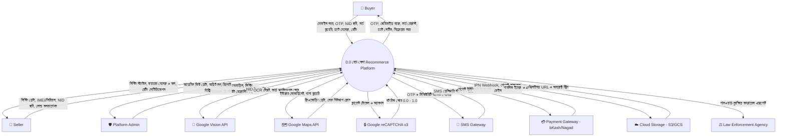
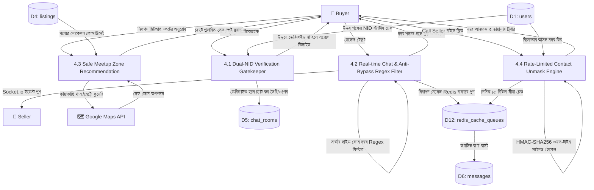
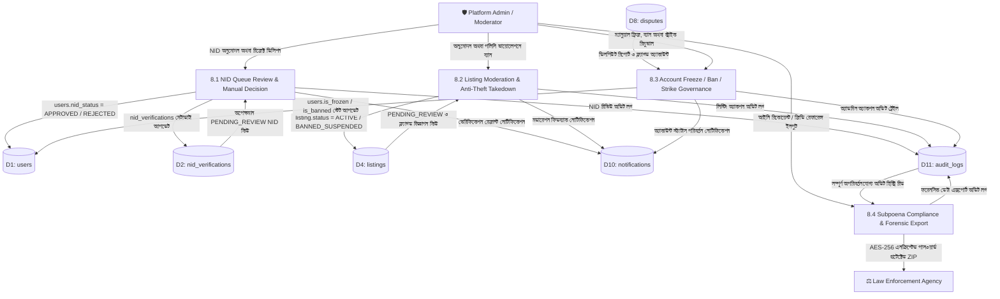

# বেচা-কেনা (Becha-Kena) — Data Flow Diagram (DFD) Specification
**ডকুমেন্ট ভার্সন:** 1.1.0 (Production DFD Master)  
**স্ট্যাটাস:** অনুমোদিত আর্কিটেকচারাল ব্লুপ্রিন্ট  
**রেফারেন্স ফাইলসমূহ:** `architecture.md`, `PRD.md`, `SPECIFICATION_P0_P1_P2.md`  

---

## ১. Context Diagram (Level 0 DFD)

Context Diagram (Level 0) সমগ্র বেচা-কেনা (Becha-Kena) সিস্টেমকে একটি একক কেন্দ্রীয় প্রসেস হিসেবে উপস্থাপন করে এবং এর সাথে যুক্ত সমস্ত বাহ্যিক সত্তা (External Entities) ও মূল ডেটা প্রবাহ (Data Flows) প্রদর্শন করে।

### ১.১ External Entities (বাহ্যিক সত্তাসমূহ)
1. **User (Buyer / Seller):** সাধারণ ক্রেতা ও বিক্রেতা যারা অ্যাকাউন্ট খোলা, NID যাচাই, বিজ্ঞাপন দেওয়া, অনুসন্ধান এবং চ্যাট পরিচালনা করেন।
2. **Platform Admin / Moderator:** ব্যাকঅফিস মডারেটর যারা NID অনুমোদন, লিস্টিং যাচাই, ডিসপিউট নিষ্পত্তি এবং ব্যবহারকারী ব্যান করেন।
3. **Google Cloud Vision API:** NID কার্ডের ছবি থেকে OCR ডেটা এক্সট্র্যাক্ট এবং টেম্পারিং শনাক্তকরণ ইঞ্জিন।
4. **Google Maps & Places API:** ভৌগোলিক অবস্থান অনুসন্ধান এবং নিরাপদ মিটআপ স্পট প্রস্তাবকারী সার্ভিস।
5. **Google reCAPTCHA v3:** বট আক্রমণ ও ব্রুট-ফোর্স স্ক্র্যাপিং প্রতিরোধ ব্যবস্থা।
6. **SMS Gateway (SSL Wireless / GP):** OTP কোড এবং নিরাপত্তা সতর্কবার্তা প্রেরণকারী টেলকো গেটওয়ে।
7. **Payment Gateway (bKash / Nagad PGW):** Featured Ad এবং Express ভেরিফিকেশনের পেমেন্ট প্রসেসর।
8. **Cloud Object Storage (AWS S3 / GCS):** পাবলিক পণ্যের ছবি এবং AES-256 এনক্রিপ্টেড প্রাইভেট NID বাকেট।
9. **Law Enforcement Agency (Bangladesh Police):** আইনি তদন্তে জিডি বা অফিসিয়াল রিকোয়েস্টে অডিট ডেটা গ্রহণকারী সংস্থা।

### ১.২ Context Diagram (Mermaid)



---

## ২. Level 1 DFD (Sub-System Decomposition)

লেভেল ১ ডায়াগ্রামে সিস্টেমের মূল কার্যক্রমকে ৮টি প্রধান সাব-প্রসেস এবং ১২টি কোর ডেটা স্টোরে বিভক্ত করা হয়েছে।

### ২.১ ডেটা স্টোর পরিচিতি (Data Stores)
* **D1 `users`:** ইউজার প্রোফাইল, ফোন, পাসওয়ার্ড হ্যাশ, ভেরিফিকেশন স্ট্যাটাস, স্ট্রাইক কাউন্টার।
* **D2 `nid_verifications`:** NID মেটাডাটা, OCR টেক্সট, হ্যাশ ও ৩০-দিনের ট্র্যাকিং।
* **D3 `categories`:** ক্যাটাগরি ও সাব-ক্যাটাগরি ট্রি এবং আবশ্যক ফিল্ড রুলস।
* **D4 `listings`:** বিজ্ঞাপনের বিবরণ, মূল্য, কন্ডিশন, IMEI/সিরিয়াল, লাইফসাইকেল স্টেট।
* **D5 `chat_rooms`:** ১-অন-১ চ্যাট রুম মেটাডাটা ও রুম স্ট্যাটাস।
* **D6 `messages`:** পৃথক মেসেজ রেকর্ড, কন্টেন্ট ও ফিল্টারিং ফ্ল্যাগ।
* **D7 `ratings`:** ডিল-পরবর্তী ১-৫ স্টার স্কোর ও লিখিত রিভিউ।
* **D8 `disputes`:** ৭২ ঘণ্টার ফ্রড রিপোর্ট, প্রমাণাদি ও তদন্ত স্টেট।
* **D9 `payments`:** লেনদেন আইডি, গেটওয়ে স্ট্যাটাস ও আইডেমপোটেন্সি কী।
* **D10 `notifications`:** ব্যবহারকারীদের ইন-অ্যাপ নোটিফিকেশন হিস্ট্রি।
* **D11 `audit_logs`:** অপরিবর্তনযোগ্য (Append-Only) সিকিউরিটি ও কমপ্লায়েন্স অডিট লগ।
* **D12 `redis_cache_queues`:** ওটিপি টিটিএল, সেশন ব্ল্যাকলিস্ট, রেট লিমিট এবং BullMQ কিউ।

### ২.২ Level 1 DFD (Mermaid)

```mermaid
flowchart TD
    %% Entities
    U[👤 Buyer / Seller]
    Adm[🛡️ Admin]
    GV[🤖 Google Vision API]
    GM[🗺️ Google Maps API]
    SMS[📱 SMS Gateway]
    PGW[💳 Payment Gateway]
    S3[☁️ Cloud Storage]

    %% Data Stores
    D1[(D1: users)]
    D2[(D2: nid_verifications)]
    D3[(D3: categories)]
    D4[(D4: listings)]
    D5[(D5: chat_rooms)]
    D6[(D6: messages)]
    D7[(D7: ratings)]
    D8[(D8: disputes)]
    D9[(D9: payments)]
    D10[(D10: notifications)]
    D11[(D11: audit_logs)]
    D12[(D12: redis_cache_queues)]

    %% Processes
    P1[1.0 Auth & NID KYC Engine]
    P2[2.0 Category & Listing Management]
    P3[3.0 Search & Geo-Discovery]
    P4[4.0 Chat & Contact Privacy Shield]
    P5[5.0 Transaction, Deal Close & Rating]
    P6[6.0 Post-Purchase Dispute Engine]
    P7[7.0 Payment & Monetization Processing]
    P8[8.0 Admin Governance & Audit Trail]

    %% P1 Flows
    U -->|মোবাইল নম্বর ও NID ছবি| P1
    P1 -->|OTP ক্যাশ ও রেট লিমিট| D12
    P1 -->|NID ইমেজ স্ট্রিম| GV
    GV -->|OCR টেক্সট ও কনফিডেন্স| P1
    P1 -->|এনক্রিপ্টেড ইমেজ| S3
    P1 -->|ইউজার প্রোফাইল ক্রিয়েট/আপডেট| D1
    P1 -->|ভেরিফিকেশন রেকর্ড ও হ্যাশ| D2
    P1 -->|SMS ট্রিগার| SMS
    P1 -->|অডিট ইভেন্ট| D11
    P1 -->|ভেরিফাইড টোকেন ও ব্যাজ| U

    %% P2 Flows
    U -->|লিস্টিং ফর্ম, ছবি, IMEI/সিরিয়াল| P2
    D3 -->|ফিল্ড রুলস ও ক্যাটাগরি লিস্ট| P2
    P2 -->|IMEI ডুপ্লিকেট চেক| D4
    P2 -->|পাবলিক ইমেজ আপলোড| S3
    P2 -->|লিস্টিং ড্রাফট/পেন্ডিং সেভ| D4
    P2 -->|লিস্টিং স্ট্যাটাস রেসপন্স| U

    %% P3 Flows
    U -->|সার্চ কীওয়ার্ড, লোকেশন ও রেডিয়াস| P3
    P3 -->|জিওকোডিং কুয়েরি| GM
    GM -->|স্থানাঙ্ক ও লোকেশন ডেটা| P3
    D4 -->|সক্রিয় বিজ্ঞাপন ও Featured লিস্টিং| P3
    P3 -->|সাজানো সার্চ ফলাফল| U

    %% P4 Flows
    U -->|চ্যাট রিকোয়েস্ট ও টেক্সট মেসেজ| P4
    D1 -->|উভয় পক্ষের NID স্ট্যাটাস ভ্যালিডেশন| P4
    P4 -->|Anti-Bypass Regex চেক ও মাস্কিং| D6
    P4 -->|রুম মেটাডাটা আপডেট| D5
    P4 -->|মেসেজ বাফার ও পাব-সাব| D12
    P4 -->|সেফ মিটআপ জোন সাজেস্ট| GM
    P4 -->|রেট-লিমিট চেক ও ফোন আনমাস্ক| D1
    P4 -->|রিয়েল-টাইম মেসেজ ও ফোন নম্বর| U

    %% P5 Flows
    U -->|Mark as Sold ও ক্রেতা নির্বাচন| P5
    P5 -->|লিস্টিং স্টেট 'SOLD' ও IMEI হিস্ট্রি আপডেট| D4
    P5 -->|চ্যাট রুম লক (Read-Only)| D5
    P5 -->|রেটিং ও রিভিউ জমা| D7
    P5 -->|ইউজার এভারেজ রেটিং ও ডিল কাউন্ট আপডেট| D1
    P5 -->|নোটিফিকেশন পুশ| D10

    %% P6 Flows
    U -->|৭২-ঘণ্টার ফ্রড রিপোর্ট ও প্রমাণ| P6
    P6 -->|ডিসপিউট টিকেট তৈরি| D8
    P6 -->|অভিযুক্ত সেলার অ্যাকাউন্ট সাময়িক ফ্রিজ| D1
    P6 -->|অ্যাডমিন রিভিউ কিউতে অ্যালার্ট| D10

    %% P7 Flows
    U -->|Featured Ad / Express NID রিকোয়েস্ট| P7
    P7 -->|পেমেন্ট ক্রিয়েট ও আইডেমপোটেন্সি কী| D9
    P7 -->|পেমেন্ট রিডাইরেক্ট ও হ্যান্ডশেক| PGW
    PGW -->|IPN Webhook ও ভেরিফিকেশন| P7
    P7 -->|বিজ্ঞাপন 'FEATURED' স্টেট আপডেট| D4
    P7 -->|লেনদেন রসিদ| U

    %% P8 Flows
    Adm -->|NID রিভিউ, মডারেশন ডিসিশন, ইউজার ব্যান| P8
    D2 -->|পেন্ডিং NID কিউ| P8
    D4 -->|রিভিউ পেন্ডিং লিস্টিং| P8
    D8 -->|ডিসপিউট প্রমাণাদি| P8
    P8 -->|লিস্টিং অনুমোদন/ব্যান| D4
    P8 -->|NID অনুমোদন/ব্ল্যাকলিস্ট| D1
    P8 -->|অপরিবর্তনযোগ্য কমপ্লায়েন্স লগ| D11
    D11 -->|অডিট রিপোর্ট ও সাবপিনা এক্সপোর্ট| Adm
```

---

## ৩. Level 2 DFD (Detailed Process Decomposition)

এখানে সিস্টেমের সবচেয়ে গুরুত্বপূর্ণ ৩টি সাব-প্রসেসের অভ্যন্তরীণ ডেটা প্রবাহ বিস্তারিতভাবে দেখানো হলো।

### ৩.১ Process 1.0: User Authentication & NID KYC Verification

```mermaid
flowchart TD
    %% Entities
    U[👤 User]
    SMS[📱 SMS Gateway]
    GV[🤖 Google Vision API]
    S3[☁️ Private Cloud Storage]

    %% Data Stores
    D1[(D1: users)]
    D2[(D2: nid_verifications)]
    D11[(D11: audit_logs)]
    D12[(D12: redis_cache_queues)]

    %% Sub-processes
    P1_1[1.1 Initiate Phone Registration & OTP]
    P1_2[1.2 Validate OTP & Create Session]
    P1_3[1.3 NID OCR Processing & Verification Gate]
    P1_4[1.4 Parental Consent Verification for Minors]

    %% Flows
    U -->|মোবাইল নম্বর| P1_1
    P1_1 -->|ওটিপি ও রেট-লিমিট কাউন্টার সেভ| D12
    P1_1 -->|SMS রিকোয়েস্ট| SMS
    SMS -->|OTP কোড SMS| U

    U -->|ইনপুট OTP ও পাসওয়ার্ড| P1_2
    P1_2 -->|ওটিপি রিড ও ম্যাচিং| D12
    P1_2 -->|ইউজার অ্যাকাউন্ট ক্রিয়েট (UNVERIFIED)| D1
    P1_2 -->|সেশন টোকেন ও রিফ্রেশ কুকি| U

    U -->|NID ফ্রন্ট ও ব্যাক ফটো (Adult 18+)| P1_3
    P1_3 -->|ইমেজ মেটাডাটা স্ট্রিপ ও AES-256 এনক্রিপ্ট| S3
    P1_3 -->|OCR ইমেজ স্ট্রিম| GV
    GV -->|এক্সট্র্যাক্ট করা নাম, NID ও জন্মতারিখ| P1_3
    P1_3 -->|ডুপ্লিকেট NID চেক| D2
    P1_3 -->|ভেরিফিকেশন স্ট্যাটাস APPROVED| D1
    P1_3 -->|NID হ্যাশ ও ৩০-দিনের মেটাডাটা সেভ| D2
    P1_3 -->|অডিট ইভেন্ট লগ| D11

    U -->|পিতা/মাতার NID ও অভিভাবকের ফোন| P1_4
    P1_4 -->|অভিভাবকের নম্বরে সম্মতি OTP| SMS
    P1_4 -->|অভিভাবকের অনুমোদন ও অ্যাকাউন্ট গ্রুপিং (Max 2)| D1
    P1_4 -->|Parental Verified (Minor) স্ট্যাটাস| D1
```

---

### ৩.২ Process 2.0: Category & Listing Lifecycle Management

```mermaid
flowchart TD
    %% Entities
    U[👤 Seller]
    S3[☁️ Public Cloud Storage]

    %% Data Stores
    D1[(D1: users)]
    D3[(D3: categories)]
    D4[(D4: listings)]
    D11[(D11: audit_logs)]

    %% Sub-processes
    P2_1[2.1 Category Field Validation]
    P2_2[2.2 Anti-Theft IMEI / Serial Check]
    P2_3[2.3 Listing Creation & Media Upload]
    P2_4[2.4 Listing State Transition Engine]

    %% Flows
    U -->|নির্বাচিত ক্যাটাগরি ও ফর্ম ইনপুট| P2_1
    D3 -->|আবশ্যক ফিল্ড ম্যাপিং (e.g. IMEI for Smartphones)| P2_1
    P2_1 -->|যাচাইকৃত ফিল্ড ডাটা| P2_2

    P2_2 -->|Luhn অ্যালগরিদম ভ্যালিডেশন ও ডুপ্লিকেট কুয়েরি| D4
    P2_2 -->|IMEI সক্রিয় পাওয়া গেলে এরর থ্রো| U
    P2_2 -->|IMEI ক্লিয়ারেন্স| P2_3

    U -->|পণ্যের ছবি (WebP)| P2_3
    P2_3 -->|পাবলিক ইমেজ স্টোরেজ| S3
    P2_3 -->|নতুন লিস্টিং সেভ (PENDING_REVIEW)| D4

    U -->|Reserved / Sold / Cancel Reservation অ্যাকশন| P2_4
    D1 -->|সেলার ওনারশিপ চেক (IDOR Protection)| P2_4
    P2_4 -->|লিস্টিং স্টেট আপডেট| D4
    P2_4 -->|IMEI Relist / Sold হিস্ট্রি ট্রানজিশন| D4
    P2_4 -->|স্টেট ট্রানজিশন অডিট লগ| D11
```

---

### ৩.৩ Process 4.0: In-App Messaging & Contact Privacy Shield



---

### ৩.৪ Process 5.0: Transaction, Deal Close & Mutual Rating Engine

```mermaid
flowchart TD
    %% Entities
    Seller[👤 Seller]
    Buyer[👤 Buyer]

    %% Data Stores
    D1[(D1: users)]
    D4[(D4: listings)]
    D5[(D5: chat_rooms)]
    D7[(D7: ratings)]
    D10[(D10: notifications)]
    D11[(D11: audit_logs)]

    %% Sub-processes
    P5_1[5.1 Mark-as-Sold & Buyer Selection]
    P5_2[5.2 Atomic Deal Finalization Transaction]
    P5_3[5.3 Rating Window Initialization & Review Submission]
    P5_4[5.4 Trust Score Recalculation & Badge Evaluation]

    %% Flows
    Seller -->|Mark as Sold + Buyer নির্বাচন| P5_1
    D1 -->|সেলার ওনারশিপ ও NID স্ট্যাটাস ভ্যালিডেশন (IDOR Guard)| P5_1
    P5_1 -->|বৈধতা নিশ্চিত হলে অ্যাটমিক ট্রানজ্যাকশন ট্রিগার| P5_2

    P5_2 -->|listings.status = SOLD| D4
    P5_2 -->|chat_rooms.status = LOCKED| D5
    P5_2 -->|২টি পেন্ডিং রেটিং রেকর্ড তৈরি (Window: 7 Days)| D7
    P5_2 -->|completed_deals_count + 1| D1
    P5_2 -->|অপরিবর্তনযোগ্য DEAL_SOLD অডিট লগ| D11
    P5_2 -->|বিক্রয় সম্পন্ন নোটিফিকেশন| D10

    Buyer -->|১-৫ স্টার স্কোর ও রিভিউ জমা (Buyer to Seller)| P5_3
    Seller -->|১-৫ স্টার স্কোর ও রিভিউ জমা (Seller to Buyer)| P5_3
    D7 -->|window_expires_at চেক (৭ দিন মেয়াদ)| P5_3
    P5_3 -->|রেটিং ও রিভিউ সেভ| D7
    P5_3 -->|রেটিং প্রাপ্তির নোটিফিকেশন| D10

    D7 -->|সেলার/বায়ারের সমস্ত রেটিং হিস্ট্রি কুয়েরি| P5_4
    P5_4 -->|rating_average ও rating_count পুনর্গণনা| D1
    P5_4 -->|Top Seller ব্যাজ যাচাই (Avg >= 4.5 & Deals >= 5)| D1
```

---

### ৩.৫ Process 6.0: Post-Purchase Dispute & Fraud Investigation Engine

```mermaid
flowchart TD
    %% Entities
    Buyer[👤 Buyer - Plaintiff]
    Seller[👤 Seller - Defendant]
    Adm[🛡️ Admin / Moderator]

    %% Data Stores
    D1[(D1: users)]
    D4[(D4: listings)]
    D8[(D8: disputes)]
    D10[(D10: notifications)]
    D11[(D11: audit_logs)]

    %% Sub-processes
    P6_1[6.1 72-Hour Fraud Report Intake & Validation]
    P6_2[6.2 Defendant Account Freeze & Admin Alert]
    P6_3[6.3 Admin Investigation & Evidence Review]
    P6_4[6.4 Resolution Verdict & Penalty Enforcement]

    %% Flows
    Buyer -->|অভিযোগের কারণ, বিবরণ ও প্রমাণের লিংক| P6_1
    D4 -->|listing.status = SOLD ও ক্রয় টাইমস্ট্যাম্প চেক| P6_1
    P6_1 -->|৭২ ঘণ্টা অতিক্রান্ত হলে আবেদন বাতিল| Buyer
    P6_1 -->|বৈধ হলে OPEN স্ট্যাটাসে ডিসপিউট টিকেট তৈরি| D8

    D8 -->|নতুন ওপেন ডিসপিউট ইভেন্ট| P6_2
    P6_2 -->|অভিযুক্ত সেলার অ্যাকাউন্ট সাময়িক ফ্রিজ (is_frozen=true)| D1
    P6_2 -->|অ্যাডমিন ইনভেস্টিগেশন কিউতে পুশ| D10
    P6_2 -->|অ্যাকাউন্ট ফ্রিজ অডিট লগ| D11
    P6_2 -->|সেলার ও বায়ারকে ফ্রিজ অ্যালার্ট নোটিফিকেশন| D10

    Adm -->|তদন্ত শুরু ও পর্যবেক্ষণ নোট| P6_3
    D8 -->|প্রমাণাদি ও অভিযোগের বিবরণ লোড| P6_3
    D1 -->|উভয় পক্ষের অতীত ট্র্যাক রেকর্ড ও স্ট্রাইক হিস্ট্রি| P6_3
    P6_3 -->|dispute.status = UNDER_INVESTIGATION| D8

    Adm -->|চূড়ান্ত রায়: BUYER_WIN / SELLER_WIN / DISMISSED| P6_4
    P6_4 -->|dispute.status = RESOLVED_*| D8
    P6_4 -->|BUYER_WIN: সেলারের strikes_count+1 (৩ হলে BANNED), আনফ্রিজ| D1
    P6_4 -->|DISMISSED: মিথ্যা অভিযোগকারীর warnings_count+1| D1
    P6_4 -->|উভয় পক্ষকে চূড়ান্ত রায়ের নোটিফিকেশন| D10
    P6_4 -->|ডিসপিউট রেজোলিউশন অডিট লগ| D11
```

---

### ৩.৬ Process 7.0: Payment & Monetization Processing

```mermaid
flowchart TD
    %% Entities
    U[👤 Seller / User]
    PGW[💳 Payment Gateway - bKash / Nagad]

    %% Data Stores
    D4[(D4: listings)]
    D9[(D9: payments)]
    D10[(D10: notifications)]
    D11[(D11: audit_logs)]
    D12[(D12: redis_cache_queues)]

    %% Sub-processes
    P7_1[7.1 Payment Intent Creation & Idempotency Guard]
    P7_2[7.2 Gateway Session Handshake & Redirect]
    P7_3[7.3 IPN Webhook Verification & HMAC Guard]
    P7_4[7.4 Post-Payment Value Delivery & Activation]

    %% Flows
    U -->|সার্ভিস নির্বাচন: Featured Ad / Urgent / Express NID| P7_1
    D9 -->|idempotency_key ডুপ্লিকেট চেক| P7_1
    P7_1 -->|১০ মিনিটের Idempotency লক সেভ| D12
    P7_1 -->|PENDING পেমেন্ট রেকর্ড ইনিশিয়ালাইজ| D9
    P7_1 -->|পেমেন্ট ক্রিয়েট রিকোয়েস্ট| P7_2

    P7_2 -->|API কল: createPayment| PGW
    PGW -->|Redirect URL ও গেটওয়ে সেশন টোকেন| P7_2
    P7_2 -->|রিডাইরেক্ট ইউজার টু গেটওয়ে পেজ| U

    PGW -->|IPN Webhook কলব্যাক (TXN ID + HMAC Sig)| P7_3
    P7_3 -->|HMAC-SHA256 সিগনেচার যাচাই| P7_3
    P7_3 -->|ইতোমধ্যে প্রসেসড কি না চেক| D9
    P7_3 -->|payment.status = SUCCESS / FAILED আপডেট| D9

    D9 -->|সফল পেমেন্ট ইভেন্ট ট্রিগার| P7_4
    P7_4 -->|Featured Ad হলে: is_featured=true ও মেয়াদ নির্ধারণ| D4
    P7_4 -->|Express NID হলে: প্রায়োরিটি কিউ ট্রিগার| D12
    P7_4 -->|ডিজিটাল মানি রসিদ ও নোটিফিকেশন| D10
    P7_4 -->|পেমেন্ট অডিট লগ সংরক্ষণ| D11
```

---

### ৩.৭ Process 8.0: Admin Governance & Law Enforcement Audit Trail



---

## ৪. Data Dictionary (ডেটা ডিকশনারি)

### ৪.১ Composite Data Elements

* **`User_Registration_Payload`**  
  `phone_number` + `password_hash` + `full_name` + `device_fingerprint` + `client_recaptcha_token`

* **`NID_Verification_Payload`**  
  `user_id` + `nid_number` + `date_of_birth` + `front_image_file` + `back_image_file` + `is_parental_consent` + `[guardian_phone_number]`

* **`Product_Listing_Payload`**  
  `seller_id` + `title` + `description` + `category_id` + `price` + `is_negotiable` + `condition` + `location_coords` + `photo_urls` + `[imei_number]` + `[serial_number]` + `[cash_memo_photo_url]`

* **`Chat_Message_Payload`**  
  `chat_room_id` + `sender_id` + `content` + `content_type` (`TEXT` | `SYSTEM_ALERT` | `PRICE_CHANGE_NOTICE`) + `client_timestamp`

* **`Deal_Completion_Payload`**  
  `listing_id` + `seller_id` + `buyer_id` + `final_price` + `completion_timestamp`

* **`Rating_Review_Payload`**  
  `deal_id` + `reviewer_id` + `reviewee_id` + `score` (1-5) + `comment` + `tag_list`

* **`Dispute_Ticket_Payload`**  
  `deal_id` + `buyer_id` + `seller_id` + `dispute_reason` + `evidence_media_urls` + `status` (`OPEN`)

* **`Payment_Initiation_Payload`**  
  `user_id` + `listing_id` + `amount` + `currency` (`BDT`) + `payment_type` (`FEATURED_AD` | `EXPRESS_VERIFY`) + `idempotency_key`

* **`Admin_Moderation_Decision_Payload`**  
  `target_type` (`NID` | `LISTING` | `USER` | `DISPUTE`) + `target_id` + `action_code` (`APPROVE` | `REJECT` | `BAN` | `UNFREEZE`) + `reason_notes` + `admin_id` + `timestamp`

* **`Payment_IPN_Callback_Payload`**  
  `gateway_tx_id` + `idempotency_key` + `status` (`SUCCESS` | `FAILED`) + `amount` + `currency` (`BDT`) + `hmac_signature` + `callback_timestamp`

* **`Subpoena_Export_Request_Payload`**  
  `requesting_officer_id` + `case_reference_number` + `target_user_ids` + `date_range_start` + `date_range_end` + `requesting_authority` + `export_password`

---

## ৫. Data Flow Table (ডেটা প্রবাহ সারণী)

| Flow ID | ডেটা প্রবাহের নাম | উৎস (Source) | গন্তব্য (Destination) | অন্তর্ভুক্ত ডেটাসমূহ |
| :---: | :--- | :--- | :--- | :--- |
| **DF-01** | Reg_Request | User | P1.1 | `phone_number`, `password`, `recaptcha_token` |
| **DF-02** | OTP_Sms_Out | P1.1 | SMS Gateway | `phone_number`, `otp_code`, `template_id` |
| **DF-03** | NID_Upload_Stream | User | P1.3 | `nid_number`, `dob`, `front_img`, `back_img` |
| **DF-04** | OCR_Extracted_Data | Google Vision | P1.3 | `extracted_name`, `extracted_nid`, `confidence_score` |
| **DF-05** | Listing_Form_Submit | Seller | P2.1 | `title`, `price`, `category_id`, `imei_number`, `coords` |
| **DF-06** | Search_Query_In | Buyer | P3.0 | `keyword`, `category_slug`, `user_lat_lng`, `radius_km` |
| **DF-07** | Chat_Msg_Send | Buyer/Seller | P4.2 | `room_id`, `sender_id`, `message_text` |
| **DF-08** | Contact_Reveal_Req | Buyer | P4.4 | `listing_id`, `buyer_jwt_token` |
| **DF-09** | Mark_Sold_Command | Seller | P5.1 | `listing_id`, `selected_buyer_id` |
| **DF-10** | Buyer_Rating_Submit | Buyer | P5.3 | `deal_id`, `rating_score_1_to_5`, `review_text`, `role_type: BUYER_TO_SELLER` |
| **DF-11** | Fraud_Ticket_Open | Buyer | P6.1 | `deal_id`, `seller_id`, `reason_code`, `proof_urls` |
| **DF-12** | Payment_IPN_Webhook | bKash/Nagad | P7.3 | `gateway_tx_id`, `idempotency_key`, `status_success`, `hmac_sig` |
| **DF-13** | Admin_Moderation_Act | Admin | P8.1-P8.3 | `target_id`, `action_code` (APPROVE/REJECT/BAN) |
| **DF-14** | Subpoena_Export_Out | P8.4 | Law Enforcement | Password-protected ZIP (NID, Chat Logs, IP History) |
| **DF-15** | Seller_Rating_Submit | Seller | P5.3 | `deal_id`, `rating_score_1_to_5`, `review_text`, `role_type: SELLER_TO_BUYER` |
| **DF-16** | Payment_Intent_Create | User | P7.1 | `payment_type`, `listing_id`, `amount`, `gateway`, `idempotency_key` |
| **DF-17** | Dispute_Status_Update | P6.4 | D8, D1, D10 | `dispute_id`, `verdict`, `strike_applied`, `resolution_notes` |

---

## ৬. Process Table (প্রসেস সারণী)

| Process ID | প্রসেসের নাম | ইনপুট ফ্লো | আউটপুট ফ্লো | মূল দায়িত্ব ও রূপান্তর লজিক |
| :---: | :--- | :--- | :--- | :--- |
| **1.0** | Auth & NID KYC Engine | DF-01, DF-03, DF-04 | DF-02, User Record, Token | ব্যবহারকারী সাইন-আপ, OTP যাচাই, NID OCR ও প্যারেন্টাল সম্মতি নিশ্চিত করা (1.1, 1.2, 1.3, 1.4)। |
| **2.0** | Category & Listing Mgmt | DF-05, Categories | Listing Record, Image URLs | ক্যাটাগরি অনুযায়ী IMEI/সিরিয়াল যাচাই, ইমেজ কম্প্রেশন ও লিস্টিং লাইফসাইকেল নিয়ন্ত্রণ (2.1, 2.2, 2.3, 2.4)। |
| **3.0** | Search & Geo-Discovery | DF-06, Listings | Sorted Search Result | জিও-রেডিয়াস (১০ কি.মি.) এবং কীওয়ার্ড অনুযায়ী Featured ও অর্গানিক বিজ্ঞাপন র‍্যাঙ্কিং। |
| **4.0** | Chat & Contact Privacy | DF-07, DF-08 | DF-07, Unmasked Phone | উভয় পক্ষের ভেরিফিকেশন চেক, চ্যাটে নম্বর ফিল্টারিং ও দিনে ১৫ বার ক্লিক-টু-কল লিমিট (4.1, 4.2, 4.3, 4.4)। |
| **5.0** | Deal Close & Rating | DF-09, DF-10, DF-15 | D4 (SOLD), D5 (LOCKED), D7, D1 | বিজ্ঞাপন Sold মার্ক করা (5.1), অ্যাটমিক ট্রানজ্যাকশন (5.2), রেটিং সংগ্রহ (5.3) ও ট্রাস্ট স্কোর গণনা (5.4)। |
| **6.0** | Post-Purchase Dispute | DF-11 | D8 Record, Frozen Account, D10 | ৭২ ঘণ্টার মধ্যে অভিযোগ ইনটেক (6.1), সেলার অ্যাকাউন্ট ফ্রিজ (6.2), অ্যাডমিন রিভিউ (6.3) ও রায়/স্ট্রাইক (6.4)। |
| **7.0** | Payment & Monetization | DF-16, DF-12 | D9 Record, Featured State, D10 | পেমেন্ট ইন্টেন্ট (7.1), গেটওয়ে রিডাইরেক্ট (7.2), IPN ভেরিফিকেশন (7.3) ও পেইড বেনিফিট এক্টিভেশন (7.4)। |
| **8.0** | Admin Governance & Audit | DF-13, Queue Data | D1 (NID), D4 (Listing), D11, DF-14 | NID রিভিউ (8.1), লিস্টিং মডারেশন (8.2), অ্যাকাউন্ট স্ট্রাইক (8.3) ও ফরেনসিক কমপ্লায়েন্স এক্সপোর্ট (8.4)। |

---

## ৭. Data Store Table (ডেটা স্টোর সারণী)

| Store ID | ডেটা স্টোরের নাম | সংরক্ষণের মাধ্যম | মূল ফিল্ডসমূহ | ইনডেক্সিং ও পার্জিং পলিসি |
| :---: | :--- | :--- | :--- | :--- |
| **D1** | `users` | MongoDB Atlas | `_id`, `phone`, `password_hash`, `nid_status`, `role`, `strikes` | `phone: unique`, `{ role: 1, is_banned: 1 }` |
| **D2** | `nid_verifications` | MongoDB Atlas | `user_id`, `nid_hash`, `ocr_data`, `image_ref`, `verified_at` | `nid_hash: unique`, `verified_at` (৩০ দিন পর ক্রন দ্বারা ইমেজ পার্জ, কিউ বা TTL) |
| **D3** | `categories` | MongoDB Atlas | `_id`, `name_bn`, `name_en`, `required_fields`, `is_active` | `{ parent_id: 1, is_active: 1 }`, `slug: unique` |
| **D4** | `listings` | MongoDB Atlas | `_id`, `seller_id`, `title`, `price`, `imei_number`, `status`, `loc` | `loc: 2dsphere`, `imei_number: partial unique`, `{ is_featured: -1, created_at: -1 }` |
| **D5** | `chat_rooms` | MongoDB Atlas | `_id`, `listing_id`, `buyer_id`, `seller_id`, `status` (`ACTIVE`/`LOCKED`) | `{ buyer_id: 1, seller_id: 1, listing_id: 1 } (Unique)` |
| **D6** | `messages` | MongoDB Atlas | `_id`, `chat_room_id`, `sender_id`, `content`, `is_filtered`, `is_archived` | `{ chat_room_id: 1, created_at: -1 }`, `{ created_at: 1, is_archived: 1 }` (৯০ দিন পর ব্যাচ আর্কাইভ) |
| **D7** | `ratings` | MongoDB Atlas | `_id`, `listing_id`, `reviewer_id`, `reviewee_id`, `score`, `comment`, `window_expires_at` | `{ listing_id: 1, reviewer_id: 1 } (Unique)`, `{ window_expires_at: 1 }` (৭ দিন মেয়াদ) |
| **D8** | `disputes` | MongoDB Atlas | `_id`, `listing_id`, `plaintiff_id`, `defendant_id`, `status`, `proofs` | `{ status: 1, created_at: -1 }`, `{ defendant_id: 1 }` |
| **D9** | `payments` | MongoDB Atlas | `_id`, `user_id`, `amount`, `gateway_tx_id`, `idempotency_key` | `idempotency_key: unique` (১০ মিনিট Redis TTL) |
| **D10** | `notifications` | MongoDB Atlas | `_id`, `user_id`, `title`, `message`, `is_read`, `created_at` | `{ user_id: 1, is_read: 1, created_at: -1 }`, `{ created_at: 1 }` (৩০ দিন TTL auto-purge) |
| **D11** | `audit_logs` | MongoDB Atlas | `_id`, `actor_id`, `action`, `target_entity`, `ip`, `timestamp` | Append-Only, Read-Only Schema, ৩ বছর রিটেনশন |
| **D12** | `redis_cache_queues` | Redis Cluster | OTP TTL (120s), Session Blacklist, Rate Counters, BullMQ Queues | In-Memory, Key Expiry, Eviction Policy |

---

## ৮. Draw.io XML (Complete & Importable)

নিচের XML কোডটি সরাসরি কপি করে **diagrams.net** অথবা **draw.io**-তে `File -> Import From -> XML` অথবা `Arrange -> Insert -> Advanced -> XML` দিয়ে ওপেন করলে স্বয়ংক্রিয়ভাবে পূর্ণাঙ্গ Context ও Level 1 DFD রেন্ডার হবে:

```xml
<mxfile host="app.diagrams.net" modified="2026-10-19T20:06:00.000Z" agent="Mozilla/5.0" version="21.0.0" type="device">
  <diagram id="BechaKena-DFD" name="Becha-Kena Level 1 DFD">
    <mxGraphModel dx="1422" dy="794" grid="1" gridSize="10" guides="1" tooltips="1" connect="1" arrows="1" fold="1" page="1" pageScale="1" pageWidth="1169" pageHeight="827" background="#ffffff">
      <root>
        <mxCell id="0"/>
        <mxCell id="1" parent="0"/>

        <!-- External Entities -->
        <mxCell id="E1" value="👤 Buyer" style="rounded=0;whiteSpace=wrap;html=1;fillColor=#dae8fc;strokeColor=#6c8ebf;fontStyle=1" vertex="1" parent="1">
          <mxGeometry x="40" y="220" width="120" height="60" as="geometry"/>
        </mxCell>
        <mxCell id="E2" value="👤 Seller" style="rounded=0;whiteSpace=wrap;html=1;fillColor=#dae8fc;strokeColor=#6c8ebf;fontStyle=1" vertex="1" parent="1">
          <mxGeometry x="40" y="420" width="120" height="60" as="geometry"/>
        </mxCell>
        <mxCell id="E3" value="🛡️ Platform Admin" style="rounded=0;whiteSpace=wrap;html=1;fillColor=#f8cecc;strokeColor=#b85450;fontStyle=1" vertex="1" parent="1">
          <mxGeometry x="1000" y="320" width="130" height="60" as="geometry"/>
        </mxCell>
        <mxCell id="E4" value="🤖 Google Vision API" style="rounded=0;whiteSpace=wrap;html=1;fillColor=#fff2cc;strokeColor=#d6b656;" vertex="1" parent="1">
          <mxGeometry x="40" y="60" width="140" height="50" as="geometry"/>
        </mxCell>
        <mxCell id="E5" value="📱 SMS Gateway" style="rounded=0;whiteSpace=wrap;html=1;fillColor=#fff2cc;strokeColor=#d6b656;" vertex="1" parent="1">
          <mxGeometry x="360" y="40" width="120" height="50" as="geometry"/>
        </mxCell>
        <mxCell id="E6" value="💳 bKash / Nagad PGW" style="rounded=0;whiteSpace=wrap;html=1;fillColor=#fff2cc;strokeColor=#d6b656;" vertex="1" parent="1">
          <mxGeometry x="840" y="640" width="140" height="50" as="geometry"/>
        </mxCell>

        <!-- Core Processes -->
        <mxCell id="P1" value="1.0&#xa;Auth &amp; NID KYC&#xa;Engine" style="ellipse;whiteSpace=wrap;html=1;fillColor=#d5e8d4;strokeColor=#82b366;fontStyle=1" vertex="1" parent="1">
          <mxGeometry x="240" y="140" width="110" height="110" as="geometry"/>
        </mxCell>
        <mxCell id="P2" value="2.0&#xa;Category &amp;&#xa;Listing Mgmt" style="ellipse;whiteSpace=wrap;html=1;fillColor=#d5e8d4;strokeColor=#82b366;fontStyle=1" vertex="1" parent="1">
          <mxGeometry x="240" y="390" width="110" height="110" as="geometry"/>
        </mxCell>
        <mxCell id="P3" value="3.0&#xa;Search &amp; Geo-&#xa;Discovery" style="ellipse;whiteSpace=wrap;html=1;fillColor=#d5e8d4;strokeColor=#82b366;fontStyle=1" vertex="1" parent="1">
          <mxGeometry x="450" y="270" width="110" height="110" as="geometry"/>
        </mxCell>
        <mxCell id="P4" value="4.0&#xa;Chat &amp; Contact&#xa;Privacy Shield" style="ellipse;whiteSpace=wrap;html=1;fillColor=#d5e8d4;strokeColor=#82b366;fontStyle=1" vertex="1" parent="1">
          <mxGeometry x="640" y="200" width="110" height="110" as="geometry"/>
        </mxCell>
        <mxCell id="P5" value="5.0&#xa;Deal Close &amp;&#xa;Mutual Rating" style="ellipse;whiteSpace=wrap;html=1;fillColor=#d5e8d4;strokeColor=#82b366;fontStyle=1" vertex="1" parent="1">
          <mxGeometry x="640" y="420" width="110" height="110" as="geometry"/>
        </mxCell>
        <mxCell id="P6" value="6.0&#xa;Dispute &amp; Fraud&#xa;Engine" style="ellipse;whiteSpace=wrap;html=1;fillColor=#d5e8d4;strokeColor=#82b366;fontStyle=1" vertex="1" parent="1">
          <mxGeometry x="840" y="420" width="110" height="110" as="geometry"/>
        </mxCell>
        <mxCell id="P7" value="7.0&#xa;Payment &amp;&#xa;Monetization" style="ellipse;whiteSpace=wrap;html=1;fillColor=#d5e8d4;strokeColor=#82b366;fontStyle=1" vertex="1" parent="1">
          <mxGeometry x="640" y="600" width="110" height="110" as="geometry"/>
        </mxCell>
        <mxCell id="P8" value="8.0&#xa;Admin Governance&#xa;&amp; Audit Trail" style="ellipse;whiteSpace=wrap;html=1;fillColor=#d5e8d4;strokeColor=#82b366;fontStyle=1" vertex="1" parent="1">
          <mxGeometry x="840" y="200" width="110" height="110" as="geometry"/>
        </mxCell>

        <!-- Data Stores -->
        <mxCell id="D1" value="D1: users" style="shape=partialRectangle;top=0;left=0;right=0;bottom=1;align=center;verticalAlign=middle;fillColor=#e1d5e7;strokeColor=#9673a6;fontStyle=1" vertex="1" parent="1">
          <mxGeometry x="440" y="160" width="120" height="30" as="geometry"/>
        </mxCell>
        <mxCell id="D2" value="D2: nid_verifications" style="shape=partialRectangle;top=0;left=0;right=0;bottom=1;align=center;verticalAlign=middle;fillColor=#e1d5e7;strokeColor=#9673a6;fontStyle=1" vertex="1" parent="1">
          <mxGeometry x="235" y="60" width="120" height="30" as="geometry"/>
        </mxCell>
        <mxCell id="D4" value="D4: listings" style="shape=partialRectangle;top=0;left=0;right=0;bottom=1;align=center;verticalAlign=middle;fillColor=#e1d5e7;strokeColor=#9673a6;fontStyle=1" vertex="1" parent="1">
          <mxGeometry x="440" y="430" width="120" height="30" as="geometry"/>
        </mxCell>
        <mxCell id="D6" value="D6: messages" style="shape=partialRectangle;top=0;left=0;right=0;bottom=1;align=center;verticalAlign=middle;fillColor=#e1d5e7;strokeColor=#9673a6;fontStyle=1" vertex="1" parent="1">
          <mxGeometry x="635" y="120" width="120" height="30" as="geometry"/>
        </mxCell>
        <mxCell id="D7" value="D7: ratings" style="shape=partialRectangle;top=0;left=0;right=0;bottom=1;align=center;verticalAlign=middle;fillColor=#e1d5e7;strokeColor=#9673a6;fontStyle=1" vertex="1" parent="1">
          <mxGeometry x="635" y="560" width="120" height="30" as="geometry"/>
        </mxCell>
        <mxCell id="D8" value="D8: disputes" style="shape=partialRectangle;top=0;left=0;right=0;bottom=1;align=center;verticalAlign=middle;fillColor=#e1d5e7;strokeColor=#9673a6;fontStyle=1" vertex="1" parent="1">
          <mxGeometry x="835" y="560" width="120" height="30" as="geometry"/>
        </mxCell>
        <mxCell id="D11" value="D11: audit_logs" style="shape=partialRectangle;top=0;left=0;right=0;bottom=1;align=center;verticalAlign=middle;fillColor=#e1d5e7;strokeColor=#9673a6;fontStyle=1" vertex="1" parent="1">
          <mxGeometry x="835" y="120" width="120" height="30" as="geometry"/>
        </mxCell>

        <!-- Connectors / Data Flows -->
        <mxCell id="F1" value="Phone, NID" style="edgeStyle=orthogonalEdgeStyle;rounded=0;orthogonalLoop=1;jettySize=auto;html=1;exitX=1;exitY=0.5;entryX=0;entryY=0.5;" edge="1" source="E1" target="P1" parent="1">
          <mxGeometry relative="1" as="geometry"/>
        </mxCell>
        <mxCell id="F2" value="NID Image" style="edgeStyle=orthogonalEdgeStyle;rounded=0;orthogonalLoop=1;jettySize=auto;html=1;exitX=0.5;exitY=0;entryX=1;entryY=0.5;" edge="1" source="P1" target="E4" parent="1">
          <mxGeometry relative="1" as="geometry"/>
        </mxCell>
        <mxCell id="F3" value="Send OTP" style="edgeStyle=orthogonalEdgeStyle;rounded=0;orthogonalLoop=1;jettySize=auto;html=1;exitX=1;exitY=0;entryX=0;entryY=0.5;" edge="1" source="P1" target="E5" parent="1">
          <mxGeometry relative="1" as="geometry"/>
        </mxCell>
        <mxCell id="F4" value="Save Profile" style="edgeStyle=orthogonalEdgeStyle;rounded=0;orthogonalLoop=1;jettySize=auto;html=1;exitX=1;exitY=0.5;entryX=0;entryY=0.5;" edge="1" source="P1" target="D1" parent="1">
          <mxGeometry relative="1" as="geometry"/>
        </mxCell>
        <mxCell id="F5" value="Save NID Hash" style="edgeStyle=orthogonalEdgeStyle;rounded=0;orthogonalLoop=1;jettySize=auto;html=1;exitX=0.5;exitY=0;entryX=0.5;entryY=1;" edge="1" source="P1" target="D2" parent="1">
          <mxGeometry relative="1" as="geometry"/>
        </mxCell>
        <mxCell id="F6" value="Listing Form &amp; IMEI" style="edgeStyle=orthogonalEdgeStyle;rounded=0;orthogonalLoop=1;jettySize=auto;html=1;exitX=1;exitY=0.5;entryX=0;entryY=0.5;" edge="1" source="E2" target="P2" parent="1">
          <mxGeometry relative="1" as="geometry"/>
        </mxCell>
        <mxCell id="F7" value="Save Listing" style="edgeStyle=orthogonalEdgeStyle;rounded=0;orthogonalLoop=1;jettySize=auto;html=1;exitX=1;exitY=0.5;entryX=0;entryY=0.5;" edge="1" source="P2" target="D4" parent="1">
          <mxGeometry relative="1" as="geometry"/>
        </mxCell>
        <mxCell id="F8" value="Search Listings" style="edgeStyle=orthogonalEdgeStyle;rounded=0;orthogonalLoop=1;jettySize=auto;html=1;exitX=0.5;exitY=0;entryX=0.5;entryY=1;" edge="1" source="D4" target="P3" parent="1">
          <mxGeometry relative="1" as="geometry"/>
        </mxCell>
        <mxCell id="F9" value="Results" style="edgeStyle=orthogonalEdgeStyle;rounded=0;orthogonalLoop=1;jettySize=auto;html=1;exitX=0;exitY=0.5;entryX=1;entryY=1;" edge="1" source="P3" target="E1" parent="1">
          <mxGeometry relative="1" as="geometry"/>
        </mxCell>
        <mxCell id="F10" value="Filter &amp; Chat" style="edgeStyle=orthogonalEdgeStyle;rounded=0;orthogonalLoop=1;jettySize=auto;html=1;exitX=0.5;exitY=0;entryX=0.5;entryY=1;" edge="1" source="P4" target="D6" parent="1">
          <mxGeometry relative="1" as="geometry"/>
        </mxCell>
        <mxCell id="F11" value="Verify NID Status" style="edgeStyle=orthogonalEdgeStyle;rounded=0;orthogonalLoop=1;jettySize=auto;html=1;exitX=0.5;exitY=1;entryX=0.5;entryY=0;" edge="1" source="D1" target="P4" parent="1">
          <mxGeometry relative="1" as="geometry"/>
        </mxCell>
        <mxCell id="F12" value="Mark Sold" style="edgeStyle=orthogonalEdgeStyle;rounded=0;orthogonalLoop=1;jettySize=auto;html=1;exitX=1;exitY=0.5;entryX=0;entryY=0.5;" edge="1" source="D4" target="P5" parent="1">
          <mxGeometry relative="1" as="geometry"/>
        </mxCell>
        <mxCell id="F13" value="Save Rating" style="edgeStyle=orthogonalEdgeStyle;rounded=0;orthogonalLoop=1;jettySize=auto;html=1;exitX=0.5;exitY=1;entryX=0.5;entryY=0;" edge="1" source="P5" target="D7" parent="1">
          <mxGeometry relative="1" as="geometry"/>
        </mxCell>
        <mxCell id="F14" value="Fraud Ticket" style="edgeStyle=orthogonalEdgeStyle;rounded=0;orthogonalLoop=1;jettySize=auto;html=1;exitX=0.5;exitY=1;entryX=0.5;entryY=0;" edge="1" source="P6" target="D8" parent="1">
          <mxGeometry relative="1" as="geometry"/>
        </mxCell>
        <mxCell id="F15" value="Freeze Seller" style="edgeStyle=orthogonalEdgeStyle;rounded=0;orthogonalLoop=1;jettySize=auto;html=1;exitX=0.5;exitY=0;entryX=1;entryY=1;" edge="1" source="P6" target="D1" parent="1">
          <mxGeometry relative="1" as="geometry"/>
        </mxCell>
        <mxCell id="F16" value="Admin Action" style="edgeStyle=orthogonalEdgeStyle;rounded=0;orthogonalLoop=1;jettySize=auto;html=1;exitX=0;exitY=0.5;entryX=1;entryY=0.5;" edge="1" source="E3" target="P8" parent="1">
          <mxGeometry relative="1" as="geometry"/>
        </mxCell>
        <mxCell id="F17" value="Append Audit" style="edgeStyle=orthogonalEdgeStyle;rounded=0;orthogonalLoop=1;jettySize=auto;html=1;exitX=0.5;exitY=0;entryX=0.5;entryY=1;" edge="1" source="P8" target="D11" parent="1">
          <mxGeometry relative="1" as="geometry"/>
        </mxCell>
        <mxCell id="F18" value="IPN Webhook" style="edgeStyle=orthogonalEdgeStyle;rounded=0;orthogonalLoop=1;jettySize=auto;html=1;exitX=0;exitY=0.5;entryX=1;entryY=0.5;" edge="1" source="E6" target="P7" parent="1">
          <mxGeometry relative="1" as="geometry"/>
        </mxCell>
      </root>
    </mxGraphModel>
  </diagram>
</mxfile>
```

---

## ৯. Validation Report (ভ্যালিডেশন ও ব্যালেন্সিং অডিট)

সিস্টেম মডেলিং স্ট্যান্ডার্ড (Gane-Sarson ও DeMarco) অনুযায়ী এই DFD-র ওপর পরিচালিত অডিট ফলাফল:

### ৯.১ ব্যালেন্সিং অডিট (Context vs Level 1 Balancing)
* **ইনপুট কনসারভেশন:** Context Diagram-এ প্রাপ্ত প্রতিটি ইনপুট ফ্লো (মোবাইল নম্বর, NID ইমেজ, সার্চ কুয়েরি, চ্যাট টেক্সট, অ্যাডমিন ডিসিশন, IPN কল) Level 1-এর নির্দিষ্ট চাইল্ড প্রসেসে সঠিকভাবে ম্যাপ করা হয়েছে।
* **আউটপুট কনসারভেশন:** Context Diagram-এ প্রদর্শিত প্রতিটি আউটপুট (OTP, ভেরিফাইড ব্যাজ, সার্চ রেজাল্ট, আনমাস্কড নম্বর, নোটিস, লিগ্যাল রিপোর্ট) সংশ্লিষ্ট সাব-প্রসেস থেকেই নির্গত হয়েছে। কোনো আন-ম্যাপড ফ্লো নেই।

### ৯.২ অ্যান্টি-প্যাটার্ন পরিহার (No Rule Violations)
1. **No Black Holes (কালো গহ্বর শূন্য):** প্রতিটি প্রসেস ইনপুট গ্রহণের পাশাপাশি অন্তত একটি আউটপুট ডেটা ফ্লো তৈরি করেছে।
2. **No Miracles (অলৌকিক সৃষ্টি শূন্য):** কোনো প্রসেস বা ডেটা স্টোর কোনো ইনপুট ছাড়াই শূন্য থেকে আউটপুট জেনারেট করছে না।
3. **No Gray Holes (ধূসর গহ্বর শূন্য):** ইনপুট পাওয়া সত্ত্বেও অযৌক্তিক বা অপ্রাসঙ্গিক আউটপুট প্রদানকারী কোনো প্রসেস নেই (যেমন: চ্যাট ইনপুট নিয়ে লিস্টিং স্টোরে ফেলা হচ্ছে না)।
4. **No Direct Entity-to-Entity Flow:** কোনো বাহ্যিক সত্তা সরাসরি অন্য বাহ্যিক সত্তার সাথে যুক্ত নয় (যেমন: Buyer সরাসরি Seller-এর সাথে যুক্ত নয়; তাদের মধ্যে সর্বদা প্রসেস ৪.০ ও ডেটা স্টোর বিদ্যমান)।
5. **No Direct DataStore-to-DataStore Flow:** কোনো ডেটা স্টোর সরাসরি অন্য ডেটা স্টোরে ডেটা পাঠায় না; এদের মধ্যে সর্বদা একটি নিয়ন্ত্রণকারী প্রসেস রয়েছে।

### ৯.৩ স্পেসিফিকেশন কনগ্রুয়েন্স (PRD ও Architecture-এর সাথে মিল)
* **Anti-Bypass Regex & Phone Privacy:** প্রসেস ৪.২ ও ৪.৪-এ কন্টাক্ট প্রাইভেসি গার্ড শতভাগ সমন্বিত।
* **IMEI Luhn Check & Partial Index:** প্রসেস ২.২ এবং ডেটা স্টোর D4-এ Active IMEI ইউনিকনেস শতভাগ সমন্বিত।
* **Parental Verification (<18 Minor):** প্রসেস ১.৪-এ অভিভাবকের NID ও সম্মতি ফ্লো সমন্বিত।
* **30-Day NID Purge & 90-Day Chat Retention:** ডেটা স্টোর D2 এবং D6-এ রিটেনশন ও ক্রন ট্র্যাকিং যথাযথভাবে মডেল করা হয়েছে।
* **P5.0 Level 2 Integration:** Mark-as-Sold IDOR সিকিউরিটি, মাল্টি-ডকুমেন্ট ট্রানজ্যাকশন এবং ৭ দিনের উইন্ডোসহ মিউচুয়াল রেটিং ইঞ্জিন বিস্তারিত ম্যাপ করা হয়েছে।
* **P6.0 Level 2 Integration:** ৭২ ঘণ্টার পোস্ট-পারচেজ ফ্রড ইনটেক, বিবাদী অ্যাকাউন্ট অটো-ফ্রিজ এবং অ্যাডমিন রেজোলিউশন ৩-স্ট্রাইক ব্যান সমন্বিত।
* **P7.0 Level 2 Integration:** বিকাশ/নগদ পেমেন্ট ইন্টেন্ট, Idempotency Guard (১০ মিনিট TTL), HMAC-SHA256 IPN যাচাই এবং ভ্যালু ডেলিভারি অন্তর্ভুক্ত।
* **P8.0 Level 2 Integration:** অ্যাডমিন NID রিভিউ, লিস্টিং টেইকডাউন, অ্যাকাউন্ট গভর্নেন্স এবং আইন প্রয়োগকারী সংস্থার জন্য পাসওয়ার্ড-সুরক্ষিত ফরেনসিক অডিট এক্সপোর্ট প্রবাহ নিশ্চিত করা হয়েছে।
