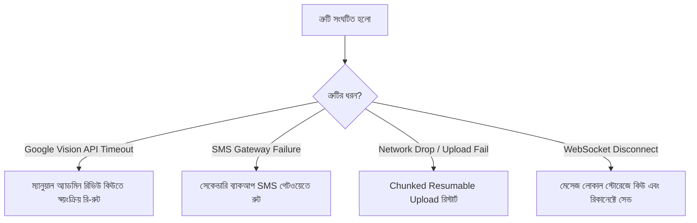

# বেচা-কেনা (Becha-Kena) — Requirements Validation Document
**ডকুমেন্ট ভার্সন:** 1.0  
**বিশ্লেষণ ও অডিট:** Senior Product & QA Systems Analyst  
**রেফারেন্স ডকুমেন্ট:** `PRD.md`, `SPECIFICATION_P0_P1_P2.md`, `prd-analysis.md`  
**তারিখ:** অক্টোবর ২০১৯, ২০২৬  

---

## ভূমিকা
এই ডকুমেন্টটি `PRD.md`-এর ওপর ভিত্তি করে ৮টি নির্দিষ্ট মাত্রায় (**Missing Flow, Edge Case, Error Handling, Security, Validation, Permission, Notification, Exception**) একটি সম্পূর্ণ ভ্যালিডেশন এবং সিস্টেম আর্কিটেকচার অডিট রিপোর্ট। এটি ডেভেলপমেন্ট টিম, QA টেস্ট ইঞ্জিনিয়ার এবং সিস্টেম আর্কিটেক্টদের জন্য একটি সুনির্দিষ্ট কমপ্লায়েন্স গাইড হিসেবে কাজ করবে।

---

## ১. Missing Flow (অনুপস্থিত বা অপূর্ণাঙ্গ ইউজার ফ্লো)

| ক্রম | ফ্লো-এর নাম | বর্তমান অবস্থা | প্রয়োজনীয় মিসিং ফ্লো ও ডিজাইন স্পেসিফিকেশন |
| :---: | :--- | :--- | :--- |
| **১.১** | **Parental Consent Verification Flow** | উল্লেখ আছে কিন্তু স্টেপ অস্পষ্ট | ১) অপ্রাপ্তবয়স্ক শিক্ষার্থী নিজের তথ্য পূরণ করবে।<br>২) পিতা/মাতার NID-এর ফ্রন্ট ও ব্যাক ছবি আপলোড।<br>৩) **Consent Mechanism:** অভিভাবকের স্বাক্ষরযুক্ত সম্মতিপত্রের ছবি অথবা অভিভাবকের নিজস্ব মোবাইল নম্বরে সরাসরি একটি ভেরিফিকেশন OTP পাঠানো এবং অভিভাবকের সেলফি আপলোড।<br>৪) অনুমোদন শেষে প্রোফাইলে "Parental Verified (Minor)" ব্যাজ যুক্ত হবে। |
| **১.২** | **Deal Cancellation / Un-reserve Flow** | উল্লেখ নেই | কোনো পণ্য `Reserved` করার পর যদি ক্রেতা সাক্ষাতে না আসে বা চুক্তি ভেঙে যায়:<br>১) বিক্রেতা ড্যাশবোর্ডে "Cancel Reservation / Revert to Active" অপশন পাবে।<br>২) একটি কারণ ড্রপডাউন সিলেক্ট করবে (যেমন: "ক্রেতা উপস্থিত হয়নি", "দরদামে মতানৈক্য")।<br>৩) পণ্যটি তাৎক্ষণিক পুনরায় পাবলিক সার্চে `Active` স্টেটে ফিরে যাবে। |
| **১.৩** | **Listing Expiration & Renewal Flow** | উল্লেখ নেই | ৪৫ দিন অতিবাহিত হলে বিজ্ঞাপন `Expired` স্টেটে যাবে:<br>১) মেয়াদ শেষ হওয়ার ৩ দিন আগে বিক্রেতাকে পুশ নোটিফিকেশন দেওয়া হবে।<br>২) ড্যাশবোর্ডে "Renew / Relist (নবায়ন)" বাটনে এক ক্লিকে আরও ৩০ দিনের জন্য বিজ্ঞাপনটি রি-অ্যাক্টিভ করা যাবে (কোনো তথ্য পরিবর্তন না হলে রি-রিভিউ ছাড়াই)। |
| **১.৪** | **Mutual Review Dispute Flow** | উল্লেখ নেই | যদি কোনো ক্ষুব্ধ ব্যবহারকারী প্রতিশোধমূলকভাবে মিথ্যা ১-স্টার রেটিং দেয়:<br>১) ব্যবহারকারী রেটিংয়ের পাশে "Dispute Review" বাটনে ক্লিক করতে পারবে।<br>২) চ্যাট স্ক্রিনশট ও অভিযোগ জমা দিলে অ্যাডমিন টিম বিষয়টি পর্যবেক্ষণ করে অসত্য প্রমাণিত হলে রেটিংটি মুছে দিতে পারবে। |
| **১.৫** | **Dispute Escalation (৭২ ঘণ্টার ফ্রড লগার)** | নীতি উল্লেখ আছে, UI ফ্লো নেই | ১) বায়ার চ্যাট স্ক্রিনে "Report Fraud / Open Dispute" বাটনে চাপবে।<br>২) সমস্যার ধরন (যেমন: ক্লোন ফোন, লকড ডিভাইস, অকেজো ব্যাটারি) নির্বাচন ও প্রমাণাদি (ছবি/ভিডিও/জিডি কপি) আপলোড।<br>৩) সেলারের অ্যাকাউন্ট তাৎক্ষণিক সাময়িক ফ্রিজ হবে এবং অ্যাডমিন টিকেট ওপেন হবে (SLA: < ৪ ঘণ্টা)। |
| **১.৬** | **Express Verification Payment Gateway Flow** | উল্লেখ আছে, পেমেন্ট ফ্লো নেই | ৳২৯ এক্সপ্রেস ভেরিফিকেশন ফি-এর জন্য bKash/Nagad PGW (Payment Gateway) রিডাইরেক্ট ➔ সফল পেমেন্ট ➔ প্রায়োরিটি কিউতে এন্ট্রি ➔ ১০ মিনিটের কাউন্টডাউন টাইমার। |
| **১.৭** | **Account Deletion & Data Erasure Flow** | সম্পূর্ণ অনুপস্থিত | ব্যবহারকারী অ্যাকাউন্ট ডিলিট করতে চাইলে: সমস্ত সক্রিয় লিস্টিং বন্ধ হবে, তবে অডিট ও আইনি তদন্তের স্বার্থে NID হ্যাশ এবং লেনদেন লগ সংশ্লিষ্ট ডাটাবেজে এনক্রিপ্টেড আর্কাইভে থাকবে (Right to Erasure compliance with fraud protection exception)। |

---

## ২. Edge Case (ব্যতিক্রমী পরিস্থিতি ও আচরণ)

| ক্রম | এজ কেস পরিস্থিতি (Scenario) | প্রভাব ও সম্ভাব্য ঝুঁকি | সিস্টেমের সুনির্দিষ্ট আচরণ (System Resolution) |
| :---: | :--- | :--- | :--- |
| **২.১** | **একই IMEI নম্বর দিয়ে একাধিক ব্যক্তির লিস্টিং চেষ্টা** | একজন বিক্রেতা এমন একটি IMEI দিল যা আগেই অন্য কেউ বিক্রি করেছে বা পোস্ট করেছে। | সিস্টেম ডেটাবেজে `active_imei` চেক করবে। যদি পাওয়া যায়, লিস্টিং ব্লক করে সতর্কবার্তা দেবে: *"এই IMEI নম্বরটি ইতোমধ্যে প্ল্যাটফর্মে নিবন্ধিত আছে। মালিকানার প্রমাণ (রসিদ) উপস্থাপন করুন।"* |
| **২.২** | **চ্যাট চলাকালীন সেলার কর্তৃক দাম পরিবর্তন** | চ্যাটে বায়ারের সাথে দরদাম চলাকালীন সেলার ড্যাশবোর্ডে পণ্যের দাম বাড়িয়ে দিল। | চ্যাট উইন্ডোতে একটি সিস্টেম নোটিস ফ্ল্যাশ করবে: *"বিজ্ঞাপনের মূল্যে পরিবর্তন এসেছে (পূর্বের মূল্য: ৳২০,০০০, বর্তমান মূল্য: ৳২৫,০০০)।"* |
| **২.৩** | **Mark as Sold কনফার্মেশনে বায়ারের অস্বীকৃতি** | সেলার বায়ার A-কে সিলেক্ট করে Sold দিল, কিন্তু বায়ার A প্রম্পটে "আমি এই পণ্যটি কিনিনি" চাপল। | রেটিং লুপ স্থগিত হবে। অ্যাডমিন ড্যাশবোর্ডে একটি ট্রানজ্যাকশন ফ্ল্যাগ তৈরি হবে যেন ভুয়া রেটিং বৃদ্ধি (Rating Manipulation) না ঘটে। পণ্যটি `Sold` হবে কিন্তু সেলার কোনো ফেক পজিটিভ রিভিউ পাবে না। |
| **২.৪** | **একই অভিভাবকের NID দিয়ে একাধিক সন্তানের অ্যাকাউন্ট** | এক পরিবারে দুই ভাই/বোন (<১৮ বছর) উভয়েই বাবার NID দিয়ে অ্যাকাউন্ট খুলতে চাইল। | অভিভাবকের NID সর্বোচ্চ **২টি মাইনর অ্যাকাউন্টের** সাথে লিঙ্ক করার অনুমতি দেওয়া হবে (Parental Account Grouping)। ৩য় রিকোয়েস্টে অ্যাডমিন ম্যানুয়াল ভেরিফিকেশন লাগবে। |
| **২.৫** | **সিম হারানো কিন্তু NID পূর্বেই লকড** | ইউজার ফোন হারিয়েছে এবং নতুন সিম নিয়েছে, ফলে OTP পাচ্ছে না, আবার NID পুরাতন অ্যাকাউন্টে আটকে আছে। | "Recover Account via NID" ফ্লো: ইউজার NID নম্বর ও জন্মতারিখ দেবে, Google Vision ফেস ম্যাচিং বা পূর্বের পাসওয়ার্ড যাচাইয়ের পর নতুন ফোন নম্বরে ওটিপি পাঠিয়ে নম্বর আপডেট করবে। |
| **২.৬** | **লিস্টিং চলাকালীন সেলারের অ্যাকাউন্ট ব্যান** | চ্যাটে কথা চলছে এমন অবস্থায় সেলার অন্য কোনো অপরাধে প্ল্যাটফর্মে ব্যান হলো। | চলমান সমস্ত চ্যাট রুম স্বয়ংক্রিয়ভাবে লক হবে এবং বায়ারদের স্ক্রিনে বড় লাল অ্যালার্ট আসবে: *"নিরাপত্তা সংক্রান্ত কারণে এই বিক্রেতার অ্যাকাউন্ট স্থগিত করা হয়েছে। কোনো লেনদেন করবেন না।"* |

---

## ৩. Error Handling (সিস্টেম ত্রুটি ও পুনরুদ্ধার)



### ৩.১ স্ট্যান্ডার্ডাইজড HTTP এরর কোড ও রেসপন্স আর্কিটেকচার (RFC 7807)
প্ল্যাটফর্মের প্রতিটি API এরর নির্দিষ্ট স্ট্যান্ডার্ড ফরম্যাটে ক্লায়েন্টে পাঠাবে:
```json
{
  "type": "https://api.becha-kena.com/errors/invalid-imei",
  "title": "Invalid IMEI Provided",
  "status": 422,
  "detail": "The provided 15-digit IMEI failed the Luhn checksum validation.",
  "instance": "/api/v1/listings/create",
  "timestamp": "2026-10-19T13:26:00Z"
}
```

### ৩.২ মূল মডিউলভিত্তিক এরর হ্যান্ডলিং ম্যাট্রিক্স

| মডিউল | সম্ভাব্য ফেইলিউর | হ্যান্ডলিং স্ট্র্যাটেজি ও ব্যবহারকারীর মেসেজ |
| :--- | :--- | :--- |
| **Google Vision OCR** | ছবির কোয়ালিটি অত্যন্ত খারাপ বা সার্ভার টাইমআউট | "আমরা স্বয়ংক্রিয়ভাবে কার্ডের লেখা পড়তে পারছি না। আপনার আবেদনটি আমাদের টিম ম্যানুয়ালি পর্যালোচনা করবে (SLA: ২ ঘণ্টা)।" |
| **SMS Gateway** | প্রাইমারি গেটওয়ে থেকে OTP ডেলিভারি ফেইল্ড (> ৩০ সেকেন্ড) | সিস্টেম স্বয়ংক্রিয়ভাবে সেকেন্ডারি টেলকো গেটওয়েতে ট্রাফিক সুইচ করবে এবং ওটিপি মেয়াদ ১২০ সেকেন্ড সচল রাখবে। |
| **Image Upload** | দুর্বল ৩জি নেটওয়ার্কে ৪MB ছবি ড্রপ হওয়া | ফ্রন্টএন্ডে ক্লায়েন্ট সাইড WebP কম্প্রেশন (৭৫% সাইজ হ্রাস) এবং চ্যাঙ্কড আপলোড (Chunked Upload) ব্যবহার করা। |
| **WebSocket Chat** | ইন্টারনেট সংযোগ বিচ্ছিন্ন হওয়া | মেসেজের পাশে 'Pending Clock' আইকন দেখাবে এবং সংযোগ ফিরলে স্বয়ংক্রিয়ভাবে সেন্ড ও রিসিট আপডেট হবে। |

---

## ৪. Security (নিরাপত্তা ও সাইবার সুরক্ষা)

### ৪.১ ডেটা এনক্রিপশন ও কী-ম্যানেজমেন্ট (Data Protection at Rest & Transit)
1. **ইন-ট্রানজিট সুরক্ষা:** সমগ্র প্ল্যাটফর্মে **TLS 1.3** বাধ্যতামূলক। সমস্ত প্লেইন HTTP ট্রাফিক স্বয়ংক্রিয়ভাবে HTTPS-এ রিডাইরেক্ট হবে।
2. **NID ডেটা এনক্রিপশন:**
   - ডেটাবেজে সংরক্ষিত NID নম্বর, জন্মতারিখ এবং মেটাডাটা **AES-256-GCM** অ্যালগরিদমে এনক্রিপ্ট থাকবে।
   - এনক্রিপশন কী কোনো হার্ডকোডেড ফাইলে থাকবে না; এটি ক্লাউড **KMS (Key Management Service)** বা HashiCorp Vault দ্বারা রোটেট হবে।
3. **NID ইমেজ পার্জিং ক্রন জব (Automated 30-Day Shredder):**
   - প্রতি রাত ১২:০১ মিনিটে একটি ব্যাকগ্রাউন্ড ক্রন জব রান করবে:
     ```sql
     DELETE FROM nid_documents 
     WHERE verification_status = 'APPROVED' 
       AND verified_at < NOW() - INTERVAL '30 days';
     ```
   - মূল ফাইল অবজেক্ট স্টোরেজ (S3/GCS) থেকে ক্রিপ্টোগ্রাফিক্যালি ডিলিট হবে, শুধুমাত্র SHA-256 হ্যাশ সংরক্ষিত থাকবে।

### ৪.২ সেশন সিকিউরিটি ও অথেনটিকেশন আর্কিটেকচার
* **JWT আর্কিটেকচার:**
  * **Access Token:** স্বল্পমেয়াদী (১৫ মিনিট), মেমরিতে সংরক্ষিত।
  * **Refresh Token:** দীর্ঘমেয়াদী (৭ দিন), শুধুমাত্র `HttpOnly`, `Secure`, `SameSite=Strict` কুকিতে সংরক্ষিত (XSS অ্যাটাক প্রতিরোধে)।
* **কনট্যাক্ট রিভিল টোকেন (HMAC Signed):**
  * ফোন নম্বর প্রকাশ করার API কল কোনো সাধারণ আইডি দিয়ে হবে না। এটি একটি টাইম-বাউন্ড HMAC-SHA256 সাইনড ওয়ান-টাইম টোকেন দিয়ে সুরক্ষিত থাকবে, যা রিপ্লে অ্যাটাক (Replay Attack) রোধ করে।

### ৪.৩ কনটেন্ট সিকিউরিটি ও অ্যান্টি-স্ক্র্যাপিং
* **Anti-Scraping Shield:** বট ট্রাফিক শনাক্ত করতে Google reCAPTCHA v3 স্কোর < ০.৫ হলে ক্যাপচা চ্যালেঞ্জ ছুড়ে দেওয়া হবে।
* **Anti-Bypass Regex:** চ্যাট সার্ভারে ফোন নম্বর, ইমেইল বা ফেসবুক লিংক বাইপাস রোধে রিয়েল-টাইম ক্লিঞ্জিং।

---

## ৫. Validation Rules (ফিল্ড ও ডেটা ভ্যালিডেশন মানদণ্ড)

| ফিল্ডের নাম | ডেটা টাইপ | অনুমোদিত ফরম্যাট ও রেগুলার এক্সপ্রেশন | ভ্যালিডেশন নিয়ম ও ত্রুটি বার্তা |
| :--- | :--- | :--- | :--- |
| **Phone Number** | String | `^(?:\+8801\|01)[3-9]\d{8}$` | ১১ ডিজিটের ভ্যালিড বাংলাদেশি অপারেটর কোড হতে হবে। |
| **NID Number** | String | `^(\d{10}\|\d{13}\|\d{17})$` | শুধুমাত্র ১০ (স্মার্ট), ১৩ অথবা ১৭ ডিজিটের সাংখ্যিক মান গ্রহণযোগ্য। |
| **IMEI Number** | String | `^\d{15}$` + Luhn Algorithm | ১৫ ডিজিটের সংখ্যা হতে হবে এবং চেক-সাম অ্যালগরিদমে সঠিক হতে হবে। |
| **Laptop Serial** | String | `^[A-Za-z0-9\-]{6,25}$` | ন্যূনতম ৬ ও সর্বোচ্চ ২৫ ক্যারেক্টারের আলফানিউমেরিক কোড। |
| **Price** | Integer | Min: `10`, Max: `5000000` | সর্বনিম্ন ১০ টাকা এবং সর্বোচ্চ ৫০ লক্ষ টাকা হতে পারবে। নেগেটিভ বা ০ নিষিদ্ধ। |
| **Listing Photos** | File Array | JPEG, PNG, WEBP (Max 5 files) | ফাইল সাইজ সর্বোচ্চ ৫ মেগাবাইট। Magic Bytes দিয়ে ফাইল এক্সটেনশন চেক বাধ্যতামূলক। |
| **Title** | String | Min: `10 chars`, Max: `100 chars` | প্রফ্যানিটি ফিল্টার চেক। বিশেষ ক্যারেক্টার স্প্যামিং নিষিদ্ধ। |
| **Description** | String | Min: `30 chars`, Max: `3000 chars` | বিস্তারিত বিবরণ বাধ্যতামূলক। ফোন নম্বর দেওয়া নিষিদ্ধ। |

---

## ৬. Permission Matrix (RBAC & Horizontal Privilege Protection)

```
[Request Arrives] ──► [Auth Middleware (JWT Verify)]
                             │
                             ▼
                      [Role Check (RBAC)]
                             │
                             ▼
              [Resource Ownership Validation (ABAC)]
         (e.g., listing.seller_id === current_user.id)
```

### ৬.১ রোল পারমিশন গ্রিড

| অপারেশন / রিসোর্স | GUEST | UNVERIFIED | PARENT_MINOR | VERIFIED_USER | MODERATOR | SUPER_ADMIN |
| :--- | :---: | :---: | :---: | :---: | :---: | :---: |
| লিস্টিং ব্রাউজ ও সার্চ | ✅ | ✅ | ✅ | ✅ | ✅ | ✅ |
| পণ্যের পূর্ণ বিবরণ ও IMEI স্ট্যাটাস দেখা | ✅ | ✅ | ✅ | ✅ | ✅ | ✅ |
| বিক্রেতাকে ইন-অ্যাপ মেসেজ দেওয়া | ❌ | ❌ | ✅ | ✅ | ❌ | ❌ |
| বিক্রেতার ফোন নম্বর আনমাস্ক করা | ❌ | ❌ | ✅ (১৫/দিন) | ✅ (১৫/দিন) | ✅ (সীমাহীন) | ✅ (সীমাহীন) |
| নতুন বিজ্ঞাপন পোস্ট করা | ❌ | ❌ | ✅ | ✅ | ❌ | ❌ |
| নিজের লিস্টিং এডিট / ডিলিট করা | ❌ | ❌ | ✅ | ✅ | ❌ | ❌ |
| অন্যের লিস্টিং এডিট / ডিলিট করা | ❌ | ❌ | ❌ | ❌ | ❌ (Forbidden) | ❌ (Forbidden) |
| লিস্টিং ফোর্স-রিমুভ বা ব্যান করা | ❌ | ❌ | ❌ | ❌ | ✅ | ✅ |
| NID আবেদন অনুমোদন বা বাতিল | ❌ | ❌ | ❌ | ❌ | ✅ | ✅ |
| ইউজার একাউন্ট ব্যান ও ব্ল্যাকলিস্ট | ❌ | ❌ | ❌ | ❌ | ❌ | ✅ |

### ৬.২ হরাইজন্টাল প্রিভিলেজ এসকেলেশন সুরক্ষা (IDOR Protection)
- কোনো বিক্রেতা `/api/v1/listings/{id}/status` এন্ডপয়েন্টে রিকোয়েস্ট পাঠালে সার্ভার চেক করবে: `listing.seller_id === request.user.id`। অমিল হলে তাৎক্ষণিক `403 Forbidden` রিটার্ন করবে।

---

## ৭. Notification System (মাল্টি-চ্যানেল ম্যাট্রিক্স)

| ইভেন্ট কোড | ইভেন্টের বিবরণ | চ্যানেল | প্রায়োরিটি | মেসেজ টেমপ্লেট |
| :--- | :--- | :--- | :---: | :--- |
| `AUTH_OTP` | লগইন/সাইন-আপ ওটিপি | SMS | **P0 (Critical)** | "Becha-Kena ওটিপি কোড: {{otp}}। মেয়াদ ২ মিনিট। কাউকে বলবেন না।" |
| `NID_APPROVED` | NID ভেরিফিকেশন সফল | Push + SMS | **P1 (High)** | "অভিনন্দন! আপনার NID ভেরিফিকেশন সফল হয়েছে। এখন আপনি কেনাবেচায় যুক্ত হতে পারেন।" |
| `NID_REJECTED` | NID ভেরিফিকেশন বাতিল | Push + SMS | **P1 (High)** | "আপনার NID ভেরিফিকেশন বাতিল হয়েছে। কারণ: {{reason}}। পুনরায় সঠিক ছবি দিন।" |
| `CHAT_MESSAGE` | নতুন চ্যাট মেসেজ প্রাপ্তি | Web Push / Mobile Push | **P1 (High)** | "{{sender_name}}: '{{short_message}}' (বিজ্ঞাপন: {{ad_title}})" |
| `DEAL_SOLD_BUYER` | বায়ার হিসেবে নির্বাচিত হওয়া | Push + SMS | **P1 (High)** | "{{seller_name}} আপনাকে '{{ad_title}}'-এর ক্রেতা হিসেবে মার্ক করেছেন। অভিজ্ঞতা রেট করুন!" |
| `AD_EXPIRING` | বিজ্ঞাপনের মেয়াদ শেষ হওয়ার সতর্কতা | In-App + Push | **P2 (Normal)** | "আপনার বিজ্ঞাপন '{{ad_title}}'-এর মেয়াদ আর ৩ দিন পর শেষ হবে। রিনিউ করতে ট্যাপ করুন।" |
| `SECURITY_ALERT` | নতুন ডিভাইস থেকে লগইন | SMS | **P0 (Critical)** | "সতর্কতা: আপনার অ্যাকাউন্টে নতুন ডিভাইস থেকে লগইন করা হয়েছে। আপনি না হলে সাথে সাথে পাসওয়ার্ড রিসেট করুন।" |

---

## ৮. Exception Handling & Fail-Safe Mechanisms (ব্যতিক্রম ও ফেইল-সেফ)

1. **ব্ল্যাকলিস্টেড NID রিকভারি চেষ্টা (Blacklisted NID Exception):**
   - কোনো ব্যানড বা ফ্রড ইউজার যদি নতুন সিম দিয়ে সাইন-আপ করে পুরাতন ব্ল্যাকলিস্টেড NID আপলোড করে:
   - সিস্টেমের ডেটাবেজ চেক করবে: `SELECT is_blacklisted FROM nid_registry WHERE nid_hash = :hash`।
   - ফলাফল সত্য হলে তাৎক্ষণিক আবেদন বাতিল হবে এবং ব্যাকঅফিসে সিকিউরিটি ইনসিডেন্ট ফ্ল্যাগ তৈরি হবে।
2. **অপ্রাপ্তবয়স্ক ব্যবহারকারীর ১৮ বছর পূর্ণ হওয়া (Minor Age Maturity Exception):**
   - একজন ইউজার যখন ১৮ বছর পূর্ণ করবে, সিস্টেম স্বয়ংক্রিয়ভাবে তার প্রোফাইল থেকে "Parental Verified (Minor)" ব্যাজ ডিঅ্যাক্টিভেট করবে এবং তাকে নিজের NID আপলোড করার জেন্টল নোটিফিকেশন দেবে।
3. **পুলিশ ও সাইবার ক্রাইম তদন্ত সহায়তা (Law Enforcement Subpoena Exception):**
   - বাংলাদেশ পুলিশের অফিসিয়াল রিকোয়েস্টে অ্যাডমিন প্যানেলে একটি নিরাপদ **"Legal Compliance Export"** বাটন থাকবে, যা নির্দিষ্ট বিজ্ঞাপনের সাথে জড়িত ক্রেতা-বিক্রেতার NID নম্বর, চ্যাট ট্রান্সক্রিপ্ট এবং আইপি লগ একটি পাসওয়ার্ড-প্রোটেক্টেড ZIP ফাইলে এক্সপোর্ট করবে।
4. **সার্ভার ক্যাশ / ডাটাবেজ ফেইলওভার (Database Circuit Breaker):**
   - যদি প্রধান ডাটাবেজে সাময়িক বিঘ্ন ঘটে, রিড-রেপ্লিকার সাহায্যে প্ল্যাটফর্ম রিড-অনলি মোডে চলে যাবে—যাতে ব্যবহারকারীরা পণ্য ব্রাউজ করতে পারে, কিন্তু কোনো লেনদেন বা চ্যাট ডেটা সাময়িকভাবে বন্ধ থাকবে।
